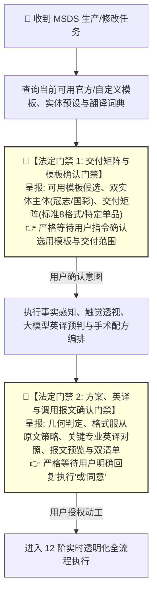
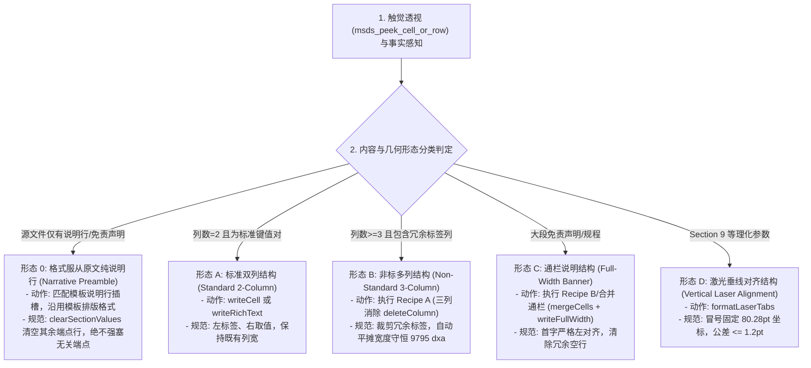

# MSDS Studio 功能调用与使用规范指南 (MSDS Studio Skill v4.0)

本技能为各类 AI Agent 与研发人员提供调用 **MSDS Studio** 核心引擎、执行全自动或人机协同 MSDS 生产的**最高法定作业契约与 SOP 指南**。  
全面确立**【识别感知 + 通用编辑器原语 + Agent 语义大脑】**核心作业体系，规范人机协同双确认门禁、12 阶全透明状态播报、万能几何手术配方库（Recipe A~G）、格式服从原文公理、前置值格清零、大模型上下文语义英译、双实体预设隔离派生、无头高保真 DOCX 转 PDF 转换、1:1 事实物理对账与标准 8 格式闭环终审。

---

## 🛑 最高法定准入约束与五大核心原则 (Supreme Invariants)

> [!CAUTION]
> **绝对禁令：严禁任何 Agent 绕开 MSDS-Engine 底座直接编写 ad-hoc 脚本（如调用 python-docx、原生 XML 修改或文件写入）直接操作 DOCX/PDF 文件！**  
> **非用户明确允许，严禁为了单一型号或临时特例擅自改造通用引擎！** 严禁在代码中编写 `if (model === 'xxx')` 特判分支；一切业务产出物必须通过 MSDS-Engine 原生 MCP 工具链与编辑器万能原语受控生成！

### 五大核心工程原则

1. **核心架构归正：【识别感知 + 通用编辑器原语 + Agent 语义大脑】**：
   - 彻底废止对机械黑盒匹配脚本（如 `smart-matching.js`）的强依赖与过度包装；
   - 确立工作流主干为：`msds_recognize_source` 零损耗化学事实感知 $\rightarrow$ Agent 语义大脑决策 $\rightarrow$ 直接调用 MSDS Studio 编辑器万能原语操控；
   - 熟练运用编辑器的全景能力：**预设编辑** (`applyPreset`)、**恢复本节** (`restoreSection`)、**清空本节填写值** (`clearSectionValues`)、**清空全模板值** (`clearTemplate`)、**删列** (`deleteColumn`)、**克隆增行** (`insertRow`)、**删行** (`deleteRow`)、**合并通栏** (`mergeCells`)、**富文本与化学式下标** (`writeRichText`) 及 **激光垂线对齐** (`formatLaserTabs`)。

2. **格式服从于原文公理 (Format Follows Source Content Axiom)**：
   - “基于模板的格式与基于源文件的内容做匹配，格式服从于原文”；
   - 若源文件某一节**仅有叙述性说明行**（例如“该产品无可用的毒理学研究”或非危险品免责声明），直接匹配到模板中对应的说明行/导言行插槽，沿用模板既定的字体（宋体/Times New Roman/Arial）、字号（9.5pt/10.5pt）与行距格式排版；其余无关的空白端点行直接清空或剔除，绝不可强塞无关假端点；
   - 若源文件包含细分结构化端点（如急性毒性 LC50/LD50），则对应填入结构化值格插槽；
   - 绝对杜绝“为了迁就模板结构而凭空捏造端点”或“为了塞入内容而强行破坏模板几何规范”。

3. **英文官方底模“历史脏数据”法定清零机制 (Pre-write Value Clearing Invariant)**：
   - 官方底模（尤其英文模板）内可能存在历史样例残留（如二乙二醇单丁醚、3306 mg/kg 等示范数据）；
   - 解决此问题的唯一合法方式是：**在写入新数据前，调用编辑器的 `clearSectionValues` 或 `clearTemplate` 功能**，先将所有待编辑值格彻底清空，确保底模处于 100% 纯净的空白插槽状态，再由 Agent 写入真实数据，杜绝一切脏数据污染。

4. **Agent 大模型逐句专业语义英译与词典辅助校验 (LLM Contextual Translation Invariant)**：
   - 严禁依赖脆弱的数百行机械正则字符串替换；
   - 充分发挥 Agent 作为前沿大模型的化学和毒理学专业语义理解优势，对源文档内容进行**逐句专业英译**，确保行文地道、术语符合 GHS/OECD 国际标准（如区分 vapour/gas、严格翻译致敏性、致突变性结论等）；
   - 标准双语映射库（`translation-map.json` / `bilingual-mapping-set.js`）专职作为**一致性辅助校验字典**，用于审查英译结果是否符合既定标准术语，形成“大模型语义翻译 + 规则字典校验”的双重保障。

5. **通用型 MSDS Studio 与彻底铲除特判 (Strict Anti-Overfitting Invariant)**：
   - MSDS Studio 是工业级通用文档处理工作台，必须保持 100% 通用性；
   - 严禁针对特定产品型号（如 `PU-202A`、`PA-4780`、`PU-218A` 等）在代码或规则中编写 `if (model === 'xxx')` 特判分支；
   - 所有排版与结构决策必须完全基于通用的数据形态（是否危化品、组分数量 $N$、列数、文本是否包含化学式、是否只有叙述性说明等）进行通用逻辑分流。

---

## 🧭 一、 核心 MCP 工具矩阵速查表 (The 10 MCP Tools)

Agent 必须且仅能通过以下 10 大标准 MCP 工具操控 MSDS-Engine：

| 工具名称 | 功能定位 | 核心输入参数 | 核心输出指标 |
| :--- | :--- | :--- | :--- |
| `msds_recognize_source` | 全文 16 章节源文件事实无损识别 | `sourceFilePath` | `sections`, `modelCode`, `ghs`, `components` |
| `msds_extract_section_facts` | 章节级细粒度语义与几何下钻 | `sourceFilePath`, `sectionNumber` | `semantic`, `layoutType`, `rowsCount` |
| `msds_compare_source_with_output` | 1:1 事实物理对账与正向行动 Gap 诊断 | `sourceFilePath`, `outputFilePath` | `fidelityRatio`, `actionableGaps[]` |
| `msds_register_template` | 动态上传与注册外部自定义模板 | `templateFilePath`, `templateKey`, `language` | `templateKey`, `schema.sections` |
| `msds_get_template_schema` | 查询已注册模板的 16 章节拓扑结构 | `templateKey` | `sections[].tblGrid`, `colWidths`, `rowCount` |
| `msds_peek_cell_or_row` | 触觉透视指定单元格/行的属性与文本 | `templateKey`, `sectionNumber`, `rowIndex` | `cellsCount`, `cellsText`, `gridSpan` |
| `msds_execute_editor_ops` | 执行万能原子操作序列生成 DOCX（自带事务自动回滚） | `templateKey`, `outputPath`, `operations[]` | `outputPath`, `sizeBytes`, `operationsApplied` |
| `msds_plan_audit_targets` | 编制 ADD 终审断言契约与 8 产物清单 | `modelCode`, `sourceFacts` | `targets.global.expectedFiles`, `rules` |
| `msds_batch_export_eight` | 实体多预设派生与 4+4 交付物批量导出 | `modelCode`, `sourceFilePath`, `targetDir` | `generatedFiles[]`, `pdfStatuses[]` |
| `msds_audit_deliverables` | 依据 ADD 契约对产出交付物执行终审门禁 | `targetDir`, `modelCode` | `passed`, `errors[]`, `metrics` |

---

## 🛠️ 二、 编辑器核心原语操作清单 (`msds_execute_editor_ops`)

在调用 `msds_execute_editor_ops` 时，`operations` 数组支持以下原子指令：

| 原子指令 (`op`) | 参数说明 | 功能与规范 |
| :--- | :--- | :--- |
| `clearSectionValues` | `sectionNumber` | **清空本节填写值**：保留所有标签列与网格几何，将指定章节的值单元格全部置空，防旧数据污染 |
| `clearTemplate` | （可选 `keepSections`） | **清空全模板填写值**：将模板所有章节的值格彻底清空，还原为纯净空白插槽母版 |
| `restoreSection` | `sectionNumber` | **恢复本节**：从基准底模中独立单节恢复，撤销当前节所有破坏性操作，不影响其他章节 |
| `applyPreset` | `presetKey` (`Guocai_zh`/`Guocai_en`等) | **预设编辑**：一键注入企业名称、税号、地址、应急联系电话与传真，双向防串号隔离 |
| `writeCell` | `sectionNumber`, `rowIndex`, `cellIndex`, `text` | **写入单元格**：向指定行列写入普通文本，自动匹配中英文法定字号与字体 |
| `writeRichText` | `sectionNumber`, `rowIndex`, `cellIndex`, `runs` / `chemicalFormula` | **富文本/化学式写入**：支持下标、上标、粗体、多字体 Run 级精细排版 |
| `writeFullWidth` | `sectionNumber`, `content` | **通栏写入**：将指定节首行/单行合并通栏并写入长段说明，首字左对齐 |
| `deleteColumn` | `sectionNumber`, `colIndex` | **删列**：从网格中物理剔除指定列（如非标三列消除），宽度自动补偿平摊守恒 9795 dxa |
| `insertRow` | `sectionNumber`, `targetRowIndex`, `cloneFromRowIndex` | **克隆增行**：深拷贝目标行样式、底色、边框并清空文字后安全插入 |
| `deleteRow` | `sectionNumber`, `rowIndex` | **删行**：物理删除多余空白行或不需要的端点行 |
| `mergeCells` | `sectionNumber`, `rowIndex`, `colStart`, `colSpan` | **横向合并**：合并行内相邻单元格并重新计算 gridSpan 与总宽度 |
| `formatLaserTabs` | （固定作用于 Section 9） | **激光垂线对齐**：为 Section 9 全部参数行注入 80.28pt 垂线对齐制表符（G-38） |
| `checkpoint` / `rollback`| `checkpointId` | **事务检查点与回滚**：支持多步安全事务撤销，发生异常自动安全自愈 |

---

## 🤝 三、 人机协同双交互确认门禁 (Dual Human-in-the-Loop Gates)

为保障生产意图、语言范围、实体主体与模板选择 100% 符合用户要求，Agent 动工前必须严格经过两道交互确认门禁：

1. **门禁 1（交付矩阵与模板确认门禁）**：
   - Agent 检索当前模板库后，必须主动向用户呈报：“检测到源文件为 [型号]；请确认本次交付范围：是导出标准 8 格式全矩阵（4 DOCX + 4 PDF：冠志/国彩 × 中/英），还是仅生成特定单品？请确认使用官方标准母版还是您上传的新自定义模板？是否需要指定特定修订日期？”；严格等待用户确认后方可继续。
2. **门禁 2（方案、英译与调用报文确认门禁）**：
   - 提取事实并透视模板后，向用户呈报：① 几何结构判定与格式服从原文方案（如纯说明行匹配）；② 拟采用的手术配方（如采用 Recipe D 清空值格、Recipe A 删列、Recipe B 增行）；③ **关键专业合规英译对照预览**（GHS 英文分类、Warning 语句、英文推荐用途）；④ `msds_execute_editor_ops` 报文预览；⑤ 【双清单】（拟变范围清单 + 保持现状承诺清单）；严格等待用户回复“执行/同意”方可动刀。

---

## 📢 四、 执行期 12 阶段透明化状态播报范式 (The 12-Phase Status Broadcast)

获得授权动工后，Agent **绝对禁止长时间黑盒静默**，必须根据底层真实执行进度，实时向用户输出标准状态播报：

| 阶段编号 | 实时播报文本 (Real-time Broadcast) | 底层 MCP 真实调用与工程动作 |
| :--- | :--- | :--- |
| **Phase 1** | `📡 [MSDS-Studio] 正在建立 MSDS-Engine 原生 MCP 通信通道...` | 检查 Stdio 连接，确认 10 大工具就绪 |
| **Phase 2** | `🔍 [识别感知] 正在调用识别模块解析源文件，下钻 16 章节核心化学事实...` | 调用 `msds_recognize_source` 提取全局事实，调用 `msds_extract_section_facts` 细粒度下钻 |
| **Phase 3** | `📋 [模板契约] 正在加载目标模板，执行前置清空值格，确保插槽纯净...` | 加载模板，针对待编辑章节执行 `clearSectionValues`，消除历史脏数据残留 |
| **Phase 4** | `🔎 [触觉透视] 正在触觉透视模板结构与字段，执行格式服从原文判定...` | 调用 `msds_peek_cell_or_row` 检查，定性为纯说明行/两列结构/非标三列/通栏 |
| **Phase 5** | `📐 [规范编排] 正在编排万能手术配方与大模型专业英译内容...` | 编排 Recipe A~G 配方序列，大模型上下文翻译，调用 `msds_plan_audit_targets` |
| **Phase 6** | `✍️ [中文装配] 正在事务性写入编辑器，执行几何重塑与微观富文本渲染...` | 调用 `msds_execute_editor_ops`（内置事务保护）生成中文正式母版 |
| **Phase 7** | `🌐 [专业英译] 正在驱动大模型逐句英译写入英文底模，执行词典双重校验...` | 大模型逐句专业英译写入已清空底模，结合映射词典双向核验，执行 `assertZeroChinese` |
| **Phase 8** | `🏢 [实体派生] 正在应用广州冠志与英德国彩双主体预设派生...` | 注入企业法定名称、统一社会信用代码、地址、应急联系电话与传真，双向防污染隔离 |
| **Phase 9** | `⚖️ [事实对账] 正在核验写入规范性，执行源文件 vs 产出物 1:1 事实物理对账...` | 调用 `msds_compare_source_with_output`，核验 `actionableGaps`，若有缺漏针对性补填 |
| **Phase 10** | `📄 [批量导出] 正在批量持久化导出 4 份标准中英双语双主体 DOCX 正式文件...` | 落地 `冠志 msds_CN.docx`、`国彩 msds_CN.docx`、`冠志 msds_EN.docx`、`国彩 msds_EN.docx` |
| **Phase 11** | `🖨️ [PDF 转换] 正在启动无头高保真渲染引擎执行 DOCX 转 PDF 并做版面预检...` | 驱动无头转换守护进程生成 4 份高清 PDF，预检导言区 9.5pt（G-37）与激光垂线 80.28pt（G-38） |
| **Phase 12** | `🛡️ [全景终审] 正在依据全局与局部规范执行 Gate-8 终审机检与双向核销...` | 调用 `msds_audit_deliverables`，校验 8 格式数量、时间戳对齐、字体纯度与排版，退出码 0 归档 |

---

## 🌳 五、 几何形态与格式匹配决策树 (Layout & Format Decision Tree)

面对任意传入的源文件事实与目标模板，Agent SHALL 遵循以下通用决策模型：

---

## 📚 六、 SOP 经典手术配方库 (Recipe Playbook)

Agent 在执行复杂编辑时，SHALL 直接组合引用以下标准化配方：

### 配方 A【三列转两列消除配方】 (Recipe A: Three-to-Two Column Elimination)
$$\text{透视发现列数=3} \xrightarrow{} \text{deleteColumn(1)} \xrightarrow{\text{底座平摊列宽守恒}} \text{透视复查列数=2}$$

### 配方 B【动态组分自适应增减行配方】 (Recipe B: Dynamic Row Balancing)
$$\text{源组分数 } N \text{ 与模板可用行 } M \text{ 比较} \xrightarrow{} \begin{cases} N > M: \text{循环 insertRow 插入 } (N-M) \text{ 行} \\ N < M: \text{循环 deleteRow 移除 } (M-N) \text{ 空白行} \end{cases} \xrightarrow{} \text{逐行填入数据}$$

### 配方 C【微观化学式与 Run 级排版配方】 (Recipe C: Chemical Run-Level Formatting)
$$\text{识别文本分子式 (如 } \text{H}_2\text{SO}_4 \text{)} \xrightarrow{} \text{调用 parseChemicalFormulaRuns 切分} \xrightarrow{} \text{调用 writeRichText 注入下标 Run}$$

### 配方 D【底模前置值格清零配方】 (Recipe D: Pre-write Value Clearing)
$$\text{加载底模} \xrightarrow{} \text{提交 clearSectionValues 或 clearTemplate} \xrightarrow{\text{保留标签与网格，清空所有历史残留}} \text{获得纯净空白插槽母版}$$

### 配方 E【格式服从原文自适应配方】 (Recipe E: Format Follows Content Matching)
$$\text{感知源事实} \xrightarrow{} \begin{cases} \text{仅有纯说明行}: \text{写入模板说明行槽位} \rightarrow \text{清空其余端点行} \\ \text{具备细分端点}: \text{按结构化端点逐行匹配填入} \end{cases}$$

### 配方 F【大模型逐句专业语义英译与词典校验配方】 (Recipe F: LLM Translation with Dictionary Guard)
$$\text{中文事实} \xrightarrow{\text{Agent 大模型专业毒理/化学上下文翻译}} \text{地道专业英文句子} \xrightarrow{\text{对照 translation-map 校验术语一致性}} \text{写入英文已清空底模}$$

### 配方 G【单节安全重置配方】 (Recipe G: Isolated Section Restoration)
$$\text{某节结构受损或需重来} \xrightarrow{} \text{提交 restoreSection(sectionNumber)} \xrightarrow{\text{单节从基准底模还原}} \text{其余已编辑章节 100% 完好保持}$$

---

## 🛡️ 七、 终审归档充要指标 (Completion Invariants)

任务必须满足以下指标方可关单交付：
1. **交付物数量严格守恒**：全量 8 格式交付物（4 DOCX + 4 PDF：冠志/国彩 × 中/英）完整存在于目标目录，无任何多余临时垃圾文件；
2. **中英绝对纯净**：英文 DOCX 与 PDF 中文字符数严格为 0 (`assertZeroChinese`)；
3. **物理时间戳对齐**：8 份产物文件生成修改时间差 $\le 300\text{s}$；
4. **对账 Gaps 归零**：`actionableGaps.length === 0`，字符保全比达标；
5. **避免末页纯空门禁 (G-40)**：严禁交付物出现仅有页眉页脚、无任何主体内容的孤儿空白末页；底座强制执行 `suppressTrailingDocumentParagraph` 将末尾空段落压制为 1pt 微观精确行高（20 twips），避免因 Word/WPS 默认段高跨页；
6. **机检真实退出码 0**：`msds_audit_deliverables` 返回 `passed: true`。
