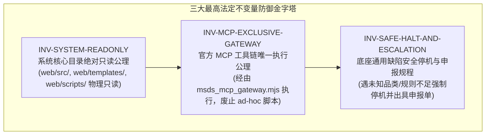
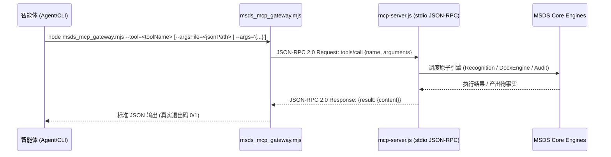

# MSDS Studio 受控工作流体系与 Agent 生产治理规范 (v7.0-ENTERPRISE)

> **版本**：v7.0-ENTERPRISE (最高法定 7 阶流水线收敛版)  
> **适用范围**：MSDS-Engine 文档处理工作台、`msds-studio` 技能生态、Antigravity 跨线程协作、MSDS Overwrite Producer 及 Auditor 智能体。  
> **核心使命**：为智能体赋予精确的感官（识别/下钻/透视/对账）与稳健的手脚（编辑器万能原语：清空值格/单节恢复/企业预设/增删行/删列/横向合并/富文本化学式/激光对齐），遵循“格式服从于原文”公理与“前置值格清零”机制，依托 Agent 大模型语义深度英译，彻底终结历史型号特判与脆弱黑盒过拟合，确立系统目录只读与 MCP 唯一执行通道，打造 100% 工业级通用文档工作台。

---

## 一、 顶层架构与三大最高法定不变量 (Supreme Invariants)

全系统生命周期内，任何 Agent、开发者与协同流程**必须无条件遵循**以下三大最高法定不变量与工程公理：



### 1.1 核心架构三元归正：【识别感知 + 通用编辑器原语 + Agent 语义大脑】
- **彻底废止对机械黑盒匹配脚本（如 `smart-matching.js`）的强依赖与过度包装**；
- **确立工作流主干**：`msds_recognize_source` 零损耗化学事实感知 $\rightarrow$ Agent 语义大脑决策 $\rightarrow$ 直接调用 MSDS Studio 编辑器万能原语受控操纵；
- **熟练运用编辑器全景能力**：预设编辑 (`applyPreset`)、恢复本节 (`restoreSection`)、清空本节值 (`clearSectionValues`)、清空全模板值 (`clearTemplate`)、删列 (`deleteColumn`)、克隆增行 (`insertRow`)、删行 (`deleteRow`)、合并通栏 (`mergeCells`)、富文本与化学式下标 (`writeRichText`) 及激光垂线对齐 (`formatLaserTabs`)。

### 1.2 系统核心目录绝对只读公理 (`INV-SYSTEM-READONLY`)
- **受控系统只读目录**：`web/src/`（核心引擎代码）、`web/templates/`（官方模板）、`web/scripts/`（核心审计与导出脚本）；
- **生产 Agent 权限边界**：执行生产与覆写任务时，生产 Agent 对受控系统目录具有**绝对物理只读约束**；仅对分配的工作区（如 `算法训练材料/TDS MSDS 重写版/...`）拥有写权限；
- **权限红线**：未经用户显式、指名道姓的书面授权，严禁任何 Agent 擅自修改、创建或删除系统目录下的任何文件。任何对系统文件的写操作将被立即拦截。

### 1.3 官方 MCP 工具链唯一执行通道公理 (`INV-MCP-EXCLUSIVE-GATEWAY`)
- **唯一合法通道**：官方 10 大原子 MCP 工具（注册于 `web/src/mcp-server.js`，通过 `web/scripts/msds_mcp_gateway.mjs` 调度）是执行源文档识别、模式探查、几何编辑、批量导出与审计核销的**唯一法定通道**；
- **废止 ad-hoc 临时脚本**：严禁私自编写针对单一型号的一次性 Node/Python 脚本直接篡改 Word OOXML、拼接底层 XML 或修改模板。一切编辑操作必须封装为标准 MCP 原语经由网关执行。

### 1.4 底座通用缺陷安全停机与申报升级规程 (`INV-SAFE-HALT-AND-ESCALATION`)
- **严禁就地特判**：生产 Agent 遇到未知化工分类（如无水环氧、固化剂复合体）、英译缺失、正则表达式失配或版式不兼容时，**绝对严禁**为了应付单个型号而就地打硬编码补丁（如 `if (model === 'xxx')`）；
- **安全停机机制**：Agent 必须立即挂起停机，冻结现场，并按照第六节标准格式出具《系统底座通用缺陷申报单》，提请架构治理层或用户在平台通用层进行升级。

### 1.5 版式与物理事实守恒公理
1. **格式服从于原文公理 (Format Follows Source Content Axiom)**：
   - 基于模板的格式与基于源文件的内容做匹配，格式服从于原文；
   - 若源文件某节仅有叙述性说明行，直接匹配到模板对应的说明行插槽，沿用模板排版；其余无关空白端点行清空或剪枝，绝不强塞无关假端点；
   - 若源文件包含细分结构化端点（如 LC50/LD50），则对应填入结构化值格插槽。绝不凭空捏造端点，绝不强行破坏模板几何规范。
2. **英文官方底模“历史脏数据”法定清零机制 (Pre-write Value Clearing Invariant)**：
   - 官方底模（尤其英文模板）内可能存在历史残留数据（如二乙二醇单丁醚、1306 mg/kg 等示范数据）；
   - 写入前必须调用编辑器的 `clearSectionValues` 或 `clearTemplate`，先将待编辑章节的所有值格彻底清空，确保处于 100% 纯净空白插槽状态，再由 Agent 写入真实数据。
3. **Agent 大模型逐句专业语义英译与词典辅助校验 (LLM Contextual Translation Invariant)**：
   - 严禁依赖脆弱的数百行机械正则字符串替换；
   - 充分发挥 Agent 化学和毒理学专业语义理解优势，对源文档内容进行逐句专业英译，确保行文地道、术语符合 GHS/OECD 国际标准；
   - 标准双语映射库专职作为一致性辅助校验字典，形成“大模型语义翻译 + 规则字典校验”双重保障。
4. **Section 2 零外生虚增最高公理 (`INV-ZERO-EXOGENOUS`)**：
   - 源文档未提及 GHS 象形图或信号词时，交付物**绝对严禁**凭空添加 `GHS象形图：无` 与 `信号词：无`（英文版亦严禁添加 `GHS pictograms: None` 与 `Signal word: None`）；
   - “没有”就是“没有”，不展示任何象形图与信号词标签行才是唯一合法表现。
5. **Section 2 阶梯排版几何公理 (`INV-S2-TYPOGRAPHY-HIERARCHY`)**：
   - 中文版：分类标题首行缩进 480 twips (24pt)，正文危害说明顶格 840 twips (42pt)；
   - 英文版：分类标题首行缩进 317 twips，正文说明缩进 677 twips；
   - 分类标题（如“易燃液体 类别3”）绝对保持普通字重（严禁加粗），正文首字严格垂直左对齐。
6. **无水环氧品名解耦与排版标点自愈 (`INV-PRODUCER-ISOLATION-AND-FACT-FIDELITY`)**：
   - 遇无水/非水/无溶剂环氧树脂，英文品名与化学品分类严格输出为 `Anhydrous epoxy resin`，彻底阻断向 `Waterborne` 或 `emulsion` 串流；
   - 写入层自动清洗全角/半角空格（`\s\u3000`），自愈标点后西文空格（`([.!?\)])([A-Za-z])` $\rightarrow$ `$1 $2`）。

---

## 二、 10 大标准原子 MCP 工具完整语义契约 (Official MCP Toolset)

MSDS-Engine 官方注册全量 10 项原子工具，其接口参数与规范语义如下：

### 1. `msds_recognize_source`
- **业务定位**：多模态物理源事实零损耗感知与 16 章节结构化事实提取。
- **参数规范**：
  - `sourceFilePath` (string, 必需)：待识别解析的 MSDS Word 源文件完整绝对路径。
- **返回数据**：包含 16 个章节完整原始化学事实、GHS 分类、CAS 组分明细、理化及毒理数据对象。

### 2. `msds_extract_section_facts`
- **业务定位**：针对源 DOCX 文件的特定章节（1~16）进行细粒度下钻提取。
- **参数规范**：
  - `sourceFilePath` (string, 必需)：源 DOCX 文件绝对路径；
  - `sectionNumber` (number, 必需)：章节编号 (1~16)。
- **返回数据**：该章节专属事实对象、结构形态（`TWO_COLUMN` / `FULL_WIDTH` / `MULTI_COLUMN`）与排版样式。

### 3. `msds_compare_source_with_output`
- **业务定位**：源文档与产出文档 1:1 事实物理对账，逐章节比对字符保全度与形变。
- **参数规范**：
  - `sourceFilePath` (string, 必需)：原始输入源 DOCX 绝对路径；
  - `outputFilePath` (string, 必需)：产出物 DOCX 绝对路径。
- **返回数据**：字符留存率、缺失项列表、结构变形警告及物理对账清算状态。

### 4. `msds_register_template`
- **业务定位**：动态注册新的自定义 MSDS Word 模板，解析 16 章节分布与网格拓扑 (`tblGrid`)。
- **参数规范**：
  - `templateFilePath` (string, 必需)：模板 DOCX 绝对路径；
  - `templateKey` (string, 必需)：模板唯一标识键；
  - `language` (string, 必需)：语言类型 (`zh` 或 `en`)；
  - `company` (string, 可选)：所属主体公司（如 `guanzhi`, `guocai`）。
- **返回数据**：注册成功状态、章节插槽映射及网格骨架哈希。

### 5. `msds_get_template_schema`
- **业务定位**：获取指定模板的 16 章节拓扑架构 Schema。
- **参数规范**：
  - `templateKey` (string, 必需)：模板标识符（支持官方母版或已注册 key）。
- **返回数据**：16 章节表格行列数、列宽坐标（`tblGrid`）、单元格角色及预设插槽分布。

### 6. `msds_peek_cell_or_row`
- **业务定位**：视觉透视指定模板在特定章节和行列的单元格物理属性。
- **参数规范**：
  - `templateKey` (string, 必需)：模板唯一标识；
  - `sectionNumber` (number, 必需)：章节编号 (1~16)；
  - `rowIndex` (number, 必需)：行索引（从 0 开始）；
  - `cellIndex` (number, 可选)：单元格列索引（从 0 开始；省略时返回整行透视）。
- **返回数据**：单元格文本内容、加粗状态、字体字号、跨列数 (`gridSpan`) 及物理宽度 (`dxa`)。

### 7. `msds_plan_audit_targets`
- **业务定位**：动工前执行设计期审计规划 (ADD)，依据全局规范（G-01~G-40）生成终审目标契约。
- **参数规范**：
  - `modelCode` (string, 必需)：产品型号编码（如 `EP-1404`, `PU-218A`）；
  - `sourceFacts` (object, 可选)：由 `msds_recognize_source` 提取的事实对象。
- **返回数据**：不可篡改的终审审计目标清单、必检断言矩阵及预期容差界限。

### 8. `msds_execute_editor_ops`
- **业务定位**：万能几何手术台，批量执行受控原子编辑操作并导出合规 DOCX。自带事务检查点与失败自愈。
- **参数规范**：
  - `templateKey` (string, 必需)：母版标识符；
  - `outputPath` (string, 必需)：目标 DOCX 完整绝对路径；
  - `operations` (array, 必需)：有序原子操作列表，每个操作支持：
    - `op`: `clearTemplate`, `clearSectionValues`, `restoreSection`, `applyPreset`, `writeCell`, `writeRichText`, `writeFullWidth`, `formatLaserTabs`, `deleteRow`, `deleteColumn`, `mergeCells`, `insertRow`, `checkpoint`, `rollback`；
    - 针对具体操作挂载：`sectionNumber`, `rowIndex`, `cellIndex`, `colIndex`, `colStart`, `colSpan`, `targetRowIndex`, `cloneFromRowIndex`, `text`, `content`, `chemicalFormula`, `runs`, `presetKey` 等。
- **返回数据**：执行成功状态、各操作受影响行列计数及最终产出物文件指纹。

### 9. `msds_batch_export_eight`
- **业务定位**：驱动标准批处理流水线，原子生成双主体 × 双语标准 8 格式交付物（4 DOCX + 4 PDF）。
- **参数规范**：
  - `modelCode` (string, 必需)：产品型号编码；
  - `sourceFilePath` (string, 必需)：源文件绝对路径；
  - `targetDir` (string, 必需)：交付物输出目录绝对路径。
- **返回数据**：生成的 8 份文件绝对路径清单、转换耗时及文件哈希记录。

### 10. `msds_audit_deliverables`
- **业务定位**：交付物集中式双极双层全景主审计，覆盖 150 项机械与事实保真硬断言。
- **参数规范**：
  - `targetDir` (string, 必需)：交付目录绝对路径；
  - `modelCode` (string, 必需)：产品型号编码。
- **返回数据**：总检验项数、通过项数、缺陷清单及最终判定状态（`AUDIT_PASSED` / `FAILED`，退出码 0 为充要条件）。

---

## 三、 唯一执行通道：标准 MCP 网关驱动器调用指南 (`msds_mcp_gateway.mjs`)

为根除散落脚本与环境差异，全系统统一通过位于 `web/scripts/msds_mcp_gateway.mjs` 的标准网关驱动器与 MCP 核心底座通信。



### 3.1 命令行直接调用范式
适用于简短参数调用：
```powershell
# 1. 探查母版模式定义
node web/scripts/msds_mcp_gateway.mjs --tool=msds_get_template_schema --args='{\"templateKey\":\"正式模板_MSDS_CN_冠志\"}'

# 2. 列出全量可用工具清单
node web/scripts/msds_mcp_gateway.mjs --list-tools
```

### 3.2 参数文件载荷调用范式 (`--argsFile`，企业推荐模式)
针对包含长路径、复杂 JSON 数组或化学事实的调用，**强制推荐使用 `--argsFile` 模式**，彻底免除 PowerShell/CMD 转义困扰：
```powershell
# 1. 将参数写入临时文件 args.json
# 内容: {"sourceFilePath": "F:/App Location/Guanzhi Tong/Skill/MSDS-Engine/源文件/EP-1404.docx"}

# 2. 通过 --argsFile 安全执行
node web/scripts/msds_mcp_gateway.mjs --tool=msds_recognize_source --argsFile=args.json
```

---

## 四、 工作流开篇三部曲与标准作业流水线 SOP (Mandatory Pipeline)

任何 Agent 执行 MSDS 文档生产与识别任务时，**SHALL** 强制将工作流路线收敛并锁定为以下不可动摇的法定受控作业流水线，严禁任何跳步或私写 ad-hoc 脚本：

```mermaid
flowchart TD
    subgraph Context1Entry["开篇三部曲 (Context 1 识别提取与独立反向机械审计闭环)"]
        S1["步骤 1: 接受任务并找到源文件 (Source Discovery)<br>锁定物理 DOCX，排除 TDS，提取型号与冻结指纹"]
        S2["步骤 2: 通过导入受控识别器识别 (Recognizer Ingestion)<br>(run_source_recognition 抽取 16 章节客观事实，转义管道符，落地 4 列 Markdown)"]
        S3["步骤 3: 获取 Context 1 并进行独立反向审计 (Context 1 Audit)<br>(audit_context1_mechanical 严格执行 P1~P4 及 M-01~M-08 探针检测)"]
        GATE1{"审计结果<br>Exit Code == 0?"}
        
        S1 --> S2 --> S3 --> GATE1
    end

    subgraph Context2Flow["Context 2 业务合规治理与受控生产流水线"]
        S4["阶段 4: 源文件检查与规范化治理形成 Context 2<br>(全局与局部规范/内容100%源自原文/大模型专业逐句双语英译)"]
        S5["阶段 5: 强制调用编辑器模块受控写入<br>(前置清空 + 万能原语装配 + 格式服从原文 + Design Tokens)"]
        S6["阶段 6: 严格法定生产工序<br>(先做中文 Word -> 再做英文 Word -> 批量转换 4 份高清 PDF)"]
        S7["阶段 7: 两阶双轨深度审计<br>(159项机械主审计退出码0 + Agent 16章节逐行对照审验证伪)"]
        S8["阶段 8: 自动镜像分发至用户目录并交付<br>(自动同步至 E:\\冠志\\...\\待处理文件\\<modelCode>)"]
        
        S4 --> S5 --> S6 --> S7 --> S8
    end

    GATE1 -->|通过 (0 违规 0 警告)| S4
    GATE1 -->|未通过| HALT["触发安全停机，上报具体违规探针，严禁盲目推进"]
```

---

### 🚀 新 Agent 极速上手指南卡片 (Quick Start Card for Any New Agent)

> 💡 **任何全新入驻的 Agent，请在接到 MSDS 处理任务后，直接执行以下三步模板！无需猜测，无需自写脚本！**

```markdown
### 🚀 MSDS 处理新 Agent 极速上手指南（三步开篇法）

1. 【第一步：找到源文件】
   定位目标型号的中文 MSDS 源文件（严格排除 TDS）：
   $sourceFile = "算法训练材料/源文件材料/.../<MODEL>/<MODEL> msds_CN 冠志.docx"

2. 【第二步：导入受控识别器】
   运行官方受控识别命令（耗时约 300ms）：
   node web/scripts/run_source_recognition.mjs --source="$sourceFile" --output="<OUTPUT_DIR>" --format=md
   确认已生成文件：<OUTPUT_DIR>/<MODEL>_context1_recognition.md

3. 【第三步：独立机械反向审计】
   运行独立司法机械审计器进行一票否决式严查：
   node web/scripts/audit_context1_mechanical.mjs --target="<OUTPUT_DIR>/<MODEL>_context1_recognition.md" --strict
   
   【通关判断】：
   - 检查控制台：必须显示 "0 violations, 0 warnings" 且进程退出码为 0！
   - 若通过：恭喜！Context 1 物理事实已成功锁定，向用户呈报并进入 Context 2！
   - 若失败：立即停机并上报具体的报错探针编号，严禁擅自修改审计脚本！
```

---

### 【开篇三部曲核心规约】Context 1 职责与审计边界公理
1. **Context 1 的审计核心**：确保源文件和识别结果准确与分类准确（标签/值/说明行的归类判断准确性，物理网格忠实映射）。
2. **Context 1 绝对零修改公理**：在此阶段**绝对严禁**进行任何中英翻译、词汇替换、语序调整、数据推测补全或预设注水。
3. **内容治理收敛至 Context 2**：真正要对源文件内容进行的标准化治理、高保真专业双语翻译、理化指标格式清洗、GHS 象形图对齐及企业底模几何适配，**统一且必须在 Context 2 及后续阶段完成**。

---

### 步骤 1：接受任务并找到源文件 (Source Discovery & Verification)
1. 定位输入的源 DOCX 文件绝对路径，校验文件物理存在且字节数 $> 0$；
2. 提取或确认产品目标型号（`modelCode`，如 `HPU-7651`），冻结输入事实指纹；
3. **排他过滤铁律**：严格纳选 `*msds_CN*.docx`，坚决过滤排除包含 `tds`、`TDS`、`技术说明书` 的文件。

### 步骤 2：通过导入受控识别器识别 (Recognizer Ingestion & Extraction)
1. 统一调用官方受控执行通路：
   ```bash
   node web/scripts/run_source_recognition.mjs --source="<SOURCE_DOCX>" --output="<OUTPUT_DIR>" --format=md
   ```
2. 零损耗提取源文档 16 章节原始化学事实、GHS 危害分类、CAS 组分明细、理化指标与毒理学数据；
3. 单元格内容若含管道符 `|`，底层引擎自动转义为 `\|`，杜绝破坏 Markdown 表格列数；
4. 生成客观未经修饰的原始数据资产 `Context 1`（标准 4 列 Markdown，包含序号、标签、事实值、语义类型），严禁夹带任何底模预设。

### 步骤 3：获取 Context 1 并进行独立反向审计 (Context 1 Acquisition & Audit)
1. 严禁识别脚本内部自测自通，强制调用独立的外部反向反欺诈机械审计器：
   ```bash
   node web/scripts/audit_context1_mechanical.mjs --target="<OUTPUT_DIR>/<MODEL>_context1_recognition.md" --strict
   ```
2. 严格核验 M-01~M-08 格式规范及 P1~P4 探针（P1 伪标签猎杀、P2 伪说明行猎杀、P3 伪参数值猎杀、P4 物理网格真实性）；
3. **一票否决通关门禁**：真实进程退出码必须为 `0`，且 `CRITICAL: 0`，`WARNING: 0`；通过后方可推进至 Context 2。

### 阶段 4：源文件检查与规范化治理形成 Context 2 (Content Governance)
1. 依据系统最高全局规范、16 章节局部规范与主审计契约，对 `Context1` 执行深度清洗与结构化治理；
2. **事实保真与防外生虚增契约**：源文件载明为非危险化学品或未提及象形图/信号词时，严格标注 `isHazardous = false`，**绝对严禁**生成“象形图：无”或“信号词：无”虚增项；
3. **标点与度数符号纠偏**：度数符号统一标准化为西文 `°C`（如 `100 °C`），去除粘连标点与行末悬挂冒号；
4. **大模型地道双语英译**：对组分名、外观、气味及毒理测试终点执行专业语义深度英译，严格遵照 OECD/GHS 国际化学品标准；
5. **内容必须来源于源文件**：除专业英文翻译外，所有数据与标签 100% 来源于源文件事实，形成唯一法定交付数据源 `Context2`。

### 阶段 4：强制调用编辑器模块受控写入 (Universal Editor Primitives Execution)
1. **必须调用编辑器模块**：编辑器（`universal-editor-primitives.js`、`template-editor.js`、`docx-engine.js`）已内置标准化输出能力（固定 Design Tokens、自适应对齐标尺、表格边框、剪枝能力）；
2. **前置清空机制**：写入前必须清空底模历史残留示范数据（如示范 CAS、浓度），使值格处于纯净空白插槽状态；
3. **格式服从原文公理**：不能死板硬套模板结构，而是通过调用编辑器的万能原语能力（增行、删行、删列、通栏合并、写入富文本、更新页眉页脚）动态重构表格网格，使“格式服从于原文”；
4. **排版拓扑自动投影**：写入完毕自动投影标准字阶（中文小四12pt/五号10.5pt，英文五号9.5pt/小四11pt）与自适应 420/560 dxa 悬挂缩进标尺。

### 阶段 5：严格法定生产工序 (Strict Order of Production)
1. **严格线性编排**，绝对严禁工序颠倒：
   - **工序 1**：先做中文 Word（冠志版 `CN 冠志.docx` + 国彩版 `CN 国彩.docx`）；
   - **工序 2**：再做英文 Word（Guanzhi版 `EN Guanzhi.docx` + Guocai版 `EN Guocai.docx`）；
   - **工序 3**：最后由原生 Word/WPS 引擎批量导出对应的 4 份高清 PDF；
2. 全流程受控运行，总耗时稳定控制在 60 秒以内（基准实测 $\sim 45$ 秒）。

### 阶段 6：两阶双轨全景深度审计 (Two-Step Deep Audit)
1. **第一阶：机械确定性主审计（机器准入门禁）**：
   - 运行 159 项集中式主审计（`run_master_msds_audit.mjs`），覆盖 G-01~G-40 物理宏观不变量、PDF 渲染实测（80.28pt 垂线）、16 章节局部专属契约及 Oracle 白名单；
   - 运行双极双层法医级深度审计（`audit_bipolar_bilayer.mjs`）；
   - **充要门禁**：必须以真实进程**退出码 0**（Failures: 0）作为通行的不可动摇凭证；
2. **第二阶：Agent 智能体语义规范审计（语义契约证伪）**：
   - Agent 必须亲自介入 16 章节，逐章逐行逐句对照源文件与产出物的数值、测试条件与中英文翻译保真度；
   - 检查 OECD 导则号保全度、非危品防虚增及企业主体信息隔离。

### 阶段 7：自动镜像分发至用户目录并正式交付 (Delivery & Synchronization)
1. 审计全绿通过后，系统自动将全量 8 份标准交付物同步至用户工作目录：
   - 目标路径：`E:\\冠志\\TDS MSDS (2)\\待处理文件\\<modelCode>\\`
2. 校验目标目录下 8 份文件物理存在、时间戳为当前批次且字节数合规；
3. 出具标准 1:1 双向物理核销交付报告与 Git 存证。

---

### 统一受控生产入口 (Unified Production Entrypoints)

全系统提供以下两种标准调用方式，生产 Agent 必须二选一调用，**严禁私写脚本**：

#### 方式 A：标准命令行一键生产 (CLI Entrypoint)
```powershell
# 一键触发 7 阶流水线原子执行：源文件 -> 8格式产出 -> 159项审计 -> 用户目录同步
node web/scripts/produce_standard_deliverables.mjs \
  --model=OS-8970 \
  --sourceDocx="算法训练材料/源文件材料/水性噁唑啉交联剂/OS-8970/OS-8970 msds_CN 冠志.docx"
```

#### 方式 B：官方 MCP 工具网关调用 (MCP Gateway Entrypoint)
```powershell
# 构造参数文件 args.json
# {
#   "modelCode": "OS-8970",
#   "sourceFilePath": "算法训练材料/源文件材料/水性噁唑啉交联剂/OS-8970/OS-8970 msds_CN 冠志.docx"
# }
node web/scripts/msds_mcp_gateway.mjs --tool=msds_batch_export_eight --argsFile=args.json
```

---

## 五、 万能几何手术配方库 (Recipe Library A~H)

Agent 在执行复杂版式操作时，**SHALL** 直接组合调用以下标准配方，严禁随意拼凑原子操作：

### 配方 A【三列转两列消除配方】(Recipe A: Three-to-Two Column Elimination)
- **适用场景**：模板出现无意义冗余标签列（如合并导致三列结构，而内容仅需标准标签与数值）。
- **操作序列**：
  ```json
  [
    {"op": "deleteColumn", "sectionNumber": 8, "colIndex": 1},
    {"op": "writeCell", "sectionNumber": 8, "rowIndex": 2, "cellIndex": 0, "text": "标准标签"},
    {"op": "writeCell", "sectionNumber": 8, "rowIndex": 2, "cellIndex": 1, "text": "真实数值"}
  ]
  ```
- **几何保证**：自动平摊宽度，保持表格总宽守恒为 9795 dxa。

### 配方 B【通栏说明合并配方】(Recipe B: Full-Width Banner Merging)
- **适用场景**：大段叙述性免责声明、法规总结或无可用研究说明（如 Section 11/12/16）。
- **操作序列**：
  ```json
  [
    {"op": "mergeCells", "sectionNumber": 11, "rowIndex": 0, "colStart": 0, "colSpan": 2},
    {"op": "writeFullWidth", "sectionNumber": 11, "rowIndex": 0, "text": "本品无可用毒理学数据。基于其成分评估..."}
  ]
  ```
- **排版保证**：首字左对齐，清除冗余空行，段落行距与字体继承母版规范。

### 配方 C【克隆增行配方】(Recipe C: Clone Insert Row)
- **适用场景**：组分列表（Section 3）包含 $N$ 项化学物质，或理化参数超过模板现有行数。
- **操作序列**：
  ```json
  [
    {"op": "insertRow", "sectionNumber": 3, "targetRowIndex": 2, "cloneFromRowIndex": 1},
    {"op": "writeCell", "sectionNumber": 3, "rowIndex": 2, "cellIndex": 0, "text": "环氧树脂"},
    {"op": "writeCell", "sectionNumber": 3, "rowIndex": 2, "cellIndex": 1, "text": "25068-38-6"}
  ]
  ```
- **格式保证**：100% 完整继承被克隆行的边框、内边距、行高与单元格对齐属性。

### 配方 D【冗余行精准剔除配方】(Recipe D: Prune Row)
- **适用场景**：源文件无对应项目且不属于母版受控保留项的空白行。
- **操作序列**：
  ```json
  [
    {"op": "deleteRow", "sectionNumber": 8, "rowIndex": 5}
  ]
  ```
- **红线警告**：父级分类题头（如“8.1 控制参数：”、“8.2 暴露控制：”）绝对严禁删除！父级无内容时应留纯空值格，绝不可删行。

### 配方 E【富文本与化学式下标写入配方】(Recipe E: RichText & Chemical Formula)
- **适用场景**：包含化学分子式（如 $\text{H}_2\text{O}$、$\text{CO}_2$、$\text{Fe}_2\text{O}_3$）或部分加粗文本。
- **操作序列**：
  ```json
  [
    {
      "op": "writeRichText",
      "sectionNumber": 10,
      "rowIndex": 3,
      "cellIndex": 1,
      "chemicalFormula": "CO2, H2O, NO2",
      "runs": [
        {"text": "燃烧产物包括：", "bold": false},
        {"text": "CO2", "subscript": true},
        {"text": " 和水蒸气。", "bold": false}
      ]
    }
  ]
  ```

### 配方 F【激光垂直对齐配方】(Recipe F: Laser Tab Alignment)
- **适用场景**：Section 9 理化参数值格多行键值对纵向对齐。
- **操作序列**：
  ```json
  [
    {"op": "formatLaserTabs", "sectionNumber": 9, "rowIndex": 0, "cellIndex": 1}
  ]
  ```
- **精度指标**：冒号固定对齐于 80.28pt 坐标，垂线公差 $\le 1.2\text{pt}$。

### 配方 G【历史残留值格前置清零配方】(Recipe G: Pre-clear Section Values)
- **适用场景**：所有章节写入数据前的前置动作。
- **操作序列**：
  ```json
  [
    {"op": "clearSectionValues", "sectionNumber": 11}
  ]
  ```

### 配方 H【单节母版几何恢复配方】(Recipe H: Restore Section Geometry)
- **适用场景**：操作失误或版式错乱后的原子级自愈回退。
- **操作序列**：
  ```json
  [
    {"op": "restoreSection", "sectionNumber": 8}
  ]
  ```

---

## 六、 系统底座通用缺陷申报与升级闭环机制

生产 Agent 遇到底座缺陷或未知品类时，**严禁自行修改 `web/src/` 或 `web/scripts/`**，必须立即挂起停机，呈报如下格式的结构化报告：

### 《系统底座通用缺陷申报单》标准模板
```markdown
# 🚨 系统底座通用缺陷申报单 (Base Engine Deficiency Report)

- **申报时间**：YYYY-MM-DD HH:mm:ss
- **申报智能体**：msds-overwrite-producer
- **当前受阻型号**：[产品型号，如 EP-1404]
- **受阻章节**：[如 Section 1.1 / Section 9.1]

### 1. 现场证据与源文档事实
- **源文件物理事实**：[源文档原始文本与上下文]
- **当前引擎行为**：[底座引擎当前输出结果或异常报错信息]
- **缺陷定性**：[品类识别缺失 / 英文专业术语翻译失真 / 正则空格清洗失效 / 排版几何溢出]

### 2. 根因深度剖析
- **底座代码关联模块**：[如 pipeline-engine.js / recognition-engine.js]
- **为什么当前规则不适用**：[详细说明现有逻辑对该通用类别的盲区]

### 3. 建议的通用修复方案 (禁止特判)
- **通用处理建议**：[阐明面向该类化学品/版式形态的通用规则设计，绝不包含 if (model === 'xxx')]
- **影响半径与预期兼容性**：[说明对其他型号的回归安全保障]

---
🛑 状态：已挂起等待治理层或用户仲裁，未私自修改系统代码。
```

---

## 七、 防御性故障排除与自愈手册 (Troubleshooting Guide)

| 故障现象 | 根因深度剖析 | 标准工程自愈对策 |
| :--- | :--- | :--- |
| **PowerShell JSON 引号转义报错** (`Unexpected token`) | Windows CLI 对单双引号嵌套与空格路径解析冲突 | **强制改用 `--argsFile=<pathToJson>` 模式**，将完整参数写入临时 JSON 文件传入，彻底解耦 CLI 引号 |
| **模板切换后数据交叉污染** | 内存中母版实例未执行深拷贝或单节未前置清零 | 在执行任何 `writeCell` 之前，强制首选调用 `clearSectionValues` 或在任务起点调用 `clearTemplate` |
| **Section 2 危害说明加粗/缩进错乱** | 沿用了旧版单段落或混合了非标准样式 | 严格遵循 `INV-S2-TYPOGRAPHY-HIERARCHY`：分类标题普通字重，首行缩进 480/317 twips；正文首字垂直对齐 840/677 twips |
| **主审计报告报 `MISSING_FACT`** | 源文档存在某行内容，产出物因过度剪枝被误删 | 严格执行“格式服从原文”与“源事实底线保留”公理；即使原文为“无数据”，只要源文档存在该行，必须 100% 留存 |
| **英文交付物出现中文品名或乱码** | 大模型英译未覆盖品名派生或字典未匹配 | 检查 `translateChemicalCategoryToEnglish` 状态机，结合大模型逐句专业语义英译，确保英译规范地道 |
