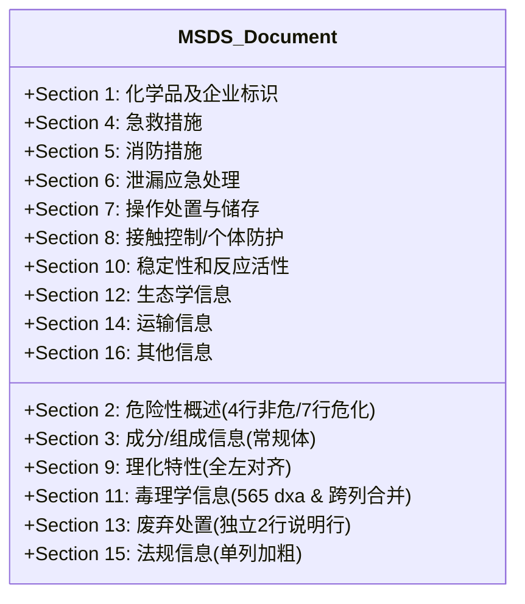

# MSDS 中英文覆写排版与数据装配全景统一工业级规范 (Single Source of Truth)

> **版本**：v5.0.0 (2026 校准终审版)  
> **法定效力**：本文档为 MSDS Studio Web 编辑器、MSDS-Engine 覆写算法引擎以及 Agent API 批量自动化管道的**唯一法定真理源（Single Source of Truth）**。  
> **适用范围**：广州冠志新材料有限公司（Guanzhi）、英德市国彩新材料有限公司（Guocai）全型号化学品安全技术说明书（MSDS/SDS）中英文双语、四形态（中文冠志、中文国彩、英文冠志、英文国彩）及标准 8 交付物（4 DOCX + 4 PDF）的装配与渲染全流程。

---

## 第一章 总则与系统定位

```text
┌────────────────────────────────────────────────────────────────────────┐
│             【MSDS 中英文覆写统一规范 (Single Source of Truth)】        │
│                           最高法定真理源                                │
└───────────────────────────────────┬────────────────────────────────────┘
                                    │
           ┌────────────────────────┴────────────────────────┐
           ▼                                                 ▼
┌──────────────────────────────────────┐  ┌──────────────────────────────────────┐
│  通道 A: Web 工作台与交互式编辑器     │  │  通道 B: Agent API 自动化流水线       │
│  • 前端单型号加载与视图覆写          │  │  • POST /api/msds/pipeline/generate- │
│  • 人工微调与所见即所得保存          │  │    eight 全自动全型号生产             │
│  • 一键导出 8 格式合规交付物         │  │  • 工业级算法训练材料全量闭环         │
└──────────────────────────────────────┘  └──────────────────────────────────────┘
                                    │
                                    ▼
       ┌────────────────────────────────────────────────────────────┐
       │             【4 DOCX + 4 PDF 标准交付矩阵】                │
       │  • 100% 拓扑合规   • 100% 网格锁定   • 100% 零字词拉伸     │
       │  • 100% 文字垂线对齐  • 100% 零制表符弹飞  • 100% 零中文残留 │
       └────────────────────────────────────────────────────────────┘
```

### 1.1 法定效力
1. **决定性权威**：无论是人类用户在 Web 工作台界面操作覆写与导出，还是外部 Agent 通过 HTTP API 驱动底层流水线，产出物的字段选取、翻译收敛、网格拓扑、缩进尺寸、字体磅值及对齐方式，**必须严格且唯一受控于本规范**。
2. **严禁绕开引擎直改**：严禁任何人员或 Agent 编写一次性 ad-hoc 脚本直接读写最终 DOCX/PDF 产出物。一切变更必须回溯到 `pipeline-engine.js`、`docx-engine.js` 及对应模板引擎管道中执行。

### 1.2 核心工程不变量
1. **底模网格几何不可变公理**：Word 模板中既有的表格网格结构、列宽分布、单元格点线边框（Dotted Borders）享有最高只读豁免权，严禁擅自破坏网格结构。
2. **无菌覆写与防污染公理**：在注入新数据前，必须对模板中的旧数据、残留占位符进行物理级安全清空，严禁产生图文混杂或历史残留污染。
3. **正向确定性准则**：系统排版不依赖模型随机性，所有段落属性（`<w:jc>`、`<w:ind>`、`<w:sz>`）必须通过代码级确定性几何规则锁死。

---

## 第二章 全仓级排版不变量与底层 OOXML 几何规范

### 2.1 网格与单元格几何约束
- **边框规范**：所有章节表格内部横向与纵向分割线统一采用半角浅灰/点状细边框（`<w:tcBorders><w:bottom w:val="dotted" w:sz="4" w:space="0"/><w:right w:val="dotted" w:sz="4" w:space="0"/></w:tcBorders>`）；
- **垂直对齐**：除通栏说明行与长文本行外，标签格与值格的垂直对齐方式默认统一为垂直居中（`<w:vAlign w:val="center"/>`）；Section 13 的 `Disposal methods:` 单元格强制双居中（水平垂直居中）。

### 2.2 第一列（Col 0 标签列）“文字对文字”首字垂线对齐法典
第一列标签的首字垂直对齐，必须严格以**标签正文首字母/文字**为基准对齐，**绝对严禁与数字序号挤在一列**：

```text
0 dxa (单元格边缘)
│
├── 1.1 [Tab] ──>  Product name:                (文字 P 在 420 dxa 垂线)
│                  Chemical category:           (无序号标签 C 在 420 dxa 垂线，与 P 对齐！)
├── 1.2 [Tab] ──>  Relevant identified uses:    (文字 R 在 420 dxa 垂线)
│
└── 11.10 [Tab] ─> Additional information:      (Section 11 采用 565 dxa 垂线，防弹飞！)
```

#### ① 双基准悬挂缩进几何（Hanging Indent Architecture）
| 适用章节 | 序号特征 | 悬挂缩进设置 | 文字垂线绝对坐标 | 技术依据与防错机理 |
| :--- | :---: | :--- | :---: | :--- |
| **通用章节**<br>(Sec 1, 2, 9, 14, 15 等) | 一位数序号<br>(`1.1` ~ `2.6`) | `<w:ind w:left="420" w:hanging="420"/>` | **`420 dxa`**<br>(约 7.4mm) | 序号占 4 字符（宽度约 340 dxa），制表符 `<w:tab/>` 稳稳跳跃至 420 dxa 起笔文字。 |
| **Section 11 专属**<br>(毒理学信息) | 包含两位数序号<br>(`11.10`) | `<w:ind w:left="565" w:hanging="565"/>` | **`565 dxa`**<br>(约 10.0mm) | `11.10` 占 5 字符（宽度约 452 dxa），**超过了 420 dxa**！必须放宽至 565 dxa（底模原生规范），彻底避免制表符弹飞至 840 dxa 产生巨大空档。 |

#### ② 无序号标签（No-Sequence Labels）沉降与右缩进铁律
- **受管标签范围**：Section 1 的 `Chemical category:`、`Name of supplier:`、`Supplier address:`、`Tel:`、`Fax:`，Section 2 的 `GHS Pictograms:` 等；
- **强制规则**：
  - 严禁顶在 0 dxa 位置；
  - 必须显式设置段落左缩进：通用章节应用 `<w:ind w:left="420"/>`；Section 11 若有则应用 `<w:ind w:left="565"/>`；
  - 保证无序号标签首字与上方有序号标签的文字首字，处于同一条垂直线上；换行折行也锁定在该垂线。

#### ③ 标签字体与西文标点收敛
- **中文字体**：宋体/黑体，小四号/五号（对应 9.5pt，`w:sz val="19"`），统一加粗；
- **英文字体**：Arial，字号 9.5pt（`w:sz val="19"`），统一加粗（`w:b`）；
- **末尾标点**：中文版标签末尾统一为全角冒号 `：`；英文版标签末尾统一收敛为半角西文冒号加空格 `: ` 或半角冒号 `:`（除 Other hazards 等特殊声明外）。

---

### 2.3 第二列及数据列（Col 1+ 值格）纯左对齐与词距拉大根治规范

#### ① 100% 强制纯左对齐（Flush Left Axiom）
- **根治病灶**：禁止段落保留任何 `<w:jc w:val="both"/>`（两端对齐）或 `<w:jc w:val="distribute"/>`（分散对齐）。两端对齐是造成英文单词之间、中文字符之间被机械拉伸出巨大空隙的唯一元凶！
- **法定实施**：所有值格（Col 1 及后续数据列）内的每个段落，强制设为 `<w:jc w:val="left"/>`。英文采用自然词距（Natural Word Spacing）断行，左侧严密对齐，右侧自然折行（Ragged Right）。

#### ② 缩进清零与前导空白清洗
- **缩进彻底清除**：物理移除值格段落中的所有 `<w:ind>`（无首行缩进 `firstLine`、无左侧缩进 `left`、无悬挂缩进 `hanging`），确保第 1 行至第 N 行首字符全部死死贴齐单元格内边距；
- **空白净化**：
  - 剔除段落前导制表符 `<w:tab/>`；
  - 压缩正文内的连续多个空格：`text.replace(/[ \t]{2,}/g, ' ')`；
  - 剔除行首空白字符：`text.replace(/^\s+/, '')`。

#### ③ 第二列内部二级子标签（Sub-labels within Col 1）
- 如 Section 11 中的 `Oral:`、`Inhalation:`、`Dermal:`：
  - 在第二列单元格内部顶格左对齐起笔，第二列与第二列彼此垂直对齐；
  - 标签名称加粗（`bold: true`），其后的测试数值与判定结论采用常规体（`bold: false`）。

---

### 2.4 页眉与页脚法定排版规范

页脚采用单行双格隐形表格结构，排版布局必须严格遵守下表：

| 单元格位置 | 实体与格式要求 | 对齐方式 | 示例（冠志 2026 校准版） |
| :--- | :--- | :---: | :--- |
| **Cell 0（左单元格）** | **企业官方全称 + 产品型号-MSDS**<br>• 中文版：宋体 9pt<br>• 英文版：Arial 9pt Regular | **强制绝对左对齐**<br>(`w:jc val="left"`) | `Guangzhou Guanzhi New Material Co., Ltd. PU-608-MSDS` |
| **Cell 1（右单元格）** | **修订日期（Revision Date）**<br>• 冒号后带 1 空格<br>• 英文必须为 `Revision Date:` 首字母大写<br>• 日期必须同步当前最新有效时间 | **强制绝对右对齐**<br>(`w:jc val="right"`) | `Revision Date: 2026.03.01`<br>（中文版：`修订日期：2026.03.01`） |

---

### 2.5 语言纯洁性公理（Language Purity Axiom）
1. **英文版零中文字符**：全量英文交付物（4 DOCX + 4 PDF）严禁残留任何中文字符（Unicode 范围 `\u4e00-\u9fa5`）。一旦检测到中文字符，Gate 6 质量门禁立即一票否决。
2. **标点西进化**：英文版中所有的全角标点符号必须自动转换为西文标准标点：
   - `：` $\rightarrow$ `: `
   - `，` $\rightarrow$ `, `
   - `；` $\rightarrow$ `; `
   - `（` / `）` $\rightarrow$ ` (` / `) `
   - `“` / `”` $\rightarrow$ `"`

---

## 第三章 Section 1 至 Section 16 中英文逐项全景覆写矩阵



---

### 3.1 Section 1: 化学品及企业标识 (Identification)

- **表格拓扑**：共 9 行。行 0 为通栏大标题；行 1~8 为经典双列（Col 0 标签，Col 1 值）。
- **字段明细与排版约束**：

| 行号 | 中文标签 (Col 0) | 英文标签 (Col 0) | 缩进几何 | 值格内容与实体绑定规范 (Col 1) |
| :---: | :--- | :--- | :---: | :--- |
| **Row 0** | **化学品及企业标识** | **Identification** | 居中加粗 | 章节通栏标题（11pt / Arial 11pt Bold） |
| **Row 1** | 1.1 产品名称： | 1.1 Product name: | 420 悬挂 | 产品型号（如 `PU-608`，加粗，左对齐） |
| **Row 2** | 化学品俗名或商品名： | Chemical category: | **420 左缩进** | 化学品类别（如 `单组份水性聚氨酯分散体 / One-component waterborne polyurethane dispersion`） |
| **Row 3** | 1.2 产品推荐及限制用途： | 1.2 Product use suggestions and restrictions: | 420 悬挂 | 推荐用途（如 `水性工业涂料、胶粘剂成膜物质 / Waterborne industrial coatings, adhesives film former`） |
| **Row 4** | 1.3 供应商信息： | 1.3 Supplier information: | 420 悬挂 | 对应实体企业名称（如 `广州冠志新材料有限公司 / Guangzhou Guanzhi New Material Co., Ltd.`） |
| **Row 5** | 供应商名称： | Name of supplier: | **420 左缩进** | 对应实体企业全称 |
| **Row 6** | 供应商地址： | Supplier address: | **420 左缩进** | 对应实体法定注册地址 |
| **Row 7** | 电话： | Tel: | **420 左缩进** | 对应实体联系电话（半角数字） |
| **Row 8** | 传真： | Fax: | **420 左缩进** | 对应实体传真号码（若无则填 `-`） |

---

### 3.2 Section 2: 危险性概述 (Hazards Identification)

- **表格拓扑判定**：
  - **非危险化学品（Not Classified）**：严格收敛为 **4 行标准结构**（Row 0 标题 + 2.1 分类 + 2.2 标签 + 2.3 其他危害）；
  - **危险化学品（Hazardous）**：保持 **8 行完整结构**（含象形图、信号词、危险说明 H 代码、防范说明 P 代码等）。

#### Section 2.5 防范说明（Precautionary Statements）专属规则：
1. **剔除重复总标题**：值格内绝不可包含冗余打印的 `Precautionary statement(s):` 或 `防范说明：`；
2. **大类小标题加粗**：`Prevention:`、`Response:`、`Storage:`、`Disposal:`（中文：`预防措施：`、`事故响应：`、`安全储存：`、`废弃处置：`）必须设为加粗，顶格左对齐；
3. **取消物理空行**：彻底取消大类之间插入的物理空行，各类别紧凑连续排列；
4. **规程段落常规体**：具体规程（如 `P261 Avoid breathing...`）必须设为常规体（`bold: false`），清除缩进，首字母 `P` 与小标题首字母在左侧垂直齐头。

---

### 3.3 Section 3: 成分/组成信息 (Composition/Information on Ingredients)

- **表格拓扑**：根据产品实际组分数量动态生成。Row 0 为章节标题，后续每行为一种化学成分。
- **排版铁律**：
  1. **具体的化学成分名称绝对严禁加粗**：如 `Polyurethane resin`（聚氨酯树脂）、`Water`（水）、`N-Methyl-2-pyrrolidone`（NMP）等，必须统一采用 Arial 9.5pt 常规体（`bold: false`）；
  2. **严禁追加多余冒号**：成分名称后禁止带有冒号；
  3. **数据列对齐**：CAS 号与质量百分比浓度（%）必须严格左对齐。

---

### 3.4 Section 4 ~ 8: 应急救援与日常防护章节群

- **Section 4 急救措施 (First-Aid Measures)**：
  - 包含眼睛接触、皮肤接触、吸入、食入四大处置要点；
  - 值格文字全量纯左对齐，自然词距断行。
- **Section 5 消防措施 (Fire-Fighting Measures)**：
  - 明确合适与不合适的灭火剂、特定危险性及消防人员防护装备；
  - 严禁出现两端对齐拉大间距。
- **Section 6 泄漏应急处理 (Accidental Release Measures)**：
  - 覆盖作业人员防护、环境保护措施及泄漏化学品收容清除方法；
  - 列表项首字严格齐头。
- **Section 7 操作处置与储存 (Handling and Storage)**：
  - 明确操作安全注意事项、通风要求与储存温湿度限制（如 `+5℃ ~ +40℃`）；
  - 温度数字与西文单位（`℃`）紧密贴合。
- **Section 8 接触控制/个体防护 (Exposure Controls/Personal Protection)**：
  - 职业接触限值（PC-TWA / PC-STEL / TLV）；
  - 呼吸、眼睛、身体、手部防护建议文字全左对齐。

---

### 3.5 Section 9: 理化特性 (Physical and Chemical Properties)

- **表格拓扑**：Row 0 为标题，后续包含外观、气味、pH、熔点、沸点、闪点、粘度、密度、溶解性等测定行。
- **彻底根治历史居中（The Flush-Left Mandate）**：
  1. **数值与未测状态全量左对齐**：所有参数数值（如 `1.0-1.1 g/cm³`、`7-9`、`>100 ℃`）及未测定声明（`Not determined` / `未测定`），**彻底废除原底模中的水平居中（`center`），全量强制设置为水平纯左对齐（`w:jc val="left"`）**；
  2. **粘度原子覆写机制**：若输入或事实中存在特定的粘度覆写指令（`viscosityOverride`），流水线在装配时原子级覆写该参数，严禁被通用模板占位符覆盖；
  3. **悬挂缩进门禁**：第一列标签严格锁定为 `420 dxa` 悬挂缩进，严禁向段落注入非法 `<w:tabs>`。

---

### 3.6 Section 10: 稳定性和反应活性 (Stability and Reactivity)

- 包含反应性、化学稳定性、危险反应可能性、应避免的条件、不相容物质及危险分解产物；
- 全文采用 9.5pt Regular，左对齐。

---

### 3.7 Section 11: 毒理学信息 (Toxicological Information)

- **表格拓扑**：Row 0 章节标题，Row 1~2 通栏说明行，Row 3~14 业务测试行（共 15 行）。
- **核心工程规范与防错拓扑**：

```text
Section 11 拓扑结构明细：
Row 0: 11. Toxicity information (章节标题)
Row 1: No toxicological studies were available for this product. (通栏说明行)
Row 2: The following are toxicological data for ...: (通栏说明行)
Row 3: 11.1 Acute toxicity: | Oral:       | LD50 ...
Row 4:                      | Inhalation: | LC50 ...
Row 5:                      | Dermal:     | LD50 ...
Row 6: 11.2 Primary skin irritation:      | ...
...
Row 11: 11.7 Reproductive toxicity:       | (跨列合并: gridSpan="3", w="6262")
...
Row 14: 11.10 Additional information:     | (565 dxa 悬挂缩进，首字母 A 绝对垂直对齐！)
```

1. **Section 11 第一列专属 565 dxa 悬挂缩进**：
   - 第一列从 `11.1` 到 `11.10`，全量应用 `<w:ind w:left="565" w:hanging="565"/>`；
   - 彻底容纳 5 字符宽度的 `11.10`（约 452 dxa），制表符 `<w:tab/>` 稳停于 `565 dxa`，首字母 `A` 与上方所有标签文字首字母绝对垂直齐头对齐！
2. **第二列二级子标签加粗列内左对齐**：
   - `Oral:`、`Inhalation:`、`Dermal:` 单元格应用 `w:jc left`，文字加粗，列内相互对齐；
3. **11.7 生殖毒性跨列合并几何保护**：
   - 11.7 行在底模中由于历史原因合并了右侧单元格，值格必须显式保留 `<w:tcPr><w:tcW w:w="6262"/><w:gridSpan w:val="3"/></w:tcPr>`，严禁被破坏拆分为两格。

---

### 3.8 Section 12: 生态学信息 (Ecological Information)

- 涵盖生态毒性、持久性和降解性、生物富集潜力、土壤中的迁移性及 PBT/vPvB 评估结果；
- 全文段落纯左对齐，自然词距断行。

---

### 3.9 Section 13: 废弃处置 (Disposal Considerations) —— 独立两行说明行

- **表格拓扑重构**：**严格锁定为 4 行标准结构**（彻底废除过去把两句说明合并在单行的错误）：

| 行号 | 单元格拓扑 | 中文规范 | 英文规范 | 排版与样式要求 |
| :---: | :---: | :--- | :--- | :--- |
| **Row 0** | 单列通栏 | **13. 废弃处置** | **13. Disposal considerations** | 居中加粗 |
| **Row 1** | 单列通栏 | 必须遵守适用的国标、国家或当地法规进行废弃。 | `Dispose of in accordance with applicable national standards and national or local regulations.` | Arial 9.5pt Regular，左对齐，无缩进 |
| **Row 2** | 单列通栏 | 在欧盟领域内废弃，应根据欧洲废弃物分类（EWC）的适当法规。 | `Within the European Union, dispose of in accordance with the applicable provisions of the European Waste Catalogue (EWC).` | Arial 9.5pt Regular，左对齐，无缩进 |
| **Row 3** | 两列 (Col 0 \| Col 1) | **处置方法：** \| 尽可能将容器中的内容物倒空... | **Disposal methods:** \| Empty containers as completely as possible... | **Col 0: 水平垂直双居中加粗**；<br>**Col 1: 垂直居中、纯左对齐**，自然词距 |

---

### 3.10 Section 14: 运输信息 (Transport Information)

- 包含公路/铁路（ADR/RID）、海运（IMDG）、空运（IATA）及运输特别防范措施；
- 对于非危化学品，明确写入：`Not classified as dangerous goods for transport` / `按普通货物运输条件办理`；
- 全文纯左对齐。

---

### 3.11 Section 15: 法规信息 (Regulatory Information)

- **单列通栏子标题加粗**：
  - `Other provisions:`（其他规定：）
  - `Complies with the following regulations:`（符合以下法律法规及标准：）
  - 上述单列子标题必须设为 **Arial 9.5pt Bold，纯左对齐，末尾补齐半角冒号**；
- 具体的法规清单（如《危险化学品安全管理条例》、TSCA、REACH、RoHS）采用常规体纯左对齐。

---

### 3.12 Section 16: 其他信息 (Other Information)

- 包含免责声明（Disclaimer）、修改说明、缩略语解释（Abbreviations and acronyms）；
- 正文文字清除所有首行缩进，纯左对齐。

---

## 第四章 双实体（冠志 vs 国彩）数据绑定与智能推理装配规范

流水线在执行覆写时，根据目标企业实体自动注入法定参数字典：

| 字段类别 | 广州冠志新材料有限公司 (Guanzhi) | 英德市国彩新材料有限公司 (Guocai) |
| :--- | :--- | :--- |
| **企业全称 (CN)** | 广州冠志新材料有限公司 | 英德市国彩新材料有限公司 |
| **企业全称 (EN)** | Guangzhou Guanzhi New Material Co., Ltd. | Yingde Guocai New Material Co., Ltd. |
| **企业地址 (CN)** | 广州市天河区高新技术产业开发区 | 广东省英德市东华镇清远华侨工业园清华园创业路1号 |
| **企业地址 (EN)** | High-tech Industrial Development Zone, Tianhe District, Guangzhou | No. 1, Chuangye Road, Tsinghua Park, Qingyuan Overseas Chinese Industrial Park, Donghua Town, Yingde City, Guangdong |
| **邮编** | 510000 | 513058 |
| **应急咨询电话** | +86-020-82562835 | +86-0763-2630098 |

---

## 第五章 全流程自动化质量断言与一票否决门禁体系 (Quality Gates 1 ~ 7)

为确保任何代码重构或模型迭代均无法破坏上述标准，在交付生成物发布前，系统必须自动化执行 **7 大质量门禁断言**。任何一项失败，立即阻断并抛出异常：

```text
┌────────────────────────────────────────────────────────────────────────┐
│                   【MSDS 交付前 7 大自动化质量断言门禁】                 │
├────────────────────────────────────────────────────────────────────────┤
│ Gate 1: Section 9 悬挂缩进 (420 dxa) 与零非法 <w:tabs> 断言              │
│ Gate 2: Section 11 生殖毒性跨列合并几何 (gridSpan="3", w="6262") 断言  │
│ Gate 3: Section 13 标准 4 行拓扑结构 (2 行独立通栏说明行) 断言          │
│ Gate 4: 全篇值格非左对齐段落数恒为 0 (Zero Non-Left Paragraphs) 断言     │
│ Gate 5: Section 11 悬挂缩进 (565 dxa) 与 11.10 防弹飞断言              │
│ Gate 6: 页眉页脚排版 (公司左对齐 / Revision Date 首字母大写右对齐) 断言 │
│ Gate 7: 英文交付物 100% 纯英文零中文残留 (Zero Chinese Characters) 门禁 │
└────────────────────────────────────────────────────────────────────────┘
```

### 5.1 Gate 1: Section 9 悬挂缩进与零制表位拦截
- **规则**：遍历 Section 9 第一列所有段落，缩进属性必须且仅能为 `<w:ind w:left="420" w:hanging="420"/>`；
- **一票否决**：段落属性中凡含有非法注入的 `<w:tabs>`，立即抛出异常拦截。

### 5.2 Gate 2: Section 11 拓扑与生殖毒性跨列几何断言
- **规则**：检验 11.7 行右侧单元格，必须具备 `w:gridSpan="3"` 及宽度 `w:w="6262"`，严禁几何断裂。

### 5.3 Gate 3: Section 13 四行标准拓扑断言
- **规则**：`s13.rows.length === 4`。Row 1 与 Row 2 必须为单列独立说明行；Row 3 必须为两列，且左列文本为 `Disposal methods:`。

### 5.4 Gate 4: 全篇值格纯左对齐断言 (Zero Non-Left Paragraphs)
- **规则**：遍历所有章节表格的第二列及后续数据列，段落的对齐属性 `<w:jc>` 必须严格为 `left`；
- **一票否决**：非左对齐（包含 `both`、`distribute`、`center`）段落数必须恒等于 0。

### 5.5 Gate 5: Section 11 专属 565 dxa 悬挂缩进断言
- **规则**：检验 Section 11 第一列标签（尤其 `11.10`），段落缩进必须且只能为 `<w:ind w:left="565" w:hanging="565"/>`，彻底阻断制表符溢出弹飞。

### 5.6 Gate 6: 页脚时间与大写规范断言
- **规则**：页脚 Cell 0 强制 `jc=left`，Cell 1 强制 `jc=right`；英文版 Cell 1 必须以 `Revision Date:` 起笔（大写），时间必须为 2026 最新年份。

### 5.7 Gate 7: 英文版零中文字符一票否决断言
- **规则**：正则扫描英文文档全文字符串，严禁匹配到 `[\u4e00-\u9fa5]`。

---

## 第六章 附录：核心引擎实现对应索引

| 规范条目 | 核心承载源码文件 | 函数/逻辑锚点 |
| :--- | :--- | :--- |
| **Section 1~16 英文标准化覆写** | `web/src/pipeline-engine.js` | `standardizeMsdsToStandardEnglish()` |
| **文字垂线对齐与标签几何** | `web/src/pipeline-engine.js` | `formatEnglishLabelCell()` / `applyLeftIndentToP()` |
| **值格纯左对齐与词距消除** | `web/src/pipeline-engine.js` | `formatValueCell()` |
| **Section 2.5 紧凑重排** | `web/src/pipeline-engine.js` | `formatPrecautionaryValueCell()` |
| **页脚公司左对齐/日期右对齐** | `web/src/docx-engine.js` | `standardizeEnglishTypographyAndLabels()` |
| **全量质量门禁断言** | `web/src/pipeline-engine.js` | `assertDeliverableQuality()` |
