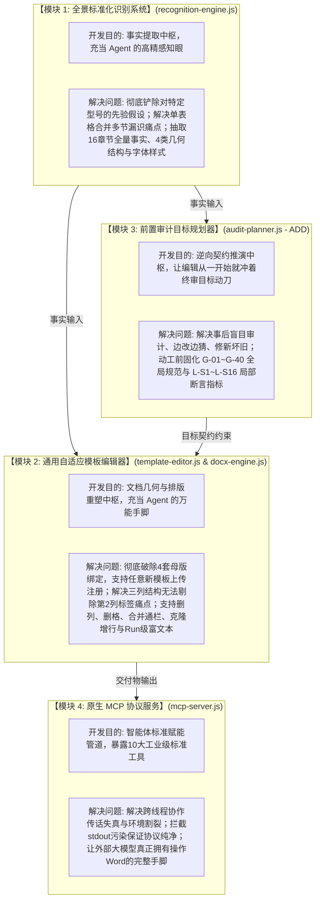

# MSDS-Engine 核心架构宪章与法定模块开发准则
> **文件性质**：最高法定工程宪法 (Supreme Architectural Constitution)  
> **生效时间**：2026-11-02  
> **核心宗旨**：立字为据，锁定 MSDS-Engine 各核心模块的法定设计初衷、解决的关键问题与不可触碰的工程承重墙，**坚决阻断任何后续 Agent 偏离航道、重蹈硬编码与伪自动化覆辙**。

---

## 一、 系统总纲与神圣核心定位 (System Manifesto)

### 1. 什么是 MSDS-Engine？
MSDS-Engine **绝不是**一个针对某些特定化学品型号（如 PU-202A、PU-218A、PA-3223）堆砌 `if-else` 固定答案的硬编码生成器！
MSDS-Engine 的真正法定定位是：
> **一套工业级“全景无损识别系统 + 通用自适应几何编辑器 + 前置审计目标规划器 (ADD) + 原生 MCP 协议赋能中枢”！**
> 它旨在成为 AI Agent 处理复杂化学品安全技术说明书（MSDS/SDS）时**最强有力的感知眼与手脚执行器**。Agent 负责依据规范做决策，MSDS-Engine 负责提供原子化、安全自愈的底层文档操控通道。

### 2. 以后核心维护与开发项（四大法定支柱）
依据用户最高法定指示，全系统生命周期内的核心维护与开发项**严格锁定且唯一限定**为以下四大支柱，核心维护服务于 Agent 真正正确真实使用 MSDS Engine 本身的能力并实现稳定产出，过程采用 SOP 操作标准化，赋予 Agent 编辑器的各大编辑能力：
1. **支柱 1：编辑器本身能力**：底层网格几何拓扑手术（删列、删行、合并、增行）、Run 级微观富文本与化学式下标排版、模板解耦与物理网格自动自愈（9795 dxa 总宽守恒），作为 Agent 终极“万能手脚”；
2. **支柱 2：MCP 与 API**：标准 stdio JSON-RPC 2.0 协议、无损参数与结果契约、拦截外部日志污染保证协议纯净，作为 Agent 与底座沟通的“神经通路”；
3. **支柱 3：全局规范与局部规范（机械 + Agent 敌手自审计双重最高门禁）**：ADD（Audit-Driven by Design）前置断言契约、G-01~G-40 全局几何/排版规范、各章节局部专属契约、表格外框实线/内框统一虚线与 1:1 事实物理对账红线，作为终审的最高“质量宪法”；法定设立【两阶双轨终审体系】：① 机械确定性全景深度硬门禁（真实退出码 0 为准入钥匙 1）；② Agent 敌手认知深度自审计（以“预设有错去发现错误”为准出钥匙 2），两钥匙齐备方可放行；
4. **支柱 4：Skill**：Agent 的大脑意识与标准化 SOP 规程，核心维护服务于指导 Agent 依照 SOP 标准化操作，熟练调用编辑器各大能力完成全流程闭环。

### 3. 最高反退化铁律与禁令 (Supreme Anti-Degradation Invariants)
任何 Agent 在后续维护、迭代或执行任务时，凡出现以下行为之一，**一票否决并视为严重工程违章**：
1. **最高防私改禁令**：**非用户明确允许，严禁直接为了单一目的（如应对某一临时特例或特定字段）而擅自改造底层通用工具！** 一切能力必须以通用化、参数化、SOP 配方化为充要前提；
2. **严禁特判倒退**：严禁在代码中编写 `if (model === 'xxx')` 针对特定型号做写死分支或假想兜底；
3. **严禁绕道私改**：严禁绕过受控编辑器通道擅自编写 ad-hoc 脚本直接读写破坏底层 DOCX/XML；
4. **严禁僵化填空**：严禁将模板视为静态死板的空槽，必须通过通用几何通道（删列、删行、合并、增行）主动重塑模板以适配事实；
5. **严禁事后盲测**：严禁脱离 ADD 逆向设计，必须在动工前制定好前置终审契约。

---

## 二、 四大核心模块的法定开发目的与解决的关键问题

---

### 模块 1：全景标准化识别系统 (`web/src/recognition-engine.js`)
- **法定开发目的**：
  - 作为系统唯一的“源文档事实感知源”，负责对任意传入的 DOCX/Word 源文档进行物理解包，抽取 100% 原始事实。
- **解决的核心痛点**：
  1. **单表格合并多章节的漏识死角**：解决源文件中将 Section 3 与 Section 4 做在同一个大表格导致后续章节被整体吞噬的严重缺陷；
  2. **多态几何形态感知**：精准将段落与表格识别分类为 `TWO_COLUMN`（两列）、`EXPLANATION_ROW`（说明行）、`FULL_WIDTH`（通栏跨列）与 `MULTI_COLUMN`（三列及以上）；
  3. **排版样式无损提取**：不仅提取文字，更提取粗体（`isBold`）、字号（`fontSizePt`）、字体族（`fontFamily`）与段落对齐方式，为后续高保真还原提供依据。
- **不可触碰承重墙**：
  - 识别引擎输出的必须是 **100% 纯净 JSON 数据**，绝对严禁将带有父子循环引用的 DOM 元素（如 `rawRow`、`drawingNodes`）泄露给外部，确保跨进程通信零崩溃。

---

### 模块 2：通用自适应模板编辑器 (`web/src/template-editor.js` & `web/src/docx-engine.js`)
- **法定开发目的**：
  - 作为 Agent 的“万能机械臂”，提供微创、精准且具备底层几何自愈能力的文档重塑通道。
- **解决的核心痛点**：
  1. **打破静态母版禁锢**：提供 `registerCustomTemplate`，允许上传任意第三方或客户 DOCX 模板，自动反射其网格结构并分配编辑通道；
  2. **攻克三列结构第二列标签无法删除的死结**：提供底层 `deleteColumn` 与网格重算算法，使 Agent 能在多列与两列、通栏之间自由切换，不再受制于模板既有网格；
  3. **避免行伸缩时的格式崩塌**：提供 `insertRow` 样式继承克隆通道，无论产品有 2 个还是 10 个组分，新增行均完美继承底色、边框与字体；
  4. **微观 Run 级排版支持**：提供 `writeRichText`，支持化学式下标（$H_2O$、CO₂）、混排加粗与多段落缩进。
- **不可触碰承重墙**：
  - 任何针对表格的增、删、改操作，必须伴随 `<w:tblGrid>` 的物理自愈（`healAllTableTopologies`），导出的 OpenXML 表格必须列宽闭环、左右边缘严格齐平（9795 dxa），绝不允许产出破损文档。

---

### 模块 3：前置审计目标规划器 (`web/src/audit-planner.js` - ADD)
- **法定开发目的**：
  - 践行 **Audit-Driven by Design (ADD)** 逆向设计工程哲学：在动工落笔之前，先由源文件事实与规范体系自动推演并锁定《终审断言目标清单契约》。
- **解决的核心痛点**：
  1. **根治事后补丁与盲目尝试**：Agent 不是先改完代码再去祈祷审计通过，而是以命中该目标清单为每一次原子操作的充要条件；
  2. **防止旧疾复发与修新坏旧**：将全局规范（G-01 纯度、G-36 时间戳、G-37 字号 9.5pt、G-38 激光对齐 80.28pt、G-39 OPC 声明）与 16 章节局部规范（L-S1~L-S16）前置固化为机器可核销的断言表。
- **不可触碰承重墙**：
  - 终审契约具有不可篡改性，严禁 Agent 在遇到审计红灯时擅自降低断言标准或删除检查项。

---

### 模块 4：原生 MCP 协议服务 (`web/src/mcp-server.js`)
- **法定开发目的**：
  - 实现标准 stdio JSON-RPC 2.0 协议规范，将 Engine 的四大基座能力封装为工业级标准工具，无缝赋能给宿主大模型与子 Agent。
- **解决的核心痛点**：
  1. **杜绝语义稀释与手工传话**：Agent 通过结构化 JSON 工具调用完成“识别 $\rightarrow$ 感知 $\rightarrow$ 规划 $\rightarrow$ 几何编辑 $\rightarrow$ 批量导出 $\rightarrow$ 终审核销”；
  2. **协议纯净性保障**：在进程顶层拦截所有外部日志输出并重定向至 `stderr`，保证 `stdout` 传输纯净的标准 JSON-RPC 报文，彻底杜绝解析崩溃。
- **不可触碰承重墙**：
  - MCP 工具必须始终提供详尽的输入参数校验与错误堆栈透传，严禁静默吞掉底层异常。
