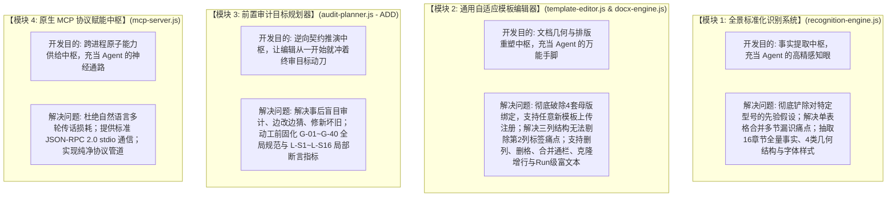

# MSDS-Engine 核心架构宪章与法定模块开发准则
> **文件性质**：最高法定工程宪法 (Supreme Architectural Constitution)  
> **生效时间**：2026-11-02  
> **核心宗旨**：立字为据，锁定 MSDS-Engine 各核心模块的法定设计初衷、解决的关键问题与不可触碰的工程承重墙，**坚决阻断任何后续 Agent 偏离航道、重蹈硬编码与伪自动化覆辙**。

---

## 一、 系统总纲与神圣核心定位 (System Manifesto)

### 1. 什么是 MSDS-Engine？
MSDS-Engine **绝不是**一个针对某些特定化学品型号（如 PU-202A、PU-218A、PA-3223）堆砌 `if-else` 固定答案的硬编码生成器！
MSDS-Engine 的真正法定定位是：
> **一套工业级“全景无损识别系统 + 通用自适应几何编辑器 + 前置审计目标规划器 (ADD) + 原生 MCP 协议赋能中枢”！**
> 它旨在成为 AI Agent 处理复杂化学品安全技术说明书（MSDS/SDS）时**最强有力的感知眼与手脚执行器**。Agent 负责依据规范做决策，MSDS-Engine 负责提供原子化、安全自愈的底层文档操控通道。

### 2. 以后核心维护与开发项（四大法定支柱）
依据用户最高法定指示，全系统生命周期内的核心维护与开发项**严格锁定且唯一限定**为以下四大支柱，核心维护服务于 Agent 真正正确真实使用 MSDS Engine 本身的能力并实现稳定产出，过程采用 SOP 操作标准化，赋予 Agent 编辑器的各大编辑能力：
1. **支柱 1：编辑器本身能力**：底层网格几何拓扑手术（删列、删行、合并、增行）、Run 级微观富文本与化学式下标排版、模板解耦与物理网格自动自愈（9795 dxa 总宽守恒），作为 Agent 终极“万能手脚”；
2. **支柱 2：MCP 与 API**：标准 stdio JSON-RPC 2.0 协议、无损参数与结果契约、拦截外部日志污染保证协议纯净，作为 Agent 与底座沟通的“神经通路”；
3. **支柱 3：全局规范与局部规范（机械 + Agent 敌手自审计双重最高门禁）**：ADD（Audit-Driven by Design）前置断言契约、G-01~G-40 全局几何/排版规范、各章节局部专属契约、表格外框实线/内框统一虚线与 1:1 事实物理对账红线，作为终审的最高“质量宪法”；法定设立【两阶双轨终审体系】：① 机械确定性全景深度硬门禁（真实退出码 0 为准入钥匙 1）；② Agent 敌手认知深度自审计（以“预设有错去发现错误”为准出钥匙 2），两钥匙齐备方可放行；
4. **支柱 4：Skill**：Agent 的大脑意识与标准化 SOP 规程，核心维护服务于指导 Agent 依照 SOP 标准化操作，熟练调用编辑器各大能力完成全流程闭环。

### 3. 最高反退化铁律与禁令 (Supreme Anti-Degradation Invariants)
任何 Agent 在后续维护、迭代或执行任务时，凡出现以下行为之一，**一票否决并视为严重工程违章**：
1. **最高防私改禁令**：**非用户明确允许，严禁直接为了单一目的（如应对某一临时特例或特定字段）而擅自改造底层通用工具！** 一切能力必须以通用化、参数化、SOP 配方化为充要前提；
2. **严禁特判倒退**：严禁在代码中编写 `if (model === 'xxx')` 针对特定型号做写死分支或假想兜底；
3. **严禁绕道私改**：严禁绕过受控编辑器通道擅自编写 ad-hoc 脚本直接读写破坏底层 DOCX/XML；
4. **严禁僵化填空**：严禁将模板视为静态死板的空槽，必须通过通用几何通道（删列、删行、合并、增行）主动重塑模板以适配事实；
5. **严禁事后盲测**：严禁脱离 ADD 逆向设计，必须在动工前制定好前置终审契约。

---

## 二、 四大核心模块的法定开发目的与解决的关键问题

### 模块 1：全景标准化识别系统 (`web/src/recognition-engine.js`)
- **法定开发目的**：
  - 充当 Agent 的高精“事实感知眼”。从多源非标输入（各种排版、各种格式的源 DOCX/PDF）中，100% 忠实提取原始化学品物理事实。
- **解决的核心痛点**：
  1. **彻底铲除对特定化学品型号的先验假设**：严禁内置“如果是 PU-202A 就提取这三行”式的私货；
  2. **解决单表格合并多节漏识痛点**：源文档常将 Section 5、6、7 合并为一个物理表格，识别引擎必须支持跨节连续解析；
  3. **事实与元数据全量提取**：抽取 16 章节全量事实、4 类几何结构（两列、三列、通栏、自由文本）与字体样式，输出结构化事实基准。
- **不可触碰承重墙**：
  - 识别引擎输出的原始事实属于绝对只读（ReadOnly），任何下游模块不得静默篡改原始提取内容。

### 模块 2：通用自适应模板编辑器 (`web/src/template-editor.js` & `docx-engine.js`)
- **法定开发目的**：
  - 充当 Agent 的“万能手脚”。提供高精度微观 OOXML 文档手术通道，让 Agent 能够根据识别到的事实与规范，动态重塑模板。
- **解决的核心痛点**：
  1. **彻底破除对固定母版的依赖**：支持任意第三方或企业新模板的安全上传、解析与结构注册；
  2. **解决多列固定死模板无法适配非标源文档的痛点**：如 Section 11 模板预设为三列，但源文档为通栏或双列时，编辑器提供原语级“删列”、“合并通栏”、“删格”能力；
  3. **微观排版保真**：支持 Run 级别的富文本拆分、化学式下标（`subscript`）注入、悬挂缩进（`hanging`）校准，杜绝文字重叠与制表符弹飞。
- **不可触碰承重墙**：
  - 严禁通过粗暴清空整个单元格（`cell.textContent = ''`）破坏既有 Run 格式；必须遵循精密 Run 级手术；
  - 表格网格总宽度必须严格维持 9795 dxa（或标准列宽守恒），严禁破坏底层表格总宽。

### 模块 3：前置审计目标规划器 (`web/src/audit-planner.js` - ADD)
- **法定开发目的**：
  - 充当 Agent 的“逆向目标规划器”。践行 Audit-Driven by Design 哲学，在动工修改前即明确终审断言。
- **解决的核心痛点**：
  1. **解决盲目改动与改前不知改后不知的痛点**：在动工前根据源事实与母版，生成一份包含 G-01~G-40 全局规范与局部特定断言的清单；
  2. **解决修新坏旧的回归风险**：每次编辑操作均受前置规划约束，偏离规划立即抛错。
- **不可触碰承重墙**：
  - 规划清单一经生成，执行期严禁擅自降低断言标准。

### 模块 4：原生 MCP 协议服务 (`web/src/mcp-server.js`)
- **法定开发目的**：
  - 实现标准 stdio JSON-RPC 2.0 协议规范，将 Engine 的四大基座能力封装为工业级标准工具，无缝赋能给宿主大模型与子 Agent。
- **解决的核心痛点**：
  1. **杜绝语义稀释与手工传话**：Agent 通过结构化 JSON 工具调用完成“识别 $\rightarrow$ 感知 $\rightarrow$ 规划 $\rightarrow$ 几何编辑 $\rightarrow$ 批量导出 $\rightarrow$ 终审核销”；
  2. **协议纯净性保障**：在进程顶层拦截所有外部日志输出并重定向至 `stderr`，保证 `stdout` 传输纯净的标准 JSON-RPC 报文，彻底杜绝解析崩溃。
- **不可触碰承重墙**：
  - MCP 工具必须始终提供详尽的输入参数校验与错误堆栈透传，严禁静默吞掉底层异常。

---

## 三、 16 章节全量中英文一一对照法定规范与五大防退化公理 (16-Section Bilingual Fidelity Axioms)

为彻底阻断后续 16 个 Section 再次出现翻译倒挂、行序错乱、模板残留、外生虚构与文字截断问题，全系统设立五大最高法定公理与自动化核销门禁（G-41~G-46）：

### 1. 逐槽位/逐行 1:1 绝对对账公理 (1:1 Physical Slot Mapping Axiom)
- **槽位数量与顺序绝对对称**：英文版在每一个 Section（特别是 Section 9、Section 10、Section 11、Section 12、Section 14）中的行数、子序号（9.1~9.N, 10.1~10.6, 11.1~11.N 等）必须严格服从中文母版顺序。严禁出现英文行数多于或少于中文母版、或序号跳跃/颠倒的情况。
- **定性与修饰语完整性**：所有定性修饰词（如闭杯 `(closed cup)`、状态 `(solids, gases)`、温度条件 `at 25 °C`、水溶性 `Dispersible and emulsifiable in water`）必须完整如实体现，严禁擅自丢弃修饰语或简化。
- **专业化学术语统一命名**：CAS 28182-81-2 在 Section 3 及全篇必须统一命名为 `Hexamethylene diisocyanate homopolymer`（均聚物），严禁随意降级为 bare polymer。

### 2. 零外生模板虚构与污染硬门禁 (Zero Extraneous Template Fabrication Invariant)
- **母版无则绝不编造**：严禁从历史死模板中带入未在中文母版中出现的任何条件语句、特殊规定或溶剂数据：
  - Section 14.4 用户特殊注意事项：若中文母版未明文包含温度范围、远离食品或酸碱隔离要求，英文版一律仅输出 `Not regulated as dangerous goods.`，严禁硬编码外生 `Temperature must not exceed +35℃...`；
  - Section 2 危害性分类：中文母版为非危险品时，英文版严禁残留旧模板的 H412、H315 或溶剂数据；
  - Section 12.1 生态毒理：严禁使用语病及外生表述（如 `water courses`），统一采用合规语法 `Do not discharge into drains, wastewater, or soil.`。

### 3. 多语言媒体资产纯度公理 (Multilingual Asset Purity Axiom)
- **英文交付物零中文光栅像素**：英文 MSDS 中的一切象形图、插图（如 Section 2 GHS 菱形标）必须使用纯净的多语言图形资产（纯图形无中文光栅字样，如 7450 bytes 纯净 PNG），绝对严禁直接复用带有中文硬编码文字（如带有“警告”二字、5493 bytes）的光栅位图。

### 4. 版面几何与页眉页脚安全边界不变量 (Header/Footer Margin & Boundary Safety Invariant)
- **防越界安全排版**：页眉页脚单元格内严禁注入超出单元格宽度（如 `w:firstLine="8730"` 超过单元格宽度 4984 dxa）的负向或异常缩进。在更新页脚数据时，必须彻底物理剥离单元格 1 内残留的 `w:ind`，杜绝右对齐文字（如“修订日期：...”与“Revision Date: ...”）在转 PDF 时首字被无头引擎截断。

### 5. 法规时效性正向演进公理 (Statutory Modernity Evolution Axiom)
- **现行有效法定法规唯一权威**：针对 Section 15 等法规条款，必须严格采用现行有效法定法规（如国令第 591 号替代已废止的 344 号，GB 30000 系列替代已废止的 GB 20576 系列），严禁盲目倒退回历史废止法规。

### 6. 终审强制覆盖门禁 (G-41 ~ G-46)
- 系统在每次全量产出交付物时，必须强制加载 `audit_16_sections_bilingual_fidelity.mjs` 对 16 章节进行逐句逐槽位 1:1 双向物理对账核销，未通过者真实退出码严禁为 0，直接阻断发布。

### 7. 既有业务规范不可否定与反向误判阻断公理 (Anti-False-Positive Audit Invariant)
- **权威白名单法定效力**：严格认定 `web/src/audit/legal-invariants-oracle.json` 为全系统最高免检与法定转换白名单：
  1. **Section 1 (OW-080/OW-208)**：中文版 1.1 产品名称值格必须法定留空，型号与中文名称单空格拼接；英文版 Product name 必须为已审英文名+型号。严禁将“1.1留空”、“未填型号”、“型号拼在第二行”指责为缺陷；
  2. **Section 8 (OW-131/OW-132)**：源 8.1 控制参数进模板 8.2 工程控制；源 8.2 暴露控制进模板 8.1 暴露控制。此为企业模板的法定语义映射，绝非颠倒，严禁指责为“层级颠倒”；
  3. **Section 2 (OW-093/OW-094)**：非危险品/未分类物质不设象形图与信号词属于法定正当表现，严禁误报为瞒报或遗漏；
  4. **Section 10 (OW-150)**：源缺“应避免条件/禁配物”时整行安全隐藏消失不留空行，但跳号（如缺失 10.2）属于真缺陷；
  5. **Section 15 (OW-180)**：采用现行有效国家法规（如 GB 30000 替代 GB 20576）属于强制合规升级，严禁误报为违背源文件篡改。
- **机器硬门禁强制拦截**：在出具任何形式的审计报告（TXT/MD/JSON）前，必须无条件执行 `npm run lint:audit`。任何命中白名单的虚假指控将直接触发 Exit Code 1 阻断报告流出，强制审计方撤回错误！
