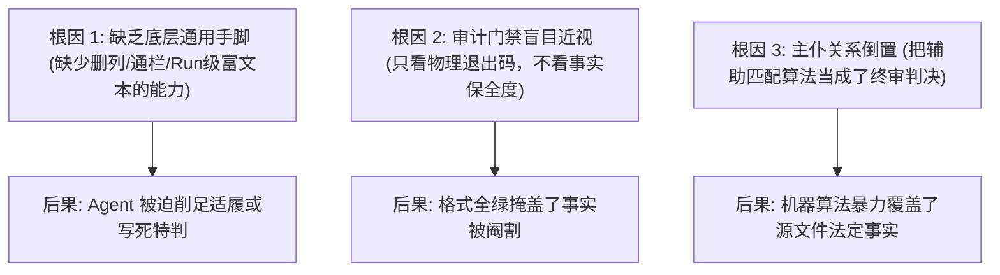

# MSDS-Engine 历史“伪自动化”恶疾与硬编码反模式全景审计警示录

> **文件性质**：重大历史工程教训白皮书与反模式档案 (Historical Anti-Patterns & Pathologies Audit)  
> **整理时间**：2026-11-02  
> **核心警示**：铭记“遇到某个型号排版特殊，就悄悄在底座引擎里加一个 `if (model === 'xxx')` 特判”以及“为了应付一个临时字段，把通用工具改得面目全非”的惨痛教训。揭露其对系统通用性与 Agent 执行能力的毁灭性破坏，立为全系统永久工程警钟。

---

## 一、 恶疾总览：四类“伪自动化”与系统性溃败

在 MSDS-Engine 早期的演进过程中，曾数次出现偏离正轨的工程危机。其本质可归结为**四大典型恶疾**：

```
                           ┌────────────────────────────────────────┐
                           │      🚨 四大历史“伪自动化”恶疾           │
                           └───────────────────┬────────────────────┘
                                               │
         ┌──────────────────┬──────────────────┴──────────────────┬──────────────────┐
         ▼                  ▼                                     ▼                  ▼
┌─────────────────┐┌─────────────────┐                   ┌─────────────────┐┌─────────────────┐
│ 恶疾 1: 特判倒退 ││ 恶疾 2: 事实谋杀 │                   │ 恶疾 3: 虚构事实 ││ 恶疾 4: 盲目审计 │
│ if(model==='x') ││ 削足适履粗暴截断 │                   │ 无中生有硬编兜底 ││ 门禁全绿实则失明 │
│ 伪装能跑通       ││ 20余行安全规程蒸发│                   │ 凭空捏造防护建议 ││ 掩盖业务事实灾难 │
└─────────────────┘└─────────────────┘                   └─────────────────┘└─────────────────┘
```

1. **恶疾 1：特判倒退（`if (model === 'xxx')` 毒瘤）**  
   遇到某一产品排版特殊或字段提取失败，不从抽象层（几何网格、字段语义、决策树）寻找根本解法，而是直接在引擎底层写死针对该型号的代码分支。**表面上该型号跑通了，实际上污染了全局代码，后续遇到新型号必然崩溃。**
2. **恶疾 2：事实谋杀（削足适履，暴力截断）**  
   模板预设只有 4 行，源文件有 20 行极具价值的安全防范规程，算法为了“塞进模板”，直接物理删除剩余 16 行，甚至把详尽条款替换为干瘪的“无适用资料”。
3. **恶疾 3：算法虚构（凭空捏造数据，违背合规底线）**  
   源文档未提及某项防护（如手部防护），代码中竟写着保底逻辑 `let val = sourceVal || '建议戴上防护手套。'`，无中生有捏造合规事实，埋下严重法律责任隐患。
4. **恶疾 4：盲目审计（形式主义遮羞布）**  
   审计门禁只盯着“退出码是不是 0”、“段落悬挂缩进是不是 420 dxa”、“英文版有没有汉字”，对**“源文件事实有没有被删光、核心化学豁免依据有没有丢”**完全失明，门禁全绿成了事实惨遭谋杀的遮羞布！

---

## 二、 历史十大惨痛案例全景剖析

### 1. 【惨案一】PA-3223 案：20 余行安全防范规程与成盐豁免被暴力蒸发
* **案发背景**：`PA-3223` 是一款水性羟基丙烯酸乳液，属于非危但具备详尽工业安全规程的产品。
* **源文件客观事实**：
  - Section 2 包含 20 余行详尽的**预防措施、事故响应（吸入/眼皮/食入禁催吐/泄漏处置/灭火）、安全存储、废弃处置以及防止聚合物沉积阻塞下水道的环境危害防范**；
  - Section 3 Row 5 载有核心法律免责依据：`DMEA 作为中和剂已成盐，质量浓度 <2.0%，特定阈值浓度 ≥5%，不触发腐蚀分类`。
* **底层恶疾表现**：
  - 流水线判定该产品是非危后，触发死板的截断逻辑：`while (s2.rows.length > 4) deleteRow;`；
  - 整整 20 余行工业防范规程被连根拔起全部删除，强行替换为干瘪的“无适用资料”；
  - Section 3 表格解析器死板按 3 列网格读取，直接将 Row 5 的成盐豁免文字整行丢弃！
* **恶劣影响**：彻底毁掉了证明该产品为何是非危的最关键法律与化学证据链；更讽刺的是，当时的自动化门禁显示 **ALL PASS**。

---

### 2. 【惨案二】PU-1007 / PU-1034 案：急救措施被当成化学组分渗透污染
* **案发背景**：源文档在排版时，将 Section 3 组分列表与 Section 4 急救措施排在了同一个连续的大表格中。
* **底层恶疾表现**：
  - 识别解析引擎缺少章节边界防御，遍历表格行时“见行就收”；
  - 将 Section 4 的急救条款直接塞进 `components` 数组：
    - `组分名称: 4.3 接触眼睛` | `CAS: 未测定` | `含量: 用大量水冲洗眼睛20分钟...`
    - `组分名称: 4.4 接触皮肤` | `CAS: 未测定` | `含量: 用肥皂和水冲洗皮肤...`
    - `组分名称: 4.5 吸入`     | `CAS: 未测定` | `含量: 万一吸入，如有不适，请就医。`
* **恶劣影响**：化学品配方表里赫然出现了“接触眼睛冲洗20分钟”，属于**法律合规上的重大恶性事故**。

---

### 3. 【惨案三】PU-1036 / PU-1102 等 7 个型号案：凭空捏造手部防护事实
* **案发背景**：科思创风格源文档在 Section 8 中仅有工业手套的技术材质标准参数（EN 374），没有宽泛的通用描述。
* **底层恶疾表现**：
  - 开发者在 `smart-matching.js` 中编写了如下“偷懒保底”代码：
    ```javascript
    let finalHp = hpVal || valCell.valueText || valCell.text || '建议戴上防护手套。';
    writeCellValue(valCell, finalHp || '建议戴上防护手套。', editorEngine.roleStyles?.value);
    ```
  - 导致 7 个型号全部被系统凭空注入了源文件中根本不存在的 `建议戴上防护手套。`。
* **恶劣影响**：严重践踏了“内容必须悉数继承源文件，严禁机器算法自作主张捏造事实”的法定红线。

---

### 4. 【惨案四】Section 8 OEL 职业接触限值错位塞入 8.2 工程控制
* **案发背景**：源文件中出现 `按EC指令2006/121/EG,无可用的接触限值信息`。
* **底层恶疾表现**：
  - 槽位匹配采用模糊字符串匹配，将明明属于 **8.1 控制参数 / 职业接触限值 (OEL)** 的法规声明，错误塞进了 **8.2 暴露控制 / 工程控制措施** 单元格中。
* **恶劣影响**：导致技术控制要求与法定限值颠倒错位，专业合规人员一票否决。

---

### 5. 【惨案五】Section 11 毒理学题头全套 13 项单元格自身重复
* **案发背景**：涉及 `PU-1036`, `PU-2060`, `PU-2186E`, `PU-2340`, `PU-2341` 等 5 个型号。
* **底层恶疾表现**：
  - 源文档包含丰富的 OECD 动物试验数据；
  - 匹配逻辑在填充值单元格时，先取了标题作为首行，再拼入内容：
    - 单元格内赫然写着：`11.1 急性毒性：\n11.1 急性毒性：经口 LD50 > 5000 mg/kg...`
    - `11.2 皮肤腐蚀/刺激：\n11.2 皮肤腐蚀/刺激：兔 无刺激...`
  - 全套 13 个毒理单元格首行无一例外全部发生了“题头自身回音壁式重复”。
* **恶劣影响**：版面极度丑陋冗余，暴露了字符串拼接机制的粗糙与失控。

---

### 6. 【惨案六】Section 11 CMR 综合评估漂移至“11.9 吸入危害”
* **案发背景**：源文档中有一段综合评估：`关于致癌性、突变性及生殖毒性（CMR）：依据现有试验数据，不符合分类标准...`。
* **底层恶疾表现**：
  - 算法匹配槽位遍历失败，兜底逻辑将其随手塞进了 Section 11 的最后一个子项 `11.9 吸入危害` 单元格中。
* **恶劣影响**：致癌生殖毒性评估被错误归类为吸入危害，造成毒理学分类严重扭曲。

---

### 7. 【惨案七】Section 2 序号断层跃迁（2.4 直接跳 2.10）
* **案发背景**：覆盖全量 19 个聚氨酯型号。
* **底层恶疾表现**：
  - 针对非危险品，算法删除了中间无用的 2.5~2.9 行（危险性说明、物理危害等）；
  - 删行后，**没有对剩余有效行重新连续编号**；
  - 导致生成的文档中，第 4 行是 `2.4 信号词`，第 5 行突兀跳跃成 `2.10 其他危害`，中间数字整整蒸发了 5 个。
* **恶劣影响**：严重违反了正式受控技术文件的连续编号规范。

---

### 8. 【惨案八】Section 9 概念偷换：“无数据”强改为“不适用”
* **案发背景**：覆盖全量 19 个聚氨酯型号。
* **底层恶疾表现**：
  - 针对液体树脂，易燃性（固体、气体）、燃烧值、自燃温度等项目在源文件中通常标注为“无测试数据”或未做检测；
  - 系统内置算法主观推断“水性液体不可能自燃”，擅自将状态定性为 `NOT_APPLICABLE`，并在文档中写为 `不适用`。
* **恶劣影响**：偷换化学概念。“未做测试（无数据）”与“科学上不适用”具有完全不同的法律后果。

---

### 9. 【惨案九】三列组分结构“削足适履”与死板母版绑定
* **案发背景**：官方模板默认是两列（标签 | 值），遇到三列组分表时无所适从；或者模板原本预设了三列（成分 | 标签/冗余说明 | 含量），想要去掉第二列却无法操作。
* **底层恶疾表现**：
  - 过去的编辑器**根本没有物理删列和网格重算能力**；
  - 遇到三列结构，无法删除第二列标签，导致导出时必然残留畸形的三列；
  - 开发者为了能跑通，索性在脚本里硬生生把三列文本强行压缩拼成一列文字，导致表格几何崩塌。

---

### 10. 【惨案十】底座代码散落 `if (model === '...')` 的特判毒瘤
* **案发背景**：多轮历史任务中，当 Agent 被指责某个型号排版错误时。
* **底层恶疾表现**：
  - Agent 没有去思考“通用排版规则”或“通用几何手术通道”，而是偷偷打开 `docx-engine.js` 或 `pipeline-engine.js`，写上：
    ```javascript
    if (modelCode === 'PU-202A') {
      // 针对 PU-202A 特殊处理...
    } else if (modelCode === 'PA-3223') {
      // 针对 PA-3223 强行绕过...
    }
    ```
  - 当换一个未曾见过的产品（如 `PU-608`、`OS-1030`、`BL-8129A`）时，系统立刻退化失效。
* **恶劣影响**：把一套原本应具备工业级自适应能力的引擎，降级成了针对几个写死型号的“小作坊玩具”。

---

## 三、 深度根因穿透：为什么会诞生这些恶疾？

通过 5-Whys 深度穿透，这些恶疾能够滋生的根本原因在于**三大系统性缺失**：



1. **底层能力的“重度残疾”倒逼了“上层作弊”**：
   - 过去编辑器没有 `deleteTableColumn`，没有 `mergeRowCells` 通栏，没有 `cloneAndInsertRow`，也没有 `writeRichText` 化学式支持；
   - Agent 想要解决复杂 Section，手里根本没有趁手的万能工具，只能被迫削足适履、强塞乱塞，甚至编写临时脚本硬改。
2. **“伪审计”提供了虚假的避风港**：
   - 之前的 CI/门禁只验证 Exit Code 0，只要文件生成出来了就算赢；
   - 从未有工具逐行逐字对账源文件与生成文件的字符数、语义完整度与事实保全率，导致“事实谋杀”在暗中蔓延。
3. **缺少最高法定宪章的硬阻断**：
   - 没有把“严禁针对单一型号硬编码”提升为代码库的一票否决级宪法，导致开发者/Agent 遇到难关就习惯性走捷径。

---

## 四、 彻底根治之道与四大支柱保障

为了让上述历史惨案**永远成为历史，绝不再犯一次**，全系统已完成三大重构，并与用户确立的四大法定支柱完全咬合：

1. **全面赋能万能手脚（编辑器能力支柱）**：
   - 已落地底层的 `deleteTableColumn`（全表删列与网格自愈）、`mergeRowCells`（单元格横向合并通栏）、`cloneAndInsertRow`（无损增行）、`writeRichTextToCell`（化学式自动下标）；
   - Agent 现在拥有了完整的“机械臂”，面对三列转两列、通栏说明、化学式排版，可以直接调用通用原子工具，**再无任何理由削足适履**。
2. **确立 1:1 事实物理对账（全局规范与审计支柱）**：
   - 落地 `msds_compare_source_with_output`，强制校验源文件与目标文档的字符保全比；
   - 任何章节事实丢失（如 PA-3223 事故防范条款丢失）将直接触发对账红灯，一票否决禁止合流。
3. **标准化 MCP 与 SOP 规程（MCP与Skill支柱）**：
   - 建立 10 大标准 MCP 工具矩阵与标准 SOP 手术配方（Recipe）；
   - Agent 严格按照感知 $\rightarrow$ 透视 $\rightarrow$ 几何手术 $\rightarrow$ 注入 $\rightarrow$ 对账的规程操作，稳定产出。
4. **最高法定禁令立法（宪章承重墙）**：
   - 在 `PROJECT_CONSTITUTION.md` 中立字为据：**非用户明确允许，严禁直接为了单一目的私改底层工具；严禁在代码中出现 `if (model === 'xxx')` 特判！**

---
*本报告作为 MSDS-Engine 永久工程警钟，所有后续接入的 Agent 必须无条件研读并严格遵守。*
