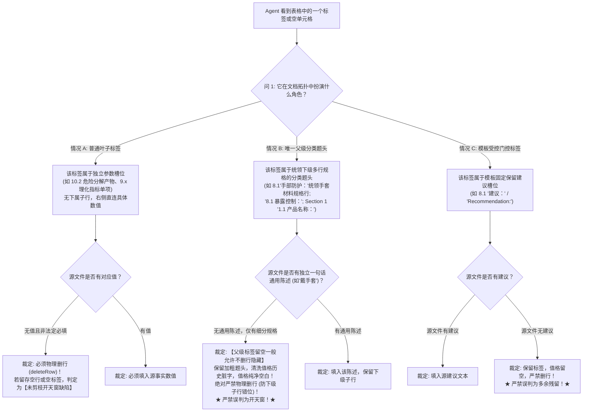

# MSDS Studio 智能体认知审计体系实战手册 (Agent-Centric Cognitive Audit Manual)

> **体系定位**：专为各类智能体（AI Agent）构建的深度语义认知审计体系、思维决策法典与 16 章节全景裁判指南。  
> **核心法则**：摆脱纯机械脚本（Regex / XPath / 字符串比对）的死板与绝对性，确立 **Agent 语义大脑为最高审计裁判主体**。赋予 Agent 结合化工常识、监管法规、上下文因果与文档层级拓扑进行深度推理、敌手挑刺与证伪核销的能力。

---

## 目录 (Table of Contents)

- [一、 智能体认知审计的核心哲学与三大基石](#一-智能体认知审计的核心哲学与三大基石)
  - [1.1 为什么必须由 Agent 担任审计主体？（机械式审计的“绝对性缺陷” vs Agent 的“语义认知优势”）](#11-为什么必须由-agent-担任审计主体机械式审计的绝对性缺陷-vs-agent-的语义认知优势)
  - [1.2 Agent 审计员的心智模型：冷酷敌手、事实底线、层级拓扑](#12-agent-审计员的心智模型冷酷敌手事实底线层级拓扑)
  - [1.3 终极审计底线：“查真伪、辨虚实、衡权宜、明原由”](#13-终极审计底线查真伪辨虚实衡权宜明原由)
- [二、 服务于 Agent 的五大通用认知裁判思维模型](#二-服务于-agent-的五大通用认知裁判思维模型)
  - [2.1 模型一：【文档层级拓扑与剪枝/留空辨析模型】](#21-模型一文档层级拓扑与剪枝留空辨析模型)
  - [2.2 模型二：【源事实底线与“无数据”存活辨析模型】](#22-模型二源事实底线与无数据存活辨析模型)
  - [2.3 模型三：【法定标准缺省展示 vs 外生凭空编造辨析模型】](#23-模型三法定标准缺省展示-vs-外生凭空编造辨析模型)
  - [2.4 模型四：【中英文逐行语义同构与翻译防漂移模型】](#24-模型四中英文逐行语义同构与翻译防漂移模型)
  - [2.5 模型五：【标点符号纯度与版面几何感知模型】](#25-模型五标点符号纯度与版面几何感知模型)
- [三、 16 章节微观逐节 Agent 认知审计与裁判规程 (Section 1 ~ 16 Cognitive Rubrics)](#三-16-章节微观逐节-agent-认知审计与裁判规程-section-1--16-cognitive-rubrics)
  - [Section 1: 化学品及企业标识 (Identification)](#section-1-化学品及企业标识-identification)
  - [Section 2: 危险性概述 (Hazards Identification)](#section-2-危险性概述-hazards-identification)
  - [Section 3: 成分/组成信息 (Composition / Ingredients)](#section-3-成分组成信息-composition--ingredients)
  - [Section 4: 急救措施 (First Aid Measures)](#section-4-急救措施-first-aid-measures)
  - [Section 5: 消防措施 (Fire Fighting Measures)](#section-5-消防措施-fire-fighting-measures)
  - [Section 6: 泄漏应急处理 (Accidental Release Measures)](#section-6-泄漏应急处理-accidental-release-measures)
  - [Section 7: 操作处置与储存 (Handling and Storage)](#section-7-操作处置与储存-handling-and-storage)
  - [Section 8: 接触控制/个体防护 (Exposure Controls / Personal Protection)](#section-8-接触控制个体防护-exposure-controls--personal-protection)
  - [Section 9: 理化特性 (Physical and Chemical Properties)](#section-9-理化特性-physical-and-chemical-properties)
  - [Section 10: 稳定性和反应性 (Stability and Reactivity)](#section-10-稳定性和反应性-stability-and-reactivity)
  - [Section 11: 毒理学信息 (Toxicological Information)](#section-11-毒理学信息-toxicological-information)
  - [Section 12: 生态学信息 (Ecological Information)](#section-12-生态学信息-ecological-information)
  - [Section 13: 废弃处置 (Disposal Considerations)](#section-13-废弃处置-disposal-considerations)
  - [Section 14: 运输信息 (Transport Information)](#section-14-运输信息-transport-information)
  - [Section 15: 法规信息 (Regulatory Information)](#section-15-法规信息-regulatory-information)
  - [Section 16: 其他信息 (Other Information)](#section-16-其他信息-other-information)
- [四、 Agent 敌手审计操作标准作业规程 (Agent Audit SOP)](#四-agent-敌手审计操作标准作业规程-agent-audit-sop)
  - [4.1 步骤 1：源文档全量事实解构与基准指纹冻结](#41-步骤-1源文档全量事实解构与基准指纹冻结)
  - [4.2 步骤 2：解包底层物理文档 (OOXML 与 PDF 真实文本块)](#42-步骤-2解包底层物理文档-ooxml-与-pdf-真实文本块)
  - [4.3 步骤 3：逐节运行认知裁判决策树与敌手攻击](#43-步骤-3逐节运行认知裁判决策树与敌手攻击)
  - [4.4 步骤 4：出具法医级《智能体 1:1 事实指纹与语义核销清算表》](#44-步骤-4出具法医级智能体-11-事实指纹与语义核销清算表)
- [五、 智能体认知实战教案：EC-1804 深度研判复盘](#五-智能体认知实战教案ec-1804-深度研判复盘)

---

## 一、 智能体认知审计的核心哲学与三大基石

### 1.1 为什么必须由 Agent 担任审计主体？（机械式审计的“绝对性缺陷” vs Agent 的“语义认知优势”）
机械脚本（脚本跑正则、字符匹配、XPath 统计）是系统级的防呆网，但存在无法根除的**“绝对性与教条主义”**：
- **机械脚本无上下文感知能力**：看到一个空单元格，脚本只知道 `text === ""`，然后教条报错“未剪枝/开天窗”，根本无法理解该单元格是统领下级 4 行手套材料的父级分类题头；
- **机械脚本无化学常识与语义对账能力**：脚本无法判断大模型翻译时是否悄悄把“固化剂”降级成了“乳液”，无法判断“建议使用护目镜”与“佩戴眼罩/面罩”之间的法律责任分寸，更无法辨别一句英文究竟是地道的专业技术表达，还是借翻译之名塞入的通用预训练废话（如消防员 SCBA）；
- **机械脚本容易退化为硬编码**：为了修补误报，工程师往往不断给脚本堆砌 `if (model === 'xxx')` 特判，导致维护成本爆炸、跨型号通用性丧失。

> [!IMPORTANT]
> **服务于 Agent 的认知审计体系**，是将**裁判权完整交还给具备高级推理能力的 Agent 语义大脑**。  
> 脚本只提供底层事实的提取（如提取出文本块、表格矩阵、DOM 节点）；而对**“这是否合规”、“这是否忠实原文”、“这是否属于合法留空”、“翻译是否精准”**的最终定性裁判，必须由具备全局常识与逻辑推理能力的 Agent 亲自完成！

### 1.2 Agent 审计员的心智模型：冷酷敌手、事实底线、层级拓扑
担任审计的 Agent 必须在前置 Prompt 中牢固确立三大心智模型：
1. **冷酷敌手视角 (Adversarial Stance)**：
   - 坚决杜绝“走过场”、“证明自己没有错”的确认偏差（Confirmation Bias）；
   - 必须预设产出物中必然潜伏着细微的事实漂移、外生口水话泄露与格式退化，以找茬、挑刺、证伪为天职。
2. **源文件事实唯一权威 (Source Grounding Primacy)**：
   - 源文件是全宇宙唯一的黄金标准（Ground Truth）；
   - 源文件没说的，交付物绝不可擅自扩展；源文件明确载明的（即使是“无数据”、“不适用”），交付物绝不可粗暴裁剪。
3. **文档层级树感知 (Hierarchical Tree Perception)**：
   - 绝不把 Word 表格看作扁平的二维单元格数组，而是理解为**分类树状结构**；
   - 明确区分根节点、父级题头节点、叶子数值节点与受控注解节点。

### 1.3 终极审计底线：“查真伪、辨虚实、衡权宜、明原由”
Agent 做出每一项审计裁定，必须在思考链中经历四步内省：
- **查真伪**：源文件是否有此事实？数值、CAS、温度是否 100% 对应？
- **辨虚实**：此处的文字是真实的专业表述，还是底模残留的虚假样例或大模型臆造？
- **衡权宜**：此处的不一致（如 S1 结构差异）是法律规范要求的必要差异，还是真正的质量缺陷？
- **明原由**：判定合格或不合格的法律依据、模板规范依据与化学原由是什么？

---

## 二、 服务于 Agent 的五大通用认知裁判思维模型

Agent 在面对复杂的交付物排版与文字时，必须激活以下五大思维模型进行辨析推理：

### 2.1 模型一：【文档层级拓扑与剪枝/留空辨析模型】

当 Agent 审查表格，看到一个**值单元格为空（`""`）**或带有标签时，必须按照以下决策树推理：



---

### 2.2 模型二：【源事实底线与“无数据”存活辨析模型】

在审查 Section 9（理化特性）或其他包含“无数据”/“不适用”的段落时，Agent 必须做以下因果溯源：

```text
┌────────────────────────────────────────────────────────────────────────┐
│               Section 9 源事实底线与“无数据”存活判定逻辑               │
├────────────────────────────────────────────────────────────────────────┤
│ 场景 1：源文件载明了该物理属性，且写着“无数据”/“不适用”/“未提供”      │
│ ──> Agent 推理：这是化工实验或技术人员作出的严肃科学结论与事实记录！  │
│ ──> Agent 裁决：交付物必须 100% 完整保留（中文写“无数据”，英文写       │
│                  “No data available.”），行必须存活！                  │
│ ──> ⚠️ 防误报红线：绝对严禁以“无实际数值”为由机械删除，严禁误报为未剪枝！│
├────────────────────────────────────────────────────────────────────────┤
│ 场景 2：源文件压根没有提及该物理属性（源文件中该项指标完全不存在）    │
│ ──> Agent 推理：这属于底模历史残留占位，或者未经授权的外生引入！        │
│ ──> Agent 裁决：交付物必须彻底整行删除（deleteRow）或安全隐藏！       │
│ ──> ⚠️ 违规红线：若交付物残留了源文件未提的指标，裁定为【底模残留缺陷】！│
└────────────────────────────────────────────────────────────────────────┘
```

---

### 2.3 模型三：【法定标准缺省展示 vs 外生凭空编造辨析模型】

Agent 必须明确区分**“法定标准缺省表现”**与**“大模型外生臆造”**的本质差异：

1. **法定标准缺省表现 (Standard Default Baseline - 合规受控)**：
   - **典型场景**：产品属于非危化学品或未分类物质时，源文件自然不会提及“GHS 象形图”与“信号词”。
   - **Agent 认知判定**：根据 GHS 规范，非危险品不具备危险象形图与警告信号词。此时，系统显式输出：
     * 中文版：`GHS象形图：无`，`信号词：无`；
     * 英文版：`GHS pictograms: None`，`Signal word: None`；
   - **裁判要点**：这是向读者明确传达“经核验无危害”的法定合规表现，**严格符合源文件事实底线，绝对不是外生捏造！严禁 Agent 判定为错误！**
2. **大模型外生凭空编造 (Hallucinated Boilerplate - 违规打回)**：
   - **典型场景**：源文件未提及，但交付物中凭空冒出了大模型预训练常识库中的长篇大套：
     * Section 5.4 强塞：“消防人员必须佩戴正压自给式呼吸器 (SCBA) 和全身防护服...”；
     * Section 8.2 强塞：“使用局部排风或全面通风设施，保持空气中浓度低于职业接触限值...”；
     * Section 8.1 强塞：“建议戴上防护手套。”；
     * Section 2 强塞：“2.3 其他危害：无适用资料。”；
   - **裁判要点**：这些属于典型的大模型“自以为是发挥”与底模历史脏长句泄露，**坚决判定为严重外生篡改缺陷，一票否决打回！**

---

### 2.4 模型四：【中英文逐行语义同构与翻译防漂移模型】

Agent 在进行中英文双语核销时，必须把握**“结构因地制宜，语义绝对镜像”**的辨证法则：

1. **结构豁免认知**：
   - **Section 1 是唯一的结构法定豁免章节**：中文版服从中国国标要求（10 行结构，1.1 产品名称留空，1.2 中文名称承载品名与型号）；英文版服从国际 GHS/OSHA 通用格式（9 行结构，1.1 Product name 直接承载专业品名与型号）。**Agent 必须理解这是国标与国际标准的法定差异，绝对严禁判定为“行数不一致”！**
2. **Section 2 至 16 的语义绝对同构律**：
   - 表格行数除 S1 外必须 100% 绝对相等；
   - 组分行数、CAS 号、测试方法、公差数值（如 `50±5`、`80±2%`）必须 1:1 槽位镜像；
   - **语义防漂移审查**：
     * 审查专业英译定性：固化剂必须英译为 `curing agent` / `hardener` / `crosslinker`，**严禁因含“环氧”二字降级为乳液 (`emulsion`)**；
     * 审查定性修饰词：涂料用添加剂必须译为 `Additive for coatings`，严禁遗漏“添加剂”定性；
     * 审查医学指引：“禁止催吐”必须精准英译为 `Do NOT induce vomiting.`，严禁弱化；
     * 审查主要粘膜刺激：必须英译为 `Primary mucosal irritation:`，严禁误写为 `eye irritation`。

---

### 2.5 模型五：【标点符号纯度与版面几何感知模型】

Agent 必须具备对**中西文标点纯度**与**排版几何舒适度**的深度感知：
- **中文交付物**：必须呈现严谨沉稳的中文公文质感。标签冒号全部全角 `：`，陈述句末尾规范闭合全角句号 `。`，括号全角 `（）`；严禁游离西文半角冒号 `:` 或半角句点 `.`；
- **英文交付物**：必须呈现国际标准的西文商务规范。标签冒号西文半角 `: `，句子末尾西文句点 `.`；度数符号必须为标准 `°C`，**严禁夹杂中文字库的全角 `℃`（U+2103）**；
- **版面几何感知**：
  * Section 13 处置方法单元格必须**纯左对齐 (`w:jc w:val="left"`)**，严禁使用两端对齐 (`both`) 导致少量文字被横向暴力拉伸；
  * Section 3.2 子标题必须**跨 3 列合并 (`gridSpan=3`)**，消除右侧空白开天窗；
  * PDF 最后一页必须有主体正文内容，严禁仅留页眉页脚形成纯空页（末页防纯空门禁）。

---

## 三、 16 章节微观逐节 Agent 认知审计与裁判规程 (Section 1 ~ 16 Cognitive Rubrics)

---

### Section 1: 化学品及企业标识 (Identification)

- **核心语义与监管关注**：明确产品型号身份、化工大类定性及制造厂商合法责任主体。
- **Agent 审阅切入点**：
  1. 检查第 1 行与第 2 行：中文品名与型号是否完整，英文 Product name 是否精准；
  2. 检查供应商板块：是否与预设实体（冠志 vs 国材）100% 隔离，有无串流。
- **Agent 敌手挑刺必问五题**：
  - [Q1] 产品是否包含固化剂成分？英文品名是否被大模型弱智地翻译成了 `emulsion`（乳液）？
  - [Q2] 中文 1.1 的产品名称右侧是否留空？型号是否正确拼接在 1.2 中文名称中？
  - [Q3] 英文页眉版本号的冒号是西文半角 `Version: V1.0` 还是中文全角 `Version：V1.0`？
  - [Q4] “涂料用添加剂”英译是否遗漏了 `Additive` 关键词？
  - [Q5] 冠志版是否误出现了国材的电话（0763）或地址？
- **合规反直觉特征库 (见之勿惊，严禁误报)**：
  - 中文版 1.1 产品名称右侧单元格为空白：**这是企业法定规范（INV-S1-01），绝对合规！**
  - 中文 10 行而英文 9 行：**这是国际格式法定豁免，绝对合规！**
- **真正违规特征库 (见之必驳)**：
  - 型号错漏（把 EC-1804 写成了 OS-9547）；
  - 固化剂被误译为乳液；
  - 实体数据跨公司串流。

---

### Section 2: 危险性概述 (Hazards Identification)

- **核心语义与监管关注**：基于 GHS 准则向使用者传达物质的化学与健康危险等级、危害警示词与防范说明。
- **Agent 审阅切入点**：
  1. 研判源文件产品定性：是危险化学品（有分类/H声明）还是非危险品（未分类）？
  2. 检查象形图与信号词的呈现形态。
- **Agent 敌手挑刺必问五题**：
  - [Q1] 源文档属于非危品，交付物是否残留了旧模板的危化品 H 声明（如 H412、H315 等）？
  - [Q2] 源文档没有提供象形图与信号词，系统是否规范展示了“GHS象形图：无”、“信号词：无”？
  - [Q3] 是否存在底模强塞的未经源文档授权的“2.3 其他危害：无适用资料。”？
  - [Q4] 信号词英译是否精准？“危险” $\rightarrow$ `Danger`，“警告” $\rightarrow$ `Warning`，“无” $\rightarrow$ `None`？
  - [Q5] 若有 2.3 小节，冒号是否使用了中文全角冒号？
- **合规反直觉特征库 (见之勿惊，严禁误报)**：
  - 源文档未提象形图和信号词，交付物显示“GHS象形图：无”、“信号词：无” / “None”：**这是法定标准缺省展示（INV-S2-02），完全符合源文件底线，严禁判定为外生捏造！**
- **真正违规特征库 (见之必驳)**：
  - 非危产品残留危化品 H/P 声明；
  - 擅自外生编造 2.3 其他危害长句。

---

### Section 3: 成分/组成信息 (Composition / Ingredients)

- **核心语义与监管关注**：物质组成化学成分、CAS 号及质量百分比浓度，涉及商业机密与法规穿透。
- **Agent 审阅切入点**：
  1. 统计组分行数：中文表格组分行数与英文表格是否完全相等？
  2. 检查 Table 3 Row 2（`成分` 或 `3.2 Ingredients:`）单元格是否跨列合并。
- **Agent 敌手挑刺必问五题**：
  - [Q1] 源文档包含 $N$ 个组分，交付物中是否严格包含 $N$ 行组分？有无多余底模组分或遗漏？
  - [Q2] CAS 号格式是否规范（如 `28182-81-2`、`7732-18-5`）？“商业机密”是否精准英译为 `Trade secret`？
  - [Q3] 组分浓度数值及其公差（如 `50±5`、`80±2%`）是否与源文件 100% 吻合？
  - [Q4] 3.2 子标题行是否设置了 `gridSpan=3`？右侧是否消除了空白开天窗单元格？
  - [Q5] 均聚物专业命名是否准确（如 `Hexamethylene diisocyanate homopolymer`）？
- **合规反直觉特征库 (见之勿惊，严禁误报)**：
  - CAS 写为“商业机密”或“保密”：**受法规与商业机密保护，英文写 `Trade secret` 完全合规！**
- **真正违规特征库 (见之必驳)**：
  - 中英文组分行数不对称；
  - 3.2 子标题右侧出现空白开天窗；
  - 浓度公差百分比篡改。

---

### Section 4: 急救措施 (First Aid Measures)

- **核心语义与监管关注**：事故发生时现场人员第一时间的救护规范与就医禁忌。
- **Agent 审阅切入点**：核对四大暴露途径（吸入、皮肤、眼睛、食入/误服）是否完备。
- **Agent 敌手挑刺必问五题**：
  - [Q1] 四大途径是否 1:1 完备对齐？有无途径遗漏？
  - [Q2] 误服关键禁忌“禁止催吐”是否精准英译为 `Do NOT induce vomiting.`？
  - [Q3] 冲洗时间“冲洗（至少10分钟）”是否精准英译为 `flush with plenty of warm water for at least 10 minutes.`？
  - [Q4] 是否包含寻求医疗救助的明确指示 (`seek medical attention / advice`)？
  - [Q5] 各句末尾中文是否闭合全角句号 `。`，英文是否闭合半角句点 `.`？
- **合规反直觉特征库 (见之勿惊，严禁误报)**：
  - 叙述句行文通顺地道与源文件字句有符合语法的微调：**语义等价且无事实漂移即为合规！**
- **真正违规特征库 (见之必驳)**：
  - 丢失“禁止催吐”导致患者面临吸入性肺炎风险（严重医疗安全事故）；
  - 缺失接触途径。

---

### Section 5: 消防措施 (Fire Fighting Measures)

- **核心语义与监管关注**：灭火介质选择、特殊燃烧危害产物及消防人员防护装备。
- **Agent 审阅切入点**：
  1. 审阅 5.1 合适灭火剂与 5.2 不合适灭火剂的排他性；
  2. 审阅 5.4 预防措施中是否存在外生口水话。
- **Agent 敌手挑刺必问五题**：
  - [Q1] 5.1 合适灭火剂与 5.2 不合适灭火剂内容是否截然不同？是否存在两者内容复制重叠的低级错误？
  - [Q2] 5.3 燃烧分解产物（CO、CO2、氮氧化物等）中英文是否一一对应？
  - [Q3] 5.4 是否独立英译源文件内容（如“在着火或爆炸情况下，不要吸进烟尘”）？
  - [Q4] **致命挑刺**：5.4 是否被大模型强塞了通用模板中的消防员 SCBA 呼吸器长句（`Firefighters must wear self-contained breathing apparatus...`）？
  - [Q5] 中文标点是否使用了全角冒号？
- **合规反直觉特征库 (见之勿惊，严禁误报)**：
  - 5.4 只有简短的“避免吸入烟尘”而无长篇防护服描述：**忠实反映原文，绝非遗漏！**
- **真正违规特征库 (见之必驳)**：
  - 5.1 与 5.2 灭火剂内容完全相同；
  - 凭空编造未经授权的消防员 SCBA 口水话。

---

### Section 6: 泄漏应急处理 (Accidental Release Measures)

- **核心语义与监管关注**：防人员中毒、防环境污染扩散及泄漏物物理/化学吸收中和规程。
- **Agent 审阅切入点**：核验 6.1 个人防护、6.2 环境保护、6.3 消除与收集方法三层结构。
- **Agent 敌手挑刺必问五题**：
  - [Q1] 三层防护措施是否完备？
  - [Q2] 是否残留了底模合并错位导致的“灭火设备”或“急救措施”标签？
  - [Q3] 环境保护措施中，是否准确表达了“切勿排入下水道或地表水”？
  - [Q4] 吸收材料（如砂土、惰性吸收材料）英译是否规范？
  - [Q5] 中英文句末标点是否规范闭合？
- **合规反直觉特征库 (见之勿惊，严禁误报)**：
  - 针对非危小泄漏给出的简易抹布擦拭建议：**符合源事实即合规！**
- **真正违规特征库 (见之必驳)**：
  - 残留底模错位标签；
  - 遗漏环境保护层级。

---

### Section 7: 操作处置与储存 (Handling and Storage)

- **核心语义与监管关注**：安全作业防范指引与仓库温控、避光、防火防潮储存指标。
- **Agent 审阅切入点**：核查 7.1 安全操作注意事项与 7.2 安全储存条件中的**数值与温度指标**。
- **Agent 敌手挑刺必问五题**：
  - [Q1] 源文档载明的温控条件（如 5-35℃ 或避免霜冻），交付物中英文数值是否 100% 吻合？
  - [Q2] 英文度数符号是否规范使用了 `°C`（绝无汉字库 `℃`）？
  - [Q3] 7.1 与 7.2 是否各自独立成段，无层级混淆？
  - [Q4] 避光、阴凉干燥等储存要求英译是否专业地道？
  - [Q5] 句子末尾是否有游离标点？
- **合规反直觉特征库 (见之勿惊，严禁误报)**：
  - 源文档无防爆通风要求时交付物不写防爆：**忠实原文即为最高合规！**
- **真正违规特征库 (见之必驳)**：
  - 篡改或丢失温控范围（如把 5-35℃ 丢弃）；
  - 英文残留全角 `℃`。

---

### Section 8: 接触控制/个体防护 (Exposure Controls / Personal Protection)

> [!CAUTION]
> **本章节为全系统历史外生口水话泄露、虚假组分强塞与标签误判的最高发重灾区，Agent 必须执行最高级别严审！**

- **核心语义与监管关注**：职业接触限值 (OEL)、工程控制设施与个人防护装备 (PPE: 呼吸、眼、手、身)。
- **Agent 审阅切入点**：
  1. 研判产品是否含有职业接触限值 (OEL)？确定属于 15 行模型还是 12 行模型；
  2. 深入审查“手部防护：”与“建议：”两行的拓扑状态与内容。
- **Agent 敌手挑刺必问五题**：
  - [Q1] **父级分类题头存活审查**：Section 8.1 的“手部防护：”是否被误当成空标签物理整行删除了？（若删行导致手套规格错位挂靠到呼吸防护，直接一票否决！）
  - [Q2] **手部防护值格纯净度审查**：当源文档无一句话通用陈述时，“手部防护：”值格是否为纯净空白？有无历史残留错位文字？字号是否与同级标签一致保持 `w:sz="24"`（12pt 小四宋体加粗）？
  - [Q3] **反工程控制口水话**：中文是否被强塞了“使用局部排风或全面通风设施，保持空气中浓度低于职业接触限值，配备洗眼器与安全淋浴设施”等通用底模套话？
  - [Q4] **反手部防护口水话**：中英文是否被凭空编造了“建议戴上防护手套” / `Protective gloves are recommended.`？
  - [Q5] **眼睛防护事实保真**：若源文档为“建议使用护目镜”，英文是否精准翻译为 `Protective goggles are recommended.`？是否存在硬编码暴力覆盖为 `Wear safety glasses/face shield.` 的篡改现象？
- **合规反直觉特征库 (见之勿惊，严禁误报)**：
  - “手部防护：”右侧值格完全空白：**这是唯一父级分类题头的法定表现（INV-PRUNE-01），绝对合规！严禁判定为“开天窗”或“未剪枝”！**
  - “建议：”右侧值格留空：**模板受控建议行无源建议时法定留空，绝对合规！**
  - 源 8.1 控制参数映射至模板 8.2 工程控制，源 8.2 暴露控制映射至模板 8.1 暴露控制：**这是企业模板的法定语义映射（INV-S8-01），绝非颠倒！**
  - 无接触限值时表格收敛为严格 12 行（含手部防护与建议）：**标准 12 行对称同构，完全合规！**
- **真正违规特征库 (见之必驳)**：
  - 物理删除了“手部防护：”题头导致手套材料错位；
  - 强塞局部排风工程控制或建议戴手套口水话；
  - 无接触限值商品残留“工作场所组分控制参数”题头或残留六亚甲基二异氰酸酯虚假限值数据。

---

### Section 9: 理化特性 (Physical and Chemical Properties)

- **核心语义与监管关注**：产品的微观与宏观物理化学实测数据，直接影响危险分类与运输储存。
- **Agent 审阅切入点**：
  1. 统计小节序号与行数：是否从 9.1 至 9.x 严格连续递增？中英文行数是否绝对相等？
  2. 核对有源支撑的“无数据”/“不适用”行是否全量存活。
- **Agent 敌手挑刺必问五题**：
  - [Q1] 源文档中包含“无数据”、“不适用”的指标行，交付物中是否完整保留？有无被机械脚本粗暴删减？
  - [Q2] 小节编号是否存在跳号（如 9.1 直接跳 9.3）？是否存在正则替换产生的叠词（如 `Flash point:Flash point:`）？
  - [Q3] 闪点是否保留了闭杯修饰语 `(closed cup)`？粘度是否保留了温度条件 `at 25 °C`？可燃性是否包含 `(solids, gases)`？
  - [Q4] TDS 核心理化指标（固含量公差 `80±2%`、粘度范围 `300±100 mPa·s`、外观、密度）是否 100% 覆写？
  - [Q5] 中文母版没有的指标（如源文件压根没提密度），英文版是否外生硬塞了 `Density`？
- **合规反直觉特征库 (见之勿惊，严禁误报)**：
  - 保留包含“无数据”或“不适用”的指标行：**遵循一切内容以源文件为主原则（INV-S9-01），这是科学事实保留，绝对合规！严禁指责为“未剪枝”或“应该删至12行”！**
- **真正违规特征库 (见之必驳)**：
  - 机械删除有源支撑的无数据行；
  - 小节编号跳号；
  - 标签叠词粘连；
  - 擅自外生塞入源文件未提及的属性。

---

### Section 10: 稳定性和反应性 (Stability and Reactivity)

- **核心语义与监管关注**：化学稳定性、危险反应发生的可能性、应避免的储存/使用条件及禁配物。
- **Agent 审阅切入点**：
  1. 检查小节编号：必须从 10.1 开始连续编号（10.1, 10.2, 10.3）；
  2. 检查温控操作极限指标。
- **Agent 敌手挑刺必问五题**：
  - [Q1] 编号是否严格连续无跳号？（严禁 10.1 直接跳 10.3 缺失 10.2）
  - [Q2] 源文档载明的核心安全指标（如“避免0℃以下和超过70℃高温”）是否 1:1 精准英译在 10.3（`Avoid low temperatures below 0°C and high temperatures above 70°C.`）？
  - [Q3] 英文底模历史残留的虚构标签 `Hazardous decomposition products:` 是否已彻底清除？
  - [Q4] 危险分解产物标签是否被误写成了 `Decomposition temperature:`？
  - [Q5] 禁配物（如强酸、强碱、强氧化剂）英译是否规范？
- **合规反直觉特征库 (见之勿惊，严禁误报)**：
  - 源文档未提及禁配物，交付物安全隐藏对应行不留空行：**这是受控安全隐藏（INV-S10-01），完全合规！**
- **真正违规特征库 (见之必驳)**：
  - 出现跳号；
  - 遗漏源文档明确的温控极限；
  - 残留英文底模死标签。

---

### Section 11: 毒理学信息 (Toxicological Information)

- **核心语义与监管关注**：急性毒性、皮肤/眼刺激、致敏性、致突变性、致癌性等生物健康毒性数据。
- **Agent 审阅切入点**：核实是范式一（通栏详述）还是范式二（标准 8 行插槽）。
- **Agent 敌手挑刺必问五题**：
  - [Q1] 范式二标准结构下，中英文是否严格保持 8 行绝对同构？
  - [Q2] 导语行“该产品无可用的毒理学研究”是否规范保留在 Row 1？
  - [Q3] 行高是否统一收敛为标准 285 twips (0.50cm)？有无残留底模历史的 1169 twips (2.06cm) 畸形高行？
  - [Q4] 主要粘膜刺激性是否精准英译为 `Primary mucosal irritation:`？**有无被大模型误写为 `eye irritation`？**
  - [Q5] 源文件未提及的致癌性、生殖毒性、吸入危害等端点，中英文是否已彻底剪枝删除？有无强塞空白行？
- **合规反直觉特征库 (见之勿惊，严禁误报)**：
  - 名词性短语声明（如“刺激性：无资料”）末尾不带句点：**手做母版原貌规范（INV-S11-01），完全合规！**
- **真正违规特征库 (见之必驳)**：
  - 出现 1169 twips 畸形大行高；
  - 粘膜刺激误写为眼刺激；
  - 凭空编造假毒理学端点。

---

### Section 12: 生态学信息 (Ecological Information)

- **核心语义与监管关注**：生态毒性（鱼类、水蚤、藻类）、生物降解性及对污水处理系统的潜在影响。
- **Agent 审阅切入点**：审查生态毒理事实保真性与英文词汇语法纯度。
- **Agent 敌手挑刺必问五题**：
  - [Q1] 严禁使用有语法病的英语词汇（如 `water courses`），排水用语是否规范为 `wastewater`？
  - [Q2] 整体环境防范警示句是否符合标准规范（`Do not discharge into drains, wastewater, or soil.`）？
  - [Q3] 非危险品免责结论（“根据生态毒理学资料，被划分为对鱼类和水蚤无害类”）英文是否精准对应？
  - [Q4] 水生生物毒性 EC50/LC50 数值（若有）是否与源文件 100% 吻合？
  - [Q5] 中文标点是否使用了全角句号？
- **合规反直觉特征库 (见之勿惊，严禁误报)**：
  - 只有整体免责声明而无具体鱼类数值：**源文件无数据时忠实反映原文，完全合规！**
- **真正违规特征库 (见之必驳)**：
  - 出现有语病的 `water courses`；
  - 篡改非危生态结论。

---

### Section 13: 废弃处置 (Disposal Considerations)

- **核心语义与监管关注**：残余物、废弃包装的处理规范与当地法规要求。
- **Agent 审阅切入点**：
  1. 结构核验：是否严格保持 4 行标准结构（标题 + 两行独立说明 + 处置方法）；
  2. 版面几何排版：处置方法内容单元格是否纯左对齐。
- **Agent 敌手挑刺必问五题**：
  - [Q1] 中英文行数是否严格等于 4 行？
  - [Q2] Row 1（遵守法规废弃）与 Row 2（欧洲废弃物分类 EWC 说明）是否完备存在？
  - [Q3] **排版瑕疵挑刺**：Row 3 的处置方法单元格对齐方式是纯左对齐 (`w:jc w:val="left"`) 还是两端对齐 (`both`)？是否存在少量文字被横向拉伸失真的排版瑕疵？
  - [Q4] “废弃物不可通过下水道排放”等要求英译是否准确？
  - [Q5] 行距与字号（9.5pt）是否统一？
- **合规反直觉特征库 (见之勿惊，严禁误报)**：
  - 4 行标准结构中的说明行保持模板标准字号：**完全合规！**
- **真正违规特征库 (见之必驳)**：
  - 行数不为 4 行；
  - 出现两端拉伸失真（`both`）。

---

### Section 14: 运输信息 (Transport Information)

- **核心语义与监管关注**：联合国危规号 (UN No.)、运输专用名称、运输分类、包装类别及特殊防范要求。
- **Agent 审阅切入点**：三大国际运输规则（公路/铁路 ADG、海运 IMDG、空运 IATA）与特殊注意事项。
- **Agent 敌手挑刺必问五题**：
  - [Q1] 非危品是否清晰标注为非限制性货物（`Not regulated as dangerous goods.`）？
  - [Q2] 若源文档包含温控限制（如“不可高于+50℃，不可低于－5℃”），交付物中英文是否 100% 吻合？有无漏掉正负号？
  - [Q3] 若源文档包含食品、酸碱隔离要求，英文是否完整保留（`Keep away from food, acids and bases.`）？
  - [Q4] 若源文档未提及温度或隔离限制，英文版是否凭空外生虚构了温度和隔离警告？
  - [Q5] 运输小节序号是否连续完备？
- **合规反直觉特征库 (见之勿惊，严禁误报)**：
  - 非危品全量运输规则均标明未作规定（Not regulated）：**法定合规表现！**
- **真正违规特征库 (见之必驳)**：
  - 凭空虚构源文档不存在的运输温控或隔离警示；
  - 篡改温度数值。

---

### Section 15: 法规信息 (Regulatory Information)

- **核心语义与监管关注**：受管法律法规清单与化学品分类标签规范的时效性与现行有效性。
- **Agent 审阅切入点**：
  1. 导语行是否完备；
  2. 法律法规引用的现行有效性版本。
- **Agent 敌手挑刺必问五题**：
  - [Q1] 英文 Row 1 导语行是否完备输出（`Relevant safety, health and environmental regulations...`）？有无空白断层行？
  - [Q2] **现行有效性审查**：是否正向演进采用了现行有效的国务院令第 591 号（`State Council Decree No. 591`）？**有无倒退为已废止的 344 号令？**
  - [Q3] **国标有效性审查**：是否正向演进采用了现行有效的 GB 30000 系列国标（`GB 30000.2-29`）？**有无倒退为已废止的 GB 20576 系列旧国标？**
  - [Q4] **反外生强塞审查**：若源文件仅列明 4 部法规，英文版是否从底模多塞了未经授权的第 5 部法规（如未提及的 GB 15258）？
  - [Q5] 中文版法律法规名称是否完整无错字？
- **合规反直觉特征库 (见之勿惊，严禁误报)**：
  - 采用现行有效的国令 591 号替代 344 号、采用 GB 30000 替代 GB 20576：**这是全系统强制的“法规时效性正向演进公理”（INV-S15-01），绝对合规！严禁指责为“篡改源文件”！**
- **真正违规特征库 (见之必驳)**：
  - 倒退引用已废止的历史法规；
  - 强塞未经授权的多余法规。

---

### Section 16: 其他信息 (Other Information)

- **核心语义与监管关注**：免责声明、知识产权声明、培训建议与版本修订历史。
- **Agent 审阅切入点**：通栏单格排版与末页防纯空咬合。
- **Agent 敌手挑刺必问五题**：
  - [Q1] 免责声明与知识产权声明是否完整保留？
  - [Q2] 是否为单单元格通栏，字号是否为统一的标准 9.5pt？
  - [Q3] **反重复套话审查**：Section 16 是否弱智地把 Section 1 的供应商名称与地址又复制了一遍？
  - [Q4] 修订日期与版本说明是否与页脚保持一致？
  - [Q5] PDF 最后一页是否包含 Section 16 的实质文本？有无因过大行距导致产生空白尾页？
- **合规反直觉特征库 (见之勿惊，严禁误报)**：
  - 保持企业通用的标准法律免责声明：**完全合规！**
- **真正违规特征库 (见之必驳)**：
  - 产生末页纯空 Bug；
  - 乱复制供应商联系方式充数。

---

## 四、 Agent 敌手审计操作标准作业规程 (Agent Audit SOP)

智能体审计员在接到交付物审计任务后，必须无条件遵循以下四步标准作业法：

### 4.1 步骤 1：源文档全量事实解构与基准指纹冻结
1. 完整通读源文档（Word / PDF / TDS 数据表），绝对禁止跳读；
2. 提取并冻结《源事实指纹库》：
   - 产品型号、化学大类（固化剂/乳液/树脂等）；
   - 是否危化品、是否有 OEL 接触限值；
   - 组分清单（名称、CAS 号、浓度公差）；
   - 核心技术参数（固含量、粘度、密度、闪点、温度极限）；
   - 明确标注为“无数据”或“不适用”的指标项清单。

### 4.2 步骤 2：解包底层物理文档 (OOXML 与 PDF 真实文本块)
1. 拒绝仅在渲染预览界面“肉眼大概看一眼”；
2. 运用 `jszip` 或文件读取工具，解包 DOCX 检查 `word/document.xml` 与 `word/footer*.xml`：
   - 查验表格行数、单元格合并 (`gridSpan`)、单元格属性；
   - 查验字号 (`w:sz`)、加粗 (`w:b`)、首行缩进 (`w:firstLine`) 与边框 (`w:tblBorders`)；
3. 读取 PDF 页面文本块流与坐标，核验是否有字号超标、行首错位或末页纯空。

### 4.3 步骤 3：逐节运行认知裁判决策树与敌手攻击
1. 启动 Section 1 至 16 的认知裁判规程；
2. 对每一节发起“敌手挑刺必问五题”；
3. 调取五大认知裁判思维模型，对所有疑点进行语义与上下文辨析；
4. 过滤已知反直觉合规白名单（INV-01 ~ INV-11），锁定真实缺陷。

### 4.4 步骤 4：出具法医级《智能体 1:1 事实指纹与语义核销清算表》
审计完成后，Agent 必须以结构化 Markdown 形式输出正式终审报告，不得使用含糊其辞的套话：

```text
====================================================================================================
               智能体认知审计 1:1 事实指纹与语义核销清算表 (Agent Cognitive Clearance)
====================================================================================================
产品型号: [目标型号]
源文档: [源文件物理路径]
审计执行 Agent: msds-deliverables-auditor
审计模式: 智能体语义大脑深度对账 (非机械式盲目断言)
----------------------------------------------------------------------------------------------------
章节 | 关注维度 / 疑点 | 源事实与法定契约 | 交付物实测文本与结构 | Agent 认知辨析与裁判原由 | 判定结果
----+----------------+-----------------+--------------------+------------------------+---------
S1  | 1.1产品名称值格 | 企业法定标准留空| 右侧单元格为空白   | 命中INV-S1-01白名单,属法定规范| 🏆 PASS
S1  | 化工专业品名定性| 固化剂类组分    | Curing agent [型号]| 准确体现固化剂,未误判为乳液  | 🏆 PASS
S2  | 象形图缺省展示  | 源文档未提图标  | GHS象形图: 无      | 命中INV-S2-02,非危品法定缺省 | 🏆 PASS
S8  | 手部防护题头存活| 统领手套规格行  | 保留加粗sz=24,值格空| 命中INV-PRUNE-01,父级题头免删 | 🏆 PASS
S8  | 工程控制口水话  | 源文档未提及    | 值格置空,无长句套话| 成功拦截外生局部排风口水话   | 🏆 PASS
S9  | 无数据属性存活  | 原文明确标无数据| 完整保留无数据指标行| 命中INV-S9-01,忠实原文事实保留| 🏆 PASS
S10 | 小节编号连续性  | 连续递增无跳号  | 10.1, 10.2, 10.3   | 编号严格连续,无底模死标签    | 🏆 PASS
S13 | 处置方法对齐方式| 消除两端拉伸失真| w:jc w:val="left"  | 纯左对齐排版规范,视觉舒适    | 🏆 PASS
S15 | 法规现行有效演化| 国令591号+GB3000| Decree 591, GB30000| 命中INV-S15-01,正向演进升级  | 🏆 PASS
----------------------------------------------------------------------------------------------------
智能体裁判总结论: 全部 16 章节技术事实 100% 忠实源文档，未检出外生编造或排版退化，裁定准出！
====================================================================================================
```

---

## 五、 智能体认知实战教案：EC-1804 深度研判复盘

为使所有 Agent 理解认知审计与机械审计的本质区别，本手册附带 **EC-1804 标准复盘教案**：

### 1. 案例背景
- 产品：水性环氧固化剂 EC-1804（广州冠志 / 英德国彩）
- 源文件特征：非危险化学品（无 GHS 象形图与信号词）、无职业接触限值 (No OEL)、Section 9 理化特性中存在多项“无数据”/“不适用”明确记录。

### 2. 机械式审计在此案例中的三次“致命翻车”：
1. **机械翻车 1 (手部防护误报开天窗)**：
   - 机械脚本看到 Section 8.1 的“手部防护：”右侧单元格为空白，立刻触发死板规则：“单元格为空且未删行，报未剪枝/开天窗缺陷！”
   - **Agent 认知纠正**：Agent 观察上下文，发现“手部防护：”下属紧跟着 EN 374-3、氟化橡胶 FKM、丁基橡胶 IIR、丁腈橡胶 NBR 四行具体手套材质参数。该行是唯一的分类题头！如果按机械脚本删行，这四行手套规格就会在视觉和语义上错位挂靠到上一个标签（呼吸防护），造成毁灭性的语义灾难！因此 Agent 裁定：**必须保留题头，值格留空是完全正当的！**
2. **机械翻车 2 (Section 9 误报未剪枝)**：
   - 机械脚本看到 Section 9 有多行写着“无数据”，死板套用旧文档规则：“Section 9 纯无数据属性行必须删除，收敛至 12 行！”
   - **Agent 认知纠正**：Agent 对账源文件，发现源文件中明确印着这些指标项且注明了“无数据”/“不适用”。这是实验室技术团队出具的正式结论！丢弃它们属于篡改实验事实。因此 Agent 裁定：**有源非空必留，19 行全部保留才是唯一真理！**
3. **机械翻车 3 (Section 2 误报外生臆造)**：
   - 机械脚本看到 Section 2 出现“GHS 象形图：无”，对比源文件找不到“无”字，死板判定：“源文件未提及，属于外生臆造！”
   - **Agent 认知纠正**：Agent 结合国际 GHS 规范推理：未分类非危险品依法不设象形图，显式声明“无”是向海关与客户明确传达免责合规事实，绝非虚构危险。因此 Agent 裁定：**标准缺省展示合法合规！**

---

> **结语**：本手册为全系统智能体认知审计的最高实践法典。每一位执行审计的 Agent 必须以此为思维基准，用敏锐的洞察力、严密的推理链和对源文件事实的绝对忠诚，捍卫交付物的最高工业级品质！
