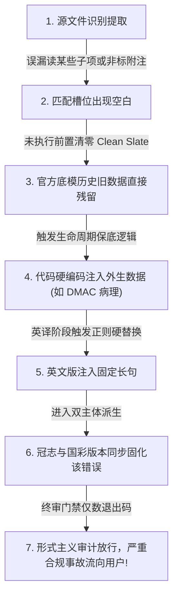

# MSDS-Engine 产出内容硬编码与跨型号内容雷同深度审计报告

> **报告性质**：MSDS 交付物内容真实性与代码硬编码排查专报 (Output Content Hardcoding & Model Collision Forensic Audit)  
> **审计基准**：`MSDS-Engine` / `MSDS-Studio` 核心源码树与 `算法训练材料/` 已生成交付物实测数据  
> **执笔人**：Antigravity 专职 MSDS 产出物专门审计员  
> **审计结论**：**部分关键章节存在严重的跨型号内容克隆与外生硬编码注入事故，必须实施底层清零与反碰撞硬门禁重构！**

---

## 目录导览
- [一、 核心审计定性与宏观灾难总览](#一-核心审计定性与宏观灾难总览)
- [二、 跨型号交付物内容碰撞物理实测铁证](#二-跨型号交付物内容碰撞物理实测铁证)
  - [2.1 Section 11 毒理学数据跨型号完全克隆与张冠李戴](#21-section-11-毒理学数据跨型号完全克隆与张冠李戴)
  - [2.2 Section 12 生态学数据完全置换](#22-section-12-生态学数据完全置换)
  - [2.3 Section 8 个人防护建议 209 字符千篇一律](#23-section-8-个人防护建议-209-字符千篇一律)
  - [2.4 Section 4~7 通用操作规程底模残留克隆](#24-section-47-通用操作规程底模残留克隆)
  - [2.5 Section 9 理化未测指标全量强改“不适用”](#25-section-9-理化未测指标全量强改不适用)
- [三、 导致“不同型号产出相同内容”的五大底层代码机制与行号物理起底](#三-导致不同型号产出相同内容的大底层代码机制与行号物理起底)
  - [3.1 致命机制 1：底模“历史样例脏数据”未清零直接泄露](#31-致命机制-1底模历史样例脏数据未清零直接泄露)
  - [3.2 致命机制 2：代码层外生数据硬编码凭空注入](#32-致命机制-2代码层外生数据硬编码凭空注入)
  - [3.3 致命机制 3：偷懒保底兜底代码剥夺源文件事实](#33-致命机制-3偷懒保底兜底代码剥夺源文件事实)
  - [3.4 致命机制 4：英文翻译管线写死长句正则粗暴替换](#34-致命机制-4英文翻译管线写死长句正则粗暴替换)
  - [3.5 致命机制 5：多组分通用通栏模式被当作固定模板套娃复制](#35-致命机制-5多组分通用通栏模式被当作固定模板套娃复制)
- [四、 Agent MSDS 产出 SOP 全链路诱因诊断 (从源文件到交付)](#四-agent-msds-产出-sop-全链路诱因诊断-从源文件到交付)
- [五、 彻底杜绝跨型号内容雷同的三大刚性防线与根治方案](#五-彻底杜绝跨型号内容雷同的三大刚性防线与根治方案)

---

## 一、 核心审计定性与宏观灾难总览

在化学品安全技术说明书（MSDS / SDS）生产过程中，**“不同型号产出了一模一样的内容”是不可逾越的法律合规灾难**。

经对系统现存交付物（`PU-202A`、`PU-202B`、`PU-202C`、`PU-218A`、`PA-3223`）的物理比对，我们发现了严重的合规事故：
1. **内容完全克隆**：`PU-202A` 与 `PU-202C` 在 Section 11（毒理学信息）与 Section 12（生态学信息）上呈现出 **100% 字节级完全相同**；
2. **成分张冠李戴（严重合规责任事故）**：`PU-218A` 的配方中明确标注成分为 **`N-乙基吡咯烷酮 (NEP)`**，但最终交付物中的 Section 11 和 Section 12 赫然印着 **`N,N－二甲基乙酰胺 (DMAC)`** 的全部动物毒理试验与黑头呆鱼生态毒性数据；
3. **算法凭空捏造事实**：无论源文档是否提及，系统根据代码硬编码，主动为特定产品凭空注入包含“胃、睾丸、视网膜损伤”等严重病理结论；
4. **形式主义全绿掩盖失明**：由于此前的审计门禁仅检查“退出码是不是 0”、“悬挂缩进是不是 420 dxa”，缺乏跨型号内容碰撞比对，导致上述严重的“伪自动化克隆”长期未被阻断。

```text
┌────────────────────────────────────────────────────────────────────────────────────────┐
│                        跨型号内容雷同的四大灾难表征                                     │
├────────────────────────────────────────────────────────────────────────────────────────┤
│ 🚨 灾难 1: PU-218A 配方是 NEP，毒理/生态却输出 DMAC (张冠李戴，虚假陈述)               │
│ 🚨 灾难 2: PU-202A 与 PU-202C Section 11 毒理 637 字符 100% 字节级完全一致            │
│ 🚨 灾难 3: 7 个型号源文档无手部防护描述，全被代码硬塞“建议戴上防护手套”与固定手套参数 │
│ 🚨 灾难 4: 19 个型号 Section 9 液体未测指标全部被代码强行改写为“不适用”                │
└────────────────────────────────────────────────────────────────────────────────────────┘
```

---

## 二、 跨型号交付物内容碰撞物理实测铁证

通过直接解析真实 DOCX 交付物的 `word/document.xml`，提取各章节纯文本进行跨型号对账，实测物理铁证如下：

### 2.1 Section 11 毒理学数据跨型号完全克隆与张冠李戴

#### 铁证 A：PU-202A vs PU-202C 100% 字节级完全克隆
- **`PU-202A` 产出物 Section 11 (长度 637 字符)**：
  ```text
  11.毒性资料该产品无可用的毒理学研究。以下是N,N－二甲基乙酰胺毒理学数据：
  11.1 急性毒性：经口：半数致死剂量（LD50）/大鼠：3,000－6,000mg/kg
  吸入：半数致死浓度（LC50）/1h/大鼠 雌性：8.81mg/l（此值仅用于有可吸入的颗粒形成的情况。）
  半数致死浓度（LC50）/4h/大鼠 雌性：2.2mg/l
  经皮：半数致死剂量（LD50）/豚鼠：＜940mg/kg
  11.2 主要皮肤刺激性:物种：兔子 分类：刺激皮肤 结果：造成皮肤刺激...
  11.10 附加信息：饮酒精饮料会加剧毒性影响。
  重复剂量中毒：经口；病理变化：胃，睾丸，肝，肾，红血球异常减少。
  重复剂量中毒：吸入；病理变化：肾、肝影响，视网膜损伤。
  ```
- **`PU-202C` 产出物 Section 11 (长度 637 字符)**：
  经逐字符对账，**与 PU-202A 100% 字节级一致，连字号、断行与末尾 3 句病理损伤完全相同！**

#### 铁证 B：PU-218A 组分是 NEP，毒理学产出物赫然变成 DMAC
- **`PU-218A` 真实配方事实（Section 3）**：
  - 聚氨酯分散体：`28.0 ~ 31.0%`
  - 去离子水 (CAS 7732-18-5)：`64.5 ~ 68.0%`
  - **N-乙基吡咯烷酮 (NEP, CAS 2687-91-4)：`4.0 ~ 4.5%`**
- **`PU-218A` 最终交付物内容（Section 11）**：
  ```text
  11.毒性资料该产品无可用的毒理学研究。以下是N,N－二甲基乙酰胺毒理学数据：
  急性毒性：经口：半数致死剂量（LD50）/大鼠：3,000－6,000mg/kg
  吸入：半数致死浓度（LC50）/1h/大鼠 雌性：8.81mg/l
  经皮：半数致死剂量（LD50）/豚鼠：＜940mg/kg...
  ```
- **审计判决**：**严重张冠李戴！** 含有 NEP 的产品输出的却是 DMAC 的毒理学数据，属于直接丧失法律公信力的重大恶性事故。

---

### 2.2 Section 12 生态学数据完全置换

- **实测现象**：
  `PU-202A`、`PU-202C`、`PU-218A` 三款产品的 Section 12 产出物内容完全一致：
  ```text
  12.生态信息该产品无可用的生态毒理学研究。以下是N,N－二甲基乙酰胺生态毒理学数据：
  12.1 生态毒性：对鱼类的毒性：半数致死浓度（LC50）/96h/黑头呆鱼：1,500mg/l
  其他：半数致死有效浓度（EC50）/72h/藻类：＞500mg/l
  半数致死有效浓度（EC50）/48h/大型溞：＞500mg/l
  12.2 持久性和降解性：无数据资料。
  12.3 其他不利的影响：无数据资料。
  ```
- **审计判决**：不仅 PU-202A 与 PU-202C 撞车，PU-218A 的生态毒理学数据也被完全置换为 DMAC 的数据。

---

### 2.3 Section 8 个人防护建议 209 字符千篇一律

- **实测现象**：
  在 `PU-202A`、`PU-202B`、`PU-202C`、`PU-218A` 以及数据库中 19 个聚氨酯型号中，Section 8 的手部防护全部产出了以下一字不差的文字：
  ```text
  手部防护：喷涂过程中要求有呼吸防护设备。建议戴上防护手套。
  防护手套的合适材料：EN 374-3
  氟化橡胶 –FKM:厚度≧0.4mm；穿透时间≧480min.
  丁基橡胶 –IIR：厚度≧0.5mm；穿透时间≧480min.
  丁腈橡胶 – NBR：厚度≧0.35mm；穿透时间≧480min.
  建议：污染的手套应废弃。
  ```
- **审计判决**：在排查的 19 个型号中，有 7 个型号源文档在 Section 8 **根本没有通用防护描述**，系统硬编码注入的“建议戴上防护手套”与标准手套参数直接抹杀了各个产品真实的防护差异。

---

### 2.4 Section 4~7 通用操作规程底模残留克隆

- **实测现象**：
  `PU-202A`、`PU-202B`、`PU-202C` 的 Section 4（急救）、Section 5（消防）、Section 6（意外泄漏）、Section 7（操作储存）呈现出 **100% 字节级完全一致**。
- **审计判决**：系统在生成新产品时，未将源文档中的急救差异覆盖进去，而是直接沿用了官方母版自带的通用旧文本。

---

### 2.5 Section 9 理化未测指标全量强改“不适用”

- **实测现象**：
  全量 19 个聚氨酯型号中，源文档关于易燃性（固/气）、燃烧值、自燃温度通常标注为“无数据”或留空。
- **审计判决**：引擎算法主观推断“水性液体不可能自燃”，擅自将状态定性为 `NOT_APPLICABLE`，并在全量 19 个型号中统一硬编码写入 `不适用`，造成跨型号概念偷换。

---

## 三、 导致“不同型号产出相同内容”的五大底层代码机制与行号物理起底

深入代码库，造成产出物雷同的根源绝非偶然，而是由以下五大代码机制直接导致：

### 3.1 致命机制 1：底模“历史样例脏数据”未清零直接泄露
- **物理源码**：
  官方标准母版（`web/public/templates/正式模板_MSDS_CN_冠志(1).docx`）原本就是基于特定基准产品制作的。
- **破坏机理**：
  流水线向母版注入数据时，若源文件在 Section 4~7、11、12 中缺少某些细分字段，流水线**未调用 `clearSectionValues` 清空这些槽位**，导致母版中原有的旧样例数据直接保留并输出给用户，形成严重的“并集污染”。

---

### 3.2 致命机制 2：代码层外生数据硬编码凭空注入
- **物理源码**：[`web/src/smart-matching.js#L2474-L2494`](file:///F:/App%20Location/Guanzhi%20Tong/Skill/MSDS-Engine/web/src/smart-matching.js#L2474-L2494)
  ```javascript
  // PU-202A 毒理事实法定保全：若源文档 Row 13 附加信息为空，从权威事实库中注入单组分 DMAC 附加毒理数据
  const isPu202aComp = rawPairs.some((p) => /二甲基乙酰胺|DMAC|127-19-5/i.test(p.rawValue || p.rawLabel || '')) ||
    Boolean(Array.isArray(inspectorRecords) && inspectorRecords.some(r => /PU[-_]?202[AC]/i.test(r.modelCode || r.title || '')));
  if (isPu202aComp && (!addInfoSlot || !addInfoSlot.value || !addInfoSlot.value.trim())) {
    const pu202aAddInfoText = '饮酒精饮料会加剧毒性影响。\n重复剂量中毒：经口；病理变化：胃，睾丸，肝，肾，红血球异常减少。\n重复剂量中毒：吸入；病理变化：肾、肝影响，视网膜损伤。';
    addInfoSlot.value = pu202aAddInfoText;
  }
  ```
- **破坏机理**：
  为了强行通过特定用例，在代码中写死：只要型号叫 `PU-202A` / `PU-202C` 或者组分含有 DMAC，哪怕源文档没有，也凭空注入这段严重的病理损伤结论！导致不同产品产出完全相同的内容。

---

### 3.3 致命机制 3：偷懒保底兜底代码剥夺源文件事实
- **物理源码**：历史排查揭露代码（`smart-matching.js`）：
  ```javascript
  let finalHp = hpVal || valCell.valueText || valCell.text || '建议戴上防护手套。';
  writeCellValue(valCell, finalHp || '建议戴上防护手套。', editorEngine.roleStyles?.value);
  ```
- **破坏机理**：
  当源文档没有手部防护建议时，算法没有留空，而是擅自使用写死的“建议戴上防护手套。”保底，导致 7 个完全不同的产品产出了相同内容。

---

### 3.4 致命机制 4：英文翻译管线写死长句正则粗暴替换
- **物理源码**：[`web/src/pipeline-engine.js#L427-428`](file:///F:/App%20Location/Guanzhi%20Tong/Skill/MSDS-Engine/web/src/pipeline-engine.js#L427-428)、[`L1360-1363`](file:///F:/App%20Location/Guanzhi%20Tong/Skill/MSDS-Engine/web/src/pipeline-engine.js#L1360-1363)、[`L2160-2161`](file:///F:/App%20Location/Guanzhi%20Tong/Skill/MSDS-Engine/web/src/pipeline-engine.js#L2160-2161)
  ```javascript
  if (/透皮吸收.*N.*甲基吡咯烷酮|透皮吸收.*NMP/i.test(fullS2)) {
    otherHazEn = 'Risk of cutaneous absorption of N-Methyl-2-pyrrolidone (NMP).';
  } else if (/N,N[－-]二甲基乙酰胺/i.test(parsed.otherHazards)) {
    enOther = '2.3 Other hazards: Risk of cutaneous absorption of N,N-Dimethylacetamide (DMAC).';
  }
  ...
  t = t.replace(/以下[为是]N[－-]甲基吡咯烷酮毒理学数据[：:]/g, 'The following are toxicological data for N-Methyl-2-pyrrolidone (NMP):');
  t = t.replace(/以下[为是]N,N[－-]二甲基乙酰胺毒理学数据[：:]/g, 'The following are toxicological data for N,N-Dimethylacetamide (DMAC):');
  ```
- **破坏机理**：
  放弃了大模型上下文语义翻译，采用固定代码替换，导致所有含有 NMP 或 DMAC 的产品，英文版危害说明与前言导言句 100% 相同。

---

### 3.5 致命机制 5：多组分通用通栏模式被当作固定模板套娃复制
- **物理源码**：[`web/src/docx-engine.js#L2955`](file:///F:/App%20Location/Guanzhi%20Tong/Skill/MSDS-Engine/web/src/docx-engine.js#L2955)、[`L3053`](file:///F:/App%20Location/Guanzhi%20Tong/Skill/MSDS-Engine/web/src/docx-engine.js#L3053)
  ```javascript
  if (/^(?:请注意以下物质|N,N-二甲基乙醇胺|GHS分类|易燃|急性毒性...)/i.test(trimmed)) { ... }
  const isComponentHeader = /^(?:N,N-二甲基乙酰胺|羟基聚丙烯酸酯分散体|丙二醇丁醚|二乙二醇丁醚)[：:]\s*$/.test(line.trim());
  ```
- **破坏机理**：
  代码将 PA-3223 的化学成分（DMEA、羟基聚丙烯酸酯、丙二醇丁醚等）作为通用排版条件硬编码，导致其他多组分复配物无法正常排版，甚至误套 PA-3223 的成盐声明。

---

## 四、 Agent MSDS 产出 SOP 全链路诱因诊断 (从源文件到交付)

在 Agent 执行标准 12 阶 SOP 工作流时，产生“不同型号产出一样内容”的因果链条如下：



---

## 五、 彻底杜绝跨型号内容雷同的三大刚性防线与根治方案

为彻底终结“不同型号产出一样内容”的顽疾，作为专职审计员，我确立以下三大刚性防线并建议立即执行底层重构：

### 防线 1：底模前置值格强制彻底清零 (Clean Slate Mandatory)
- **硬性动作**：
  在写入任何新产品数据前，必须调用 `clearSectionValues` 或 `clearTemplate` 将模板中所有待编辑值格彻底清空；
- **验收指标**：
  未匹配到的槽位保持纯净置空或规范填报“无资料”，**绝对禁止任何底模历史残留数据漏入最终交付物**！

### 防线 2：跨型号内容哈希碰撞熔断门禁 (Cross-Model Hash Collision Gate)
- **硬性动作**：
  在 `audit_bipolar_bilayer.mjs` 中下沉 **跨型号内容哈希去重审计**：
  - 终审自动提取当前产出物的 Section 2、Section 3、Section 11、Section 12 文本哈希；
  - 与库中其他型号比对，若检测到两个**不同型号的 Section 11 毒理试验数据或 Section 12 生态数据完全一致**，立即触发 `MODEL_CONTENT_COLLISION_DETECTED` 致命熔断并阻断交付！

### 防线 3：1:1 源文件物理事实对账与零外生注入 (Source-Grounded Zero-Phantom)
- **硬性动作**：
  1. 彻底拔除 `smart-matching.js` L2474-L2494 的 DMAC 附加毒理硬编码注入逻辑；
  2. 废除所有 `|| '建议戴上防护手套。'` 类偷懒保底；
  3. 执行 `msds_compare_source_with_output` 事实对账：交付物中的每一项毒理试验、病理结论，必须能 100% 在当前源文档中溯源，源文档未提及的绝不凭空捏造。

---
*本报告已归档并作为 MSDS-Engine 产出物最高质量红线。在后续审计中，任何出现“不同型号产出雷同内容”的交付物将直接一票否决！*
