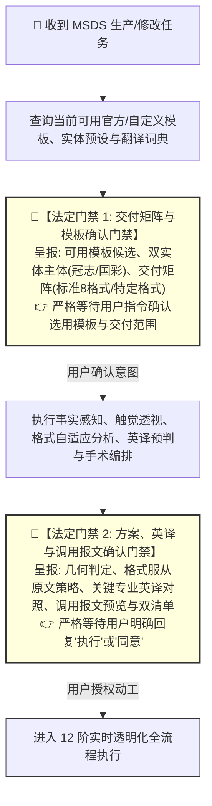
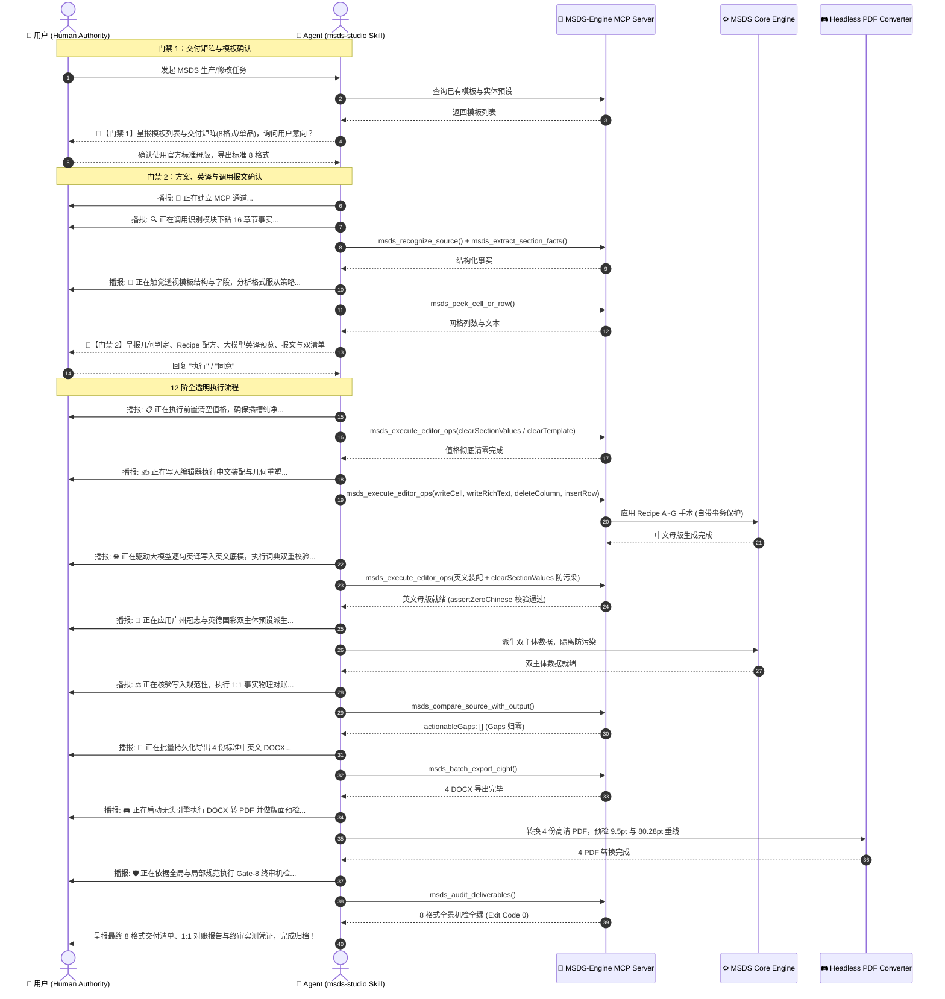

# MSDS Studio Agent 确认交互式标准工作流 SOP 规范 (Interactive MCP Workflow SOP)

> **版本**：v4.0.0 (全生命周期闭环版：【识别感知 + 通用编辑器原语 + Agent 语义大脑】)  
> **适用范围**：`msds-studio` Skill 技能体系、Antigravity 平台 Agent 交互中枢、MSDS-Engine MCP 通道。  
> **核心宗旨**：确立“人机交互确认门禁 + 12 阶实时进度播报 + 编辑器万能原语 + 格式服从原文 + 前置值格清零 + 大模型逐句英译 + 双主体派生 + 高保真 DOCX 转 PDF + 1:1 物理对账 + 全景终审阻断”的端到端标准作业规程，让 Agent 真正正确、透明、稳定地使用 MSDS-Engine。

---

## 一、 顶层架构与五大最高法定原则 (Supreme Invariants)

全系统生命周期内核心维护与开发项**严格锁定且唯一限定**为以下五大原则：

1. **核心架构归正：【识别感知 + 通用编辑器原语 + Agent 语义大脑】**：
   - 彻底废止对机械黑盒匹配脚本（如 `smart-matching.js`）的过度依赖与包装；
   - 确立工作流主干为：`msds_recognize_source` 零损耗化学事实感知 $\rightarrow$ Agent 语义大脑决策 $\rightarrow$ 直接调用 MSDS Studio 编辑器万能原语操控；
   - 熟练运用编辑器的全景能力：**预设编辑** (`applyPreset`)、**恢复本节** (`restoreSection`)、**清空本节填写值** (`clearSectionValues`)、**清空全模板值** (`clearTemplate`)、**删列** (`deleteColumn`)、**克隆增行** (`insertRow`)、**删行** (`deleteRow`)、**合并通栏** (`mergeCells`)、**富文本与化学式下标** (`writeRichText`) 及 **激光垂线对齐** (`formatLaserTabs`)。

2. **格式服从于原文公理 (Format Follows Source Content Axiom)**：
   - “基于模板的格式与基于源文件的内容做匹配，格式服从于原文”；
   - 若源文件某一节**仅有叙述性说明行**（例如“该产品无可用的毒理学研究”或非危险品免责声明），直接匹配到模板中对应的说明行/导言行插槽，沿用模板既定的字体（宋体/Times New Roman/Arial）、字号（9.5pt/10.5pt）与行距格式排版；其余无关的空白端点行直接清空或剔除，绝不可强塞无关假端点；
   - 若源文件包含细分结构化端点（如急性毒性 LC50/LD50），则对应填入结构化值格插槽；
   - 绝对杜绝“为了迁就模板结构而凭空捏造端点”或“为了塞入内容而强行破坏模板几何规范”。

3. **英文官方底模“历史脏数据”法定清零机制 (Pre-write Value Clearing Invariant)**：
   - 官方底模（尤其英文模板）内可能存在历史样例残留（如二乙二醇单丁醚、3306 mg/kg 等示范数据）；
   - 解决此问题的唯一合法方式是：**在写入新数据前，调用编辑器的 `clearSectionValues` 或 `clearTemplate` 功能**，先将待编辑章节的所有值格彻底清空，确保底模处于 100% 纯净的空白插槽状态，再由 Agent 写入真实数据，杜绝一切脏数据污染。

4. **Agent 大模型逐句专业语义英译与词典辅助校验 (LLM Contextual Translation Invariant)**：
   - 严禁依赖脆弱的数百行机械正则字符串替换；
   - 充分发挥 Agent 作为前沿大模型的化学和毒理学专业语义理解优势，对源文档内容进行**逐句专业英译**，确保行文地道、术语符合 GHS/OECD 国际标准（如区分 vapour/gas、严格翻译致敏性、致突变性结论等）；
   - 标准双语映射库（`translation-map.json` / `bilingual-mapping-set.js`）专职作为**一致性辅助校验字典**，用于审查英译结果是否符合既定标准术语，形成“大模型语义翻译 + 规则字典校验”的双重保障。

5. **通用型 MSDS Studio 与彻底铲除特判 (Strict Anti-Overfitting Invariant)**：
   - MSDS Studio 是工业级通用文档处理工作台，必须保持 100% 通用性；
   - 严禁针对特定产品型号（如 `PU-202A`、`PA-4780`、`PU-218A` 等）在代码或规则中编写 `if (model === 'xxx')` 特判分支；
   - 所有排版与结构决策必须完全基于通用的数据形态（是否危化品、组分数量 $N$、列数、文本是否包含化学式、是否只有叙述性说明等）进行通用逻辑分流。

---

## 二、 人机协同双交互确认门禁 (Dual Human-in-the-Loop Gates)

为保障生产意图、语言范围、实体主体与模板选择 100% 符合用户要求，Agent 动工前必须严格经过两道交互确认门禁：

### 1. 门禁 1：交付矩阵与模板确认门禁 (Deliverables Matrix & Template Gate)
- **触发时机**：收到用户任务后，在动工前；
- **Agent 执行动作**：
  1. 调用相关工具查询当前系统已注册的官方模板（冠志中/英、国彩中/英）或已有的自定义模板；
  2. 向用户呈报模板清单与实体预设，并询问用户意向：
     - “检测到源文件为 [型号]；
     - 请确认本次交付范围：是导出标准 8 格式全矩阵（4 DOCX + 4 PDF：冠志/国彩 × 中/英），还是仅生成特定单品？
     - 请确认使用官方标准母版还是您上传的新自定义模板？是否需要指定修订日期？”；
  3. **严格停机等待用户回复确认**。

### 2. 门禁 2：方案、英译与调用报文确认门禁 (Plan, Translation & Payload Gate)
- **触发时机**：完成源文件事实提取、模板透视、形态判定与关键英译映射后，在正式写盘修改文档前；
- **Agent 执行动作**：
  1. 呈报几何结构判定与格式服从原文策略（如：Section 11 判定为纯说明行形态，拟匹配说明行插槽并清空多余端点）；
  2. 呈报推荐的手术配方（如：采用 Recipe D 清空历史值格、Recipe A 删列、Recipe B 增行、Recipe C 渲染化学式）；
  3. **呈报关键专业合规英译对照预览**（如：GHS 英文分类、主要象形图 Warning 语句、产品英文品类与推荐用途）；
  4. 呈报即将提交给 `msds_execute_editor_ops` 的**核心调用报文预览 (Payload Preview)**；
  5. 呈报【双清单】（拟变范围清单 + 保持现状承诺清单）；
  6. **严格停机等待用户回复“执行/同意”后方可下发调用**。

---

## 三、 执行期 12 阶段透明化状态播报范式 (The 12-Phase Status Witness)

在获得门禁授权后的执行全过程中，Agent **绝对禁止长时间黑盒静默**，必须根据底层的真实执行动作，实时向用户输出结构化进度播报：

| 阶段编号 | 标准状态播报文本 (Real-time Broadcast) | 底层 MCP 真实调用与工程动作 |
| :--- | :--- | :--- |
| **Phase 1** | `📡 [MSDS-Studio] 正在建立 MSDS-Engine 原生 MCP 通信通道...` | 检查 Stdio 连接，确认 10 大工具就绪 |
| **Phase 2** | `🔍 [识别感知] 正在调用识别模块解析源文件，下钻 16 章节核心化学事实...` | 调用 `msds_recognize_source` 提取全局事实，调用 `msds_extract_section_facts` 细粒度下钻 |
| **Phase 3** | `📋 [模板契约] 正在加载目标模板，执行前置清空值格，确保插槽纯净...` | 加载模板，针对待编辑章节执行 `clearSectionValues`，消除历史脏数据残留 |
| **Phase 4** | `🔎 [触觉透视] 正在触觉透视模板结构与字段，执行格式服从原文判定...` | 调用 `msds_peek_cell_or_row` 检查，定性为纯说明行/两列结构/非标三列/通栏 |
| **Phase 5** | `📐 [规范编排] 正在编排万能手术配方与大模型专业英译内容...` | 编排 Recipe A~G 配方序列，大模型上下文翻译，调用 `msds_plan_audit_targets` |
| **Phase 6** | `✍️ [中文装配] 正在事务性写入编辑器，执行几何重塑与微观富文本渲染...` | 调用 `msds_execute_editor_ops`（内置事务保护）生成中文正式母版 |
| **Phase 7** | `🌐 [专业英译] 正在驱动大模型逐句英译写入英文底模，执行词典双重校验...` | 大模型逐句专业英译写入已清空底模，结合映射词典双向核验，执行 `assertZeroChinese` |
| **Phase 8** | `🏢 [实体派生] 正在应用广州冠志与英德国彩双主体预设派生...` | 注入企业法定名称、统一社会信用代码、地址、应急联系电话与传真，双向防污染隔离 |
| **Phase 9** | `⚖️ [事实对账] 正在核验写入规范性，执行源文件 vs 产出物 1:1 事实物理对账...` | 调用 `msds_compare_source_with_output`，核验 `actionableGaps`，若有缺漏针对性补填 |
| **Phase 10** | `📄 [批量导出] 正在批量持久化导出 4 份标准中英双语双主体 DOCX 正式文件...` | 落地 `冠志 msds_CN.docx`、`国彩 msds_CN.docx`、`冠志 msds_EN.docx`、`国彩 msds_EN.docx` |
| **Phase 11** | `🖨️ [PDF 转换] 正在启动无头高保真渲染引擎执行 DOCX 转 PDF 并做版面预检...` | 驱动无头转换守护进程生成 4 份高清 PDF，预检导言区 9.5pt（G-37）与激光垂线 80.28pt（G-38） |
| **Phase 12** | `🛡️ [全景终审] 正在依据全局与局部规范执行 Gate-8 终审机检与双向核销...` | 调用 `msds_audit_deliverables`，校验 8 格式数量、时间戳对齐、字体纯度与排版，退出码 0 归档 |

---

## 四、 核心专业子流程详解 (Specialized Sub-Pipelines)

### 1. Agent 大模型专业语义英译与词典辅助校验 (LLM Contextual Translation Pipeline)
* **大模型上下文深度理解**：利用 Agent 自身强大的多模态/大模型语言能力，对化学术语、毒理学结论、法规描述进行逐句地道翻译（如准确区分 `vapour` 与 `gas`，准确翻译 `Repeated exposure may cause skin dryness` 等）；
* **词典辅助一致性校验**：以 `pipeline-engine.js` 与 `translation-map.json` 内置的标准术语词典为辅助对账工具，校验大模型翻译的专业一致性；
* **零中文字符硬阻断 (`assertZeroChinese`)**：英文产出文件必须遍历全量 Run 与文本段，若残留中文字符 $>0$，门禁一票否决阻断交付。

### 2. 格式服从原文自适应排版管线 (Format Follows Content Pipeline)
* **说明行优先匹配**：源文档若只有叙述性说明（如无可用毒理学数据、非危险品免责声明），直接映射到模板的说明行（Preamble/Note）插槽，继承模板样式；
* **无用端点自动清零**：说明行匹配生效后，通过 `clearSectionValues` 或删行将模板中无关的示范端点行清空或精简，绝不强行保留示范数据，亦绝不伪造端点数据；
* **结构化端点自适应填入**：若源文件有具体端点指标，按结构化规则写入对应的值单元格。

### 3. 底模前置值格清零机制 (Pre-write Value Clearing Protocol)
* **底模加载即清空**：向模板（尤其英文母版）填充业务数据前，必须先调用 `clearSectionValues` 或 `clearTemplate`；
* **标签与网格绝对保留**：清空操作仅作用于值单元格，标签列、列宽坐标、边框样式 100% 完好无损。

### 4. 双主体预设派生管线 (Dual-Entity Bipolar Derivation)
* **广州冠志 (Guangzhou Guanzhi)**：
  - 企业：广州冠志新材料科技有限公司 / Guangzhou Guanzhi New Material Technology Co., Ltd.
  - 应急电话：020-82562180 / 020-82562180
* **英德国彩 (Yingde Guocai)**：
  - 企业：英德市国彩精细化工有限公司 / Yingde Guocai New Material Technology Co., Ltd.
  - 应急电话：0763-2660168 / 0763-2660168
* **隔离铁律**：严禁两家公司的信用代码、地址、电话发生任何串号污染。

### 5. 无头高保真 DOCX 转 PDF 引擎与预检 (Headless PDF Preflight)
* **多级容灾渲染**：优先调用本地受控无头转换服务，失败时自动平滑降级至备用引擎，确保 100% 成功转换；
* **PDF 版面物理预检**：
  - 导言区（Preamble）说明文字字号必须为 9.5pt（G-37）；
  - Section 9 理化特性冒号与数值对齐基准 X 坐标为 80.28pt，公差严格 $\le 1.2\text{pt}$（G-38）；
  - 必须正确嵌入宋体与 Times New Roman / Arial，绝不允许出现方块豆腐块乱码。

---

## 五、 全流程作业时序拓扑图 (Workflow Sequence Graph)

---

## 六、 终审归档充要指标 (Completion Invariants)

任务必须满足以下指标方可关单交付：
1. **交付物数量严格守恒**：全量 8 格式交付物（4 DOCX + 4 PDF：冠志/国彩 × 中/英）完整存在于目标目录，无任何多余临时垃圾文件；
2. **中英绝对纯净**：英文 DOCX 与 PDF 中文字符数严格为 0；
3. **物理时间戳对齐**：8 份产物文件生成修改时间差 $\le 300\text{s}$；
4. **对账 Gaps 归零**：`actionableGaps.length === 0`，字符保全比达标；
5. **机检真实退出码 0**：`msds_audit_deliverables` 返回 `passed: true`。
