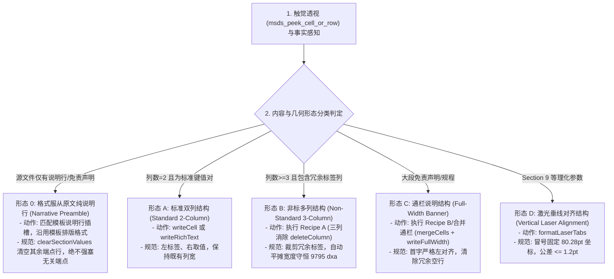
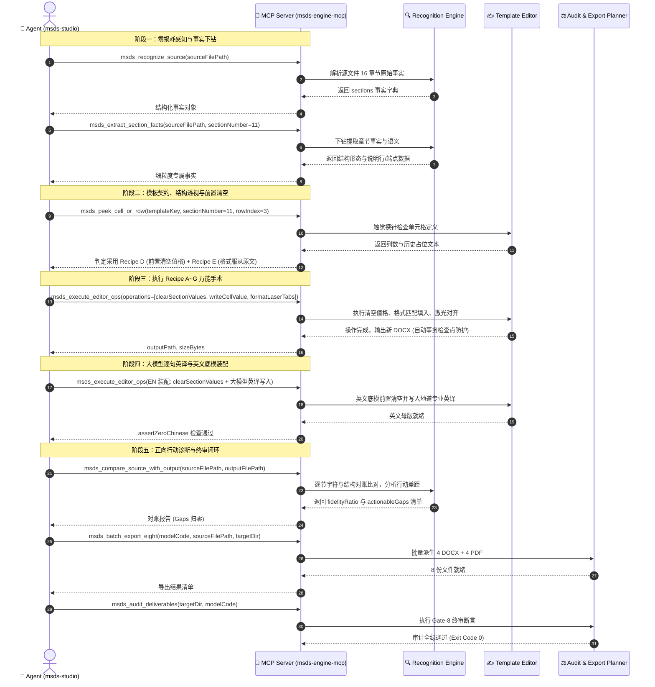

# 新一代 MCP 驱动的 MSDS Studio Skill 优化工作流白皮书与 SOP 规范

> **版本**：v3.0.0 (架构归正版：【识别感知 + 通用编辑器原语 + Agent 语义大脑】)  
> **适用范围**：MSDS-Engine 智能化文档处理工作台、`msds-studio` 技能体系、Antigravity 跨会话 Agent 协作通道。  
> **核心使命**：为 Agent 赋予精确的感官（识别/下钻/透视/对账）与稳健的手脚（编辑器万能原语：清空值格/单节恢复/企业预设/增删行/删列/横向合并/富文本化学式/激光对齐），遵循“格式服从于原文”公理与“前置值格清零”机制，依托 Agent 大模型语义深度英译，彻底铲除历史型号特判与机械匹配过拟合，打造 100% 工业级通用文档工作台。

---

## 一、 顶层架构与五大最高法定原则 (Supreme Invariants)

全系统生命周期内的核心维护与开发项**严格锁定且唯一限定**为以下五大原则：

1. **核心架构归正：【识别感知 + 通用编辑器原语 + Agent 语义大脑】**：
   - 彻底废止对机械黑盒匹配脚本（如 `smart-matching.js`）的过度依赖与包装；
   - 确立工作流主干为：`msds_recognize_source` 零损耗化学事实感知 $\rightarrow$ Agent 语义大脑决策 $\rightarrow$ 直接调用 MSDS Studio 编辑器万能原语操控；
   - 熟练运用编辑器的全景能力：**预设编辑** (`applyPreset`)、**恢复本节** (`restoreSection`)、**清空本节填写值** (`clearSectionValues`)、**清空全模板值** (`clearTemplate`)、**删列** (`deleteColumn`)、**克隆增行** (`insertRow`)、**删行** (`deleteRow`)、**合并通栏** (`mergeCells`)、**富文本与化学式下标** (`writeRichText`) 及 **激光垂线对齐** (`formatLaserTabs`)。

2. **格式服从于原文公理 (Format Follows Source Content Axiom)**：
   - “基于模板的格式与基于源文件的内容做匹配，格式服从于原文”；
   - 若源文件某一节**仅有叙述性说明行**（例如“该产品无可用的毒理学研究”或非危险品免责声明），直接匹配到模板中对应的说明行/导言行插槽，沿用模板既定的字体（宋体/Times New Roman/Arial）、字号（9.5pt/10.5pt）与行距格式排版；其余无关的空白端点行直接清空或剔除，绝不可强塞无关假端点；
   - 若源文件包含细分结构化端点（如急性毒性 LC50/LD50），则对应填入结构化值格插槽；
   - 绝对杜绝“为了迁就模板结构而凭空捏造端点”或“为了塞入内容而强行破坏模板几何规范”。

3. **英文官方底模“历史脏数据”法定清零机制 (Pre-write Value Clearing Invariant)**：
   - 官方底模（尤其英文模板）内可能存在历史样例残留（如二乙二醇单丁醚、3306 mg/kg 等示范数据）；
   - 解决此问题的唯一合法方式是：**在写入新数据前，调用编辑器的 `clearSectionValues` 或 `clearTemplate` 功能**，先将待编辑章节的所有值格彻底清空，确保底模处于 100% 纯净的空白插槽状态，再由 Agent 写入真实数据，杜绝一切脏数据污染。

4. **Agent 大模型逐句专业语义英译与词典辅助校验 (LLM Contextual Translation Invariant)**：
   - 严禁依赖脆弱的数百行机械正则字符串替换；
   - 充分发挥 Agent 作为前沿大模型的化学和毒理学专业语义理解优势，对源文档内容进行**逐句专业英译**，确保行文地道、术语符合 GHS/OECD 国际标准（如区分 vapour/gas、严格翻译致敏性、致突变性结论等）；
   - 标准双语映射库（`translation-map.json` / `bilingual-mapping-set.js`）专职作为**一致性辅助校验字典**，用于审查英译结果是否符合既定标准术语，形成“大模型语义翻译 + 规则字典校验”的双重保障。

5. **通用型 MSDS Studio 与彻底铲除特判 (Strict Anti-Overfitting Invariant)**：
   - MSDS Studio 是工业级通用文档处理工作台，必须保持 100% 通用性；
   - 严禁针对特定产品型号（如 `PU-202A`、`PA-4780`、`PU-218A` 等）在代码或规则中编写 `if (model === 'xxx')` 特判分支；
   - 所有排版与结构决策必须完全基于通用的数据形态（是否危化品、组分数量 $N$、列数、文本是否包含化学式、是否只有叙述性说明等）进行通用逻辑分流。

---

## 二、 几何形态与格式匹配决策树 (Layout & Format Decision Tree)

面对任意源文档事实与模板网格，Agent SHALL 遵循以下标准化判定决策流，决定采取的手术方案：

---

## 三、 SOP 经典手术配方库 (Recipe / Playbook Library)

Agent 在执行复杂编辑时，SHALL 直接组合引用以下经典标准化手术配方，杜绝随意拼凑原子指令：

### 配方 A【三列转两列消除配方】 (Recipe A: Three-to-Two Column Elimination)
* **适用场景**：Section 3 组分表或 Section 15 法规表中，模板包含多余的第二列标签（如 `'CAS编号'` 文本槽），导致无法按正常数据对齐。
* **标准操作流**：
  1. 调用 `msds_peek_cell_or_row(templateKey, sectionNumber, rowIndex=3)`，核实列数 `cellsCount === 3`；
  2. 提交 `{ op: 'deleteColumn', sectionNumber, colIndex: 1 }`；
  3. 底座自动从 `<w:tblGrid>` 物理剔除第 1 列，并将 2000 dxa 宽度平摊补偿至右侧数值列，总宽守恒为 9795 dxa；
  4. 再次透视验证：`cellsCount === 2`。

### 配方 B【动态组分自适应增减行配方】 (Recipe B: Dynamic Row Balancing)
* **适用场景**：产品组分数量多于或少于模板预设行数。
* **标准操作流**：
  1. 识别源事实中的组分数量 $N$，透视模板现有可用组分行数 $M$；
  2. 若 $N > M$：循环执行 $(N - M)$ 次 `{ op: 'insertRow', sectionNumber: 3, targetRowIndex: 4, cloneFromRowIndex: 3 }`，通过深拷贝继承边框、底色、行高与字体，清空文本后安全插入；
  3. 若 $N < M$：循环执行 $(M - N)$ 次 `{ op: 'deleteRow', sectionNumber: 3, rowIndex: M }` 物理清除多余空白行；
  4. 逐行调用 `writeRichText` 填入组分名称、CAS 与含量。

### 配方 C【微观化学式与 Run 级排版配方】 (Recipe C: Chemical Run-Level Formatting)
* **适用场景**：含有分子式（如 $\text{H}_2\text{SO}_4$、$\text{CO}_2$、$\text{H}_2\text{O}$）或中英文混排粗体/斜体。
* **标准操作流**：
  1. 识别文本中的化学式字符串；
  2. 提交 `{ op: 'writeRichText', sectionNumber, rowIndex, cellIndex, chemicalFormula: 'H2SO4' }` 或传入切分好的 `runs: [...]`；
  3. 底座底层自动分割为文本 Run 与带有 `<w:vertAlign w:val="subscript"/>` 的下标 Run；
  4. 导出后文字与角标在 Word/PDF 中均保持完美排版。

### 配方 D【底模前置值格清零配方】 (Recipe D: Pre-write Value Clearing)
* **适用场景**：任何向底模写入新数据前，消除历史示例残留（如二乙二醇单丁醚、3306 mg/kg）。
* **标准操作流**：
  1. 提交 `{ op: 'clearSectionValues', sectionNumber: 11 }` 或 `{ op: 'clearTemplate' }`；
  2. 底模所有值单元格被安全置空，标签列、边框、网格列宽坐标 100% 保持；
  3. 获得纯净空白插槽母版，防止脏数据外溢。

### 配方 E【格式服从原文自适应配方】 (Recipe E: Format Follows Content Matching)
* **适用场景**：源文档某节仅有纯说明行，或部分章节具备细分端点。
* **标准操作流**：
  1. 若源节仅有叙述说明（如“该产品无可用的毒理学研究”），匹配模板对应说明行插槽（如 Section 11 Row 1），调用 `writeCellValue` 填入，使用模板原生格式；
  2. 执行 `clearSectionValues` 清空该节其余示范端点行，绝不捏造假数据；
  3. 若源节包含结构化指标，逐项填入对应端点值格。

### 配方 F【大模型逐句专业语义英译与词典校验配方】 (Recipe F: LLM Translation with Dictionary Guard)
* **适用场景**：英文母版装配。
* **标准操作流**：
  1. Agent 基于化学与毒理学上下文对源事实进行逐句专业英译；
  2. 调用词典库（`translation-map.json`）核验术语一致性；
  3. 写入英文底模并执行 `assertZeroChinese` 门禁。

### 配方 G【单节安全重置配方】 (Recipe G: Isolated Section Restoration)
* **适用场景**：单节排版发生形变或需回退重试，而不希望破坏其他已编辑章节。
* **标准操作流**：
  1. 提交 `{ op: 'restoreSection', sectionNumber }`；
  2. 底座从初始基准模板中单节克隆覆盖，其余已编辑章节 100% 保持。

---

## 四、 事务级生命周期与正向行动诊断核销

### 1. 事务级会话与自动自愈 (Transaction Guard)
* **前置锁**：每次调用 `msds_execute_editor_ops`，服务端自动创建初始事务检查点 (`tx_...`)；
* **故障自愈**：任何一步操作发生异常（列越界、格式破损），服务端立即自动触发 `rollbackSession` 恢复原始干净母版，并彻底销毁磁盘上的半成品脏文件；
* **零污染下沉**：保证 Agent 永远不会向后续流程传递被破坏的半成品文档。

### 2. 正向行动诊断核销 (Actionable Gap Closed-Loop)
* 动工后调用 `msds_compare_source_with_output`，检查返回的 `actionableGaps` 数组；
* 若包含条目（如 `MISSING_CONTENT` 或 `COMPONENT_COUNT_MISMATCH`），Agent 依照返回的 `suggestedAction` 针对性执行补填手术；
* 再次执行对账，直至 `actionableGaps.length === 0` 且 `fidelityRatio` 达标。

---

## 五、 MCP 工具与万能编辑器原子指令清单

### 1. 核心 MCP 工具 (The 10 MCP Tools)
| 工具名称 | 功能定位 |
| :--- | :--- |
| `msds_recognize_source` | 全文 16 章节源文件事实识别 |
| `msds_extract_section_facts` | 章节级细粒度语义与几何下钻 |
| `msds_compare_source_with_output` | 1:1 事实物理对账与正向行动诊断 |
| `msds_register_template` | 动态上传与注册外部自定义模板 |
| `msds_get_template_schema` | 查询已注册模板的 16 章节拓扑结构 |
| `msds_peek_cell_or_row` | 触觉透视指定单元格/行的属性与文本 |
| `msds_execute_editor_ops` | 执行万能原子操作序列生成 DOCX（自带事务自愈） |
| `msds_plan_audit_targets` | 编制 ADD 终审断言契约与 8 产物清单 |
| `msds_batch_export_eight` | 实体多预设派生与 4+4 交付物批量导出 |
| `msds_audit_deliverables` | 依据 ADD 契约对产出交付物执行终审门禁 |

### 2. 万能编辑器原子指令 (`operations` in `msds_execute_editor_ops`)
- `clearSectionValues`: 清空本节填写值；
- `clearTemplate`: 清空全模板填写值；
- `restoreSection`: 恢复本节至基准模板；
- `applyPreset`: 应用企业预设 (`Guocai_zh`, `Guocai_en` 等)；
- `writeCell`: 原子写入单元格值；
- `writeRichText`: Run 级富文本与化学式下标写入；
- `writeFullWidth`: 通栏说明全量写入；
- `formatLaserTabs`: Section 9 激光垂线对齐；
- `deleteColumn`: 删列并自动平摊列宽；
- `insertRow`: 深拷贝样式克隆增行；
- `deleteRow`: 安全删行；
- `mergeCells`: 横向合并单元格；
- `checkpoint` / `rollback`: 事务快照与安全回滚。

---

## 六、 标准作业 7 阶段调用时序图 (Mermaid Sequence)

