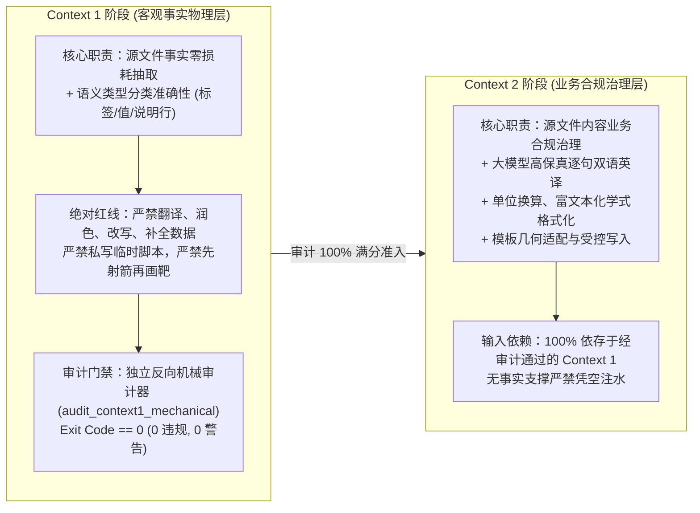
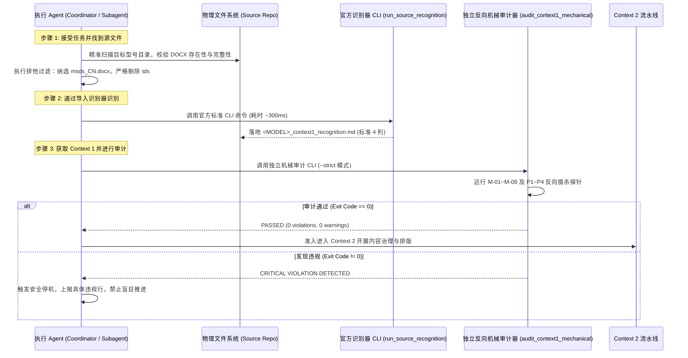

# MSDS Studio 工作流开篇三部曲标准作业规程 (SOP) 与新 Agent 上手手册

> **版本**：v1.0-ENTERPRISE  
> **适用对象**：MSDS-Engine 全系统、主协调器 (Coordinator)、执行 Subagent、新入驻 Agent 及协同开发者。  
> **核心使命**：为所有执行 Agent 提供统一、刚性、不可动摇的工作流开篇基准，确保任何新 Agent 零认知歧义、100% 依循标准路线执行开篇三部曲，严禁自由散漫与自作主张。

---

## 一、 最高法定公理与阶段边界划分 (Supreme Axioms)

在整个 MSDS 文档受控处理工作流中，所有 Agent 必须无条件遵循以下四大公理：



### 1. 公理 1：Context 1 职责纯粹性公理 (Extraction & Taxonomy Purity Axiom)
- **法定定位**：Context 1 是**未经修饰的源文件客观物理事实层**。
- **唯一核心目标**：
  1. 确保从源 DOC/DOCX 文件中抽取的文本与表格内容 100% 真实还原原文，零丢失、零虚增；
  2. 确保对每一行提取内容的语义角色分类（`父级标签`、`子标签`、`参数值`、`说明行`、`章节标题`、`表头`等）归纳准确。
- **审计聚焦**：只审计“提取准确性”与“分类准确性”，绝不在此阶段审计业务翻译质量或企业模板样式。

### 2. 公理 2：Context 1 零加工零外生修改公理 (Zero-Modification Axiom)
- 在 Context 1 阶段，**绝对禁止**进行任何中英翻译、词汇替换、语序调整、数据推测补全或删除源文件既有事实。
- 源文件是什么样，提取出来的 Context 1 就是什么样（仅做合法的 Markdown 管道符 `\|` 安全转义以保护表格结构）。

### 3. 公理 3：内容合规治理收敛至 Context 2 公理 (Content Governance in Context 2 Axiom)
- 真正要对源文件内容进行的标准化治理、高保真专业双语翻译、理化指标格式清洗、GHS 象形图对齐及企业底模几何适配，**统一且必须在 Context 2 及后续阶段完成**。
- Context 2 的一切操作必须以经 Context 1 机械审计合格的事实为唯一基石，严禁无中生有。

### 4. 公理 4：开篇三部曲强时序单向流公理 (Strict Sequence Axiom)
- 步骤 1（找源文件）$\rightarrow$ 步骤 2（导入受控识别器）$\rightarrow$ 步骤 3（获取 Context 1 并通过独立机械审计）。
- 前一步未产生可量化证据（退出码 0）前，**严禁跨步跳入下一步**；步骤 3 机械审计未通过前，**严禁进入 Context 2**。

---

## 二、 工作流开篇三部曲标准作业规程 (The Entry Triad SOP)



### 步骤 1：接受任务并找到源文件 (Source Discovery & Verification)
1. **任务接收**：接收指定产品型号代码（如 `HPU-7651`、`PA-3612` 等）或源文件相对/绝对路径。
2. **源文件寻源与锁定**：
   - 目标路径通常位于 `算法训练材料/源文件材料/<分类>/<型号>/` 或用户指定工作目录；
   - 目标文件必须严格匹配 `*msds_CN*.docx`（或经官方机制绑定的 `.doc` 实体）；
   - **排他性铁律**：严禁纳选任何文件名包含 `tds`、`TDS`、`技术说明书` 的文件。
3. **物理校验**：检查文件物理大小 $>0$，路径无中文乱码。

### 步骤 2：通过导入受控识别器识别 (Recognizer Ingestion & Extraction)
1. **执行唯一受控命令**：
   ```bash
   node web/scripts/run_source_recognition.mjs --source="<SOURCE_DOCX_PATH>" --output="<OUTPUT_DIR>" --format=md
   ```
2. **底层执行机制**：
   - 识别引擎无损解析 DOCX 内部 XML 物理表格与段落；
   - 依据《MSDS 表格语义分类与标签体系知识库手册》自动判定 8 大语义类型（`父级标签`、`子标签`、`参数值`、`说明行`、`章节标题`、`子章节序号`、`表头`、`未知`）；
   - 单元格内容若包含管道符 `|`，底层引擎自动转义为 `\|`，杜绝破坏 Markdown 表格列数。
3. **交付物规范**：
   - 输出路径：`<OUTPUT_DIR>/<MODEL>_context1_recognition.md`；
   - 必须为标准的 4 列 Markdown 表格结构：
     `| 序号 | 标签/字段 | 事实值/内容 | 语义类型 |`；
   - 必须覆盖完整的 16 大章节化学品安全技术说明书事实。

### 步骤 3：获取 Context 1 并进行审计 (Acquisition & Adversarial Audit)
1. **裁判与执行物理隔离**：
   - 严禁在识别脚本内“自测自通”；
   - 必须调用独立的外部反向反欺诈机械审计器，从外部文件系统读取生成的 Markdown 进行审查。
2. **执行独立反向机械审计命令**：
   ```bash
   node web/scripts/audit_context1_mechanical.mjs --target="<OUTPUT_DIR>/<MODEL>_context1_recognition.md" --strict
   ```
3. **探针猎杀全覆盖检测项**：
   - **M-01 ~ M-03**：文档结构与 16 章节完整性；
   - **M-04**：Markdown 物理列数完整性（严格为 4 列，无非法竖线截断溢出）；
   - **M-05 (P1 伪标签猎杀)**：猎杀含有行为动词（“就医/冲洗/佩戴/严禁”）、长连词或句号结尾的伪标签；
   - **M-06 (P2 伪说明行猎杀)**：猎杀将标准理化指标（“pH值/沸点/闪点”）或带序号项误判为说明行；
   - **M-07 (P3 伪参数值猎杀)**：猎杀将分类统领头（“手部防护：”）错误填入参数值；
   - **M-08 (P4 物理网格真实性)**：检验物理段落与单元格真实性，严禁凭空捏造。
4. **一票否决通关门禁**：
   - **充要条件**：真实操作系统进程退出码为 `0`；
   - **零容忍**：`CRITICAL: 0`，`WARNING: 0`；
   - 只有通过本门禁，开篇三部曲才算正式通关，方可产出 Context 1 凭据向用户汇报，并申请推进至 Context 2。

---

## 三、 新 Agent 极速上手卡片 (Quick Start Card for Any New Agent)

> 💡 **任何全新入驻的 Agent，请在接到 MSDS 处理任务后，直接执行以下三步模板！无需猜测，无需自写脚本！**

```markdown
### 🚀 MSDS 处理新 Agent 极速上手指南（三步开篇法）

1. 【第一步：找到源文件】
   定位目标型号的中文 MSDS 源文件（严格排除 TDS）：
   $sourceFile = "算法训练材料/源文件材料/.../<MODEL>/<MODEL> msds_CN 冠志.docx"

2. 【第二步：导入受控识别器】
   运行官方受控识别命令（耗时约 300ms）：
   node web/scripts/run_source_recognition.mjs --source="$sourceFile" --output="<OUTPUT_DIR>" --format=md
   确认已生成文件：<OUTPUT_DIR>/<MODEL>_context1_recognition.md

3. 【第三步：独立机械反向审计】
   运行独立司法机械审计器进行一票否决式严查：
   node web/scripts/audit_context1_mechanical.mjs --target="<OUTPUT_DIR>/<MODEL>_context1_recognition.md" --strict
   
   【通关判断】：
   - 检查控制台：必须显示 "0 violations, 0 warnings" 且进程退出码为 0！
   - 若通过：恭喜！Context 1 物理事实已成功锁定，向用户呈报并进入 Context 2！
   - 若失败：立即停机并上报具体的报错探针编号，严禁擅自修改审计脚本！
```

---

## 四、 常见违规行为与防御清单 (Anti-Patterns & Defense)

| 序号 | 违规行为 (Anti-Pattern) | 严重级别 | 系统防御与惩罚机制 |
| :--- | :--- | :--- | :--- |
| **AP-01** | 在 Context 1 阶段私自将中文翻译为英文 | **CRITICAL (阻断)** | 违反公理 1 & 公理 2。Context 1 必须 100% 忠实于源文件，翻译必须移至 Context 2。 |
| **AP-02** | 私自编写临时 Python/JS 脚本提取文本 | **CRITICAL (阻断)** | 违反 INV-MCP-EXCLUSIVE-GATEWAY。强制只允许调用 `run_source_recognition.mjs`。 |
| **AP-03** | 遇到机械审计报错，私自修改审计探针放行 | **CRITICAL (恶意欺诈)** | 违反裁执物理隔离。审计脚本为司法法官，任何针对审计规则的篡改一律判定为欺诈并熔断。 |
| **AP-04** | 未执行步骤 3 机械审计直接宣称“识别完成” | **CRITICAL (形式主义)** | 违反强时序单向流。未出具审计退出码 0 凭据的任务一律禁止勾选。 |
| **AP-05** | 将 TDS 技术说明书作为 MSDS 文件导入识别 | **HIGH (数据污染)** | 步骤 1 排他过滤必须执行，TDS 结构不同将破坏 16 章节拓扑。 |

---

## 五、 向 Context 2 演进的接口契约 (Transition to Context 2)

当且仅当开篇三部曲全部绿灯（步骤 3 退出码 0）时，系统产出以下受控数据资产供 Context 2 消费：
1. **只读 Markdown 事实文档**：`<OUTPUT_DIR>/<MODEL>_context1_recognition.md`（作为人类可视化审核与 Diff 比对基准）；
2. **结构化事实对象**：识别器内存中返回的 `facts` 对象（包含 16 章节数组、CAS 组分明细、GHS 分类及理化指标键值对）；
3. **衔接状态**：系统状态转移为 `STATE_CONTEXT1_VERIFIED`，下游 Context 2 流程方可安全挂载大模型逐句高保真英译器与模板写入原语。
