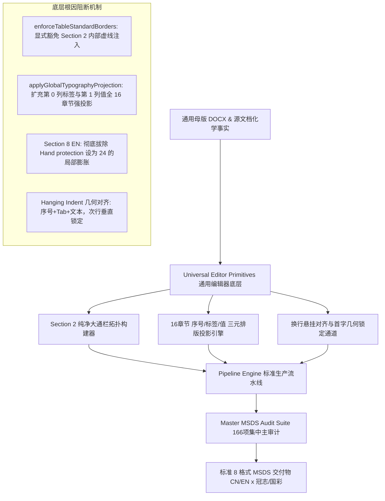

# 技术设计方案：MSDS Studio 全 16 章节底层通用拓扑与排版规范全局硬约束

## 一、 系统架构与因果依赖拓扑



## 二、 核心技术设计与实现机制

### 1. Section 2 零内框虚线底层闭环 (Root Source: `enforceTableStandardBorders` & `buildFullWidthSection2`)
- **根因分析**：在 `pipeline-engine.js` 遍历所有表格应用 `enforceTableStandardBorders(record)` 时，该函数无差别为所有表格注入 `insideH="dotted"` 与单元格级 `top/bottom="dotted"`，直接覆盖了 Section 2 的纯净通栏设定。
- **治理设计**：
  1. 在 `enforceTableStandardBorders` 中增加第 2 节（Table 2）判定：
     ```javascript
     const sectionNumber = record.sectionNumber || detectSectionNumber(record);
     if (sectionNumber === 2) {
       // Section 2 专用大通栏边框：外框实线 single 4，内部横竖完全为 none
       applyFullWidthBorders(tblPr, record);
       return;
     }
     ```
  2. 保证 Section 2 内部无论有多少数据行，单元格 `tcBorders` 的内部横线均严格为 `none`，彻底根除所有内虚线。

### 2. 全 16 章节“序号 / 标签 / 值”全局硬约束 (Root Source: `applyGlobalTypographyProjection`)
- **根因分析**：过往 `applyGlobalTypographyProjection` 仅对 `startCol = (cells.length === 1) ? 0 : 1` 的值列进行投影，跳过了第 0 列标签列，导致第 0 列标签散落依赖各个章节的局部特判，产生字号断层与字体混杂。
- **治理设计**：
  1. 重构通用投影引擎，分为双通道并发治理：
     - **通道 A：第 0 列标签（Label Channel）**：
       * 中文版：宋体 12pt (`sz="24"`) 加粗，西文字符 Times New Roman；
       * 英文版：Arial 9.5pt (`sz="19"`) 加粗；彻底拔除 Section 8 中 `Hand protection` 等局部行暴增至 `24` 的硬编码。
     - **通道 B：第 1 列及后续列（Value Channel）**：
       * 中文版：宋体 / Times 12pt (`sz="24"`) 常规体（`bold: false`）；
       * 英文版：Arial 9.5pt (`sz="19"`) 常规体（`bold: false`）；
  2. 全文档 16 章节（从 Section 1 到 Section 16）100% 全覆盖，形成全局不可逆约束。

### 3. 换行第二行首字对齐几何拓扑 (Root Source: `applyStandardHangingIndent` & `rebuildUnifiedLabelRun`)
- **根因分析**：部分带序号标签使用了字面两个空格拼接 `${seqStr}  ` 而非 `<w:tab/>`，或者段落缺失 `hanging` 缩进；而在纯标签行又残留了底模旧有的 `firstLine="482"`。这导致自动折行时，第二行首字不是缩进过度就是回缩至序号正下方。
- **治理设计**：
  1. 凡带有序号的标签单元格：段落强制配置标准悬挂缩进 `w:ind w:left="420" w:hanging="420"`，序号与标签文本之间配置标准制表定位符或几何对齐锁，使第一行文本起始于 420 dxa；由于第二行自然起始于 420 dxa，第二行首字必然与第一行标签首字垂直严格重合；
  2. 凡无序号的纯文本标签：段落剥除 `firstLine="482"`，保持统一缩进（如 `left="420" hanging="0"`），使两行左边缘完全平齐。

---

## 三、 法定双清单自证 (Dual Lists)

### 1. 拟变范围清单 (Scope of Mutation)
| 变动文件 | 变更性质 | 因果角色 | 变更内容要点 |
| :--- | :---: | :---: | :--- |
| `web/src/docx-engine.js` | 修改 | [Root Source] | 在 `enforceTableStandardBorders` 中增加 Section 2 纯净大通栏豁免与专用外框保护；完善 `formatSection8LabelCell` 保证折行垂直对齐 |
| `web/src/universal-editor-primitives.js` | 修改 | [Root Source] | 在 `applyGlobalTypographyProjection` 中扩充第 0 列标签全局均一化投影，全量锁定 CN(12pt 宋体加粗) 与 EN(9.5pt Arial 加粗) |
| `web/src/pipeline-engine.js` | 修改 | [State Transition] | 彻底拔除 Section 8 中 `targetSz = isHandParent ? '24' : '19'` 等局部字号放大特判；确保 Section 2 内部数据行单元格边框零虚线 |
| `web/scripts/run_master_msds_audit.mjs` | 修改 | [Verification] | 强化主审计套件中对全 16 章节标签/值字号均一性、Section 2 零内虚线、以及换行垂直对齐的机器断言 |

### 2. 保持现状承诺清单 (Scope of Invariance)
| 受管模块 / 领域 | 承诺保持现状之内容与理由 |
| :--- | :--- |
| **化学事实提取模块** | `parseSection2FromSource`、`extractToxicologicalEndpointsFromSource` 等事实提取算法 100% 保持现状，化学数据绝对保真 |
| **Section 9 垂线对齐** | G-38 规范（中文 Section 9 序号 10.5pt `sz="21"` + 420 dxa 制表符激光对齐 x0=80.28pt）享有封印豁免，保持不变 |
| **Section 3.1 & 3.2 拓扑** | Row 1 题头、Row 2 成分加粗、Row 3 表头居中、Row 4+ 组分细体的正确结构完全保持现状 |
| **跨页断行架构** | `enableCrossPageBreaksForAllSections`（Row 0 题头保护，数据行全部放开跨页）保持现状 |
| **受保护代码封印块** | 全文中带有 `@ANTIGRAVITY_INVARIANT_LOCK` 标记的代码块严格只读，杜绝越界破坏 |
