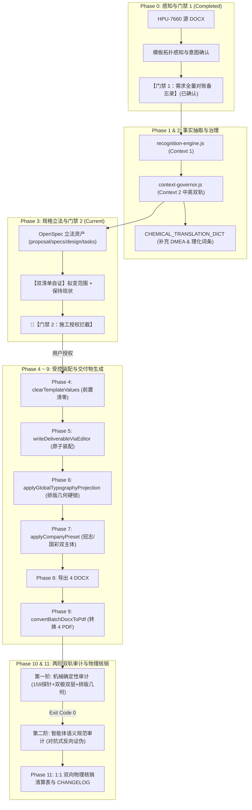

# Design: HPU-7660 工业级生产流水线与两阶双轨审计架构

## 1. 架构总览 (Architecture Overview)

## 2. 核心模块因果拓扑与状态机转移 (Causal Topology & State Machine)

1. **Context 1 $\rightarrow$ Context 2 状态流转**：
   - 输入源文件经 `recognizeSourceDocx` 提取出品名 `羟基聚氨酯分散体`、3 项化学组分及理化特性；
   - GHS 非危属性由 `sec2Text` 与 `isHazardous: false` 显式判定，进入 `INV-ZERO-EXOGENOUS` 状态机分支；
   - 英文分支由 `CHEMICAL_TRANSLATION_DICT` 注入国际通用 IUPAC/CAS 命名，禁止任何未翻译中文残留。

2. **编辑器装配与排版几何硬锁**：
   - `createWorkSession` 动态挂载官方基准底模，执行 `clearTemplateValues` 抹除所有旧数据残留；
   - `universal-editor-primitives.js` 强制投影底层几何硬锁：
     - 单 `<w:tab/>` 0 空格连接；
     - 420 dxa (Tier A) / 560 dxa (Tier B) 动态阶梯；
     - 多列单元格清除 `w:ind` 顶格对齐；
     - 3+ 列数据表格 Column 0 纯文本顶格解耦。

3. **两阶双轨审计把控机制**：
   - 机械第一阶：`runMasterMsdsAudit`（159 探针）+ `runBipolarBilayerAudit` + `test_editor_indent_and_alignment_invariants.mjs`，任何告警视为失败（`--max-warnings=0` 语义）；
   - 语义第二阶：16-Section 中英文逐句逐槽位 1:1 双向物理对账，出具核销清算凭据。
