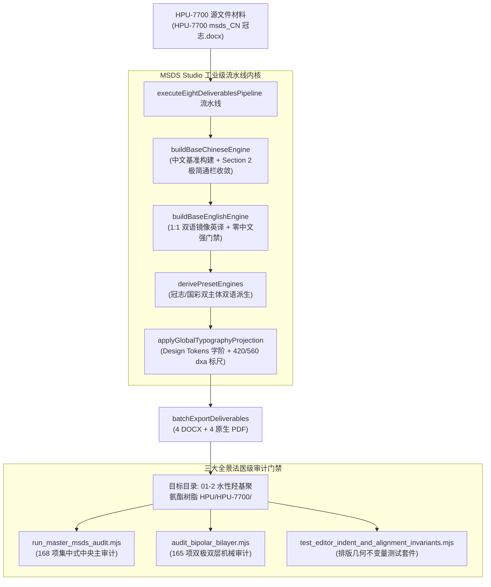

# Design: HPU-7700 八格式标准生产与法医级审计技术方案

## 1. 架构流转拓扑 (Architectural Topology)

## 2. 状态机与因果拓扑
1. **输入事实状态**:
   - `modelCode = 'HPU-7700'`
   - `isHazardous = false`（触发非危通栏 2 行模式）
   - `appearance = '透明至半透明液体'`（英译 `Transparent to translucent liquid`）
   - `solidContent = '37±2%'`
2. **生产控制状态**:
   - 编写专用生产调用脚本 `web/scripts/produce_hpu7700_deliverables.mjs`；
   - 依赖已修复的 `universal-editor-primitives.js`（零 tabs）、`template-editor.js`（9.1~9.N单调递增）、`smart-matching.js`（非破坏性PU前缀）、`pipeline-engine.js`（引燃温度完整英译）；
   - 一键生成 8 个标准文件。

## 3. 防线与门禁设计
- **L1 承重墙防线**: 模板只读豁免，页眉页脚原生继承，Section 2 极简通栏；
- **L2 静态分析门禁**: 三大脚本审计，退出码 0 为充要条件；
- **L3 契约立法**: RFC 2119 行为契约，1:1 RTM 守恒；
- **L4 外部见证者**: PyMuPDF 物理实测 PDF 字号 9.5pt 与 Section 9 标签对齐 80.28pt。
