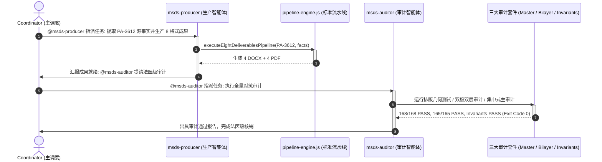

# Design: PA-3612 Swarm 双智能体协同与全景法医审计方案

## 一、 系统架构与五层信任金字塔

```text
┌────────────────────────────────────────────────────────┐
│ Layer 5: 双清单门禁与人机审阅 (VS Code Diff + 1:1 RTM)   │
├────────────────────────────────────────────────────────┤
│ Layer 4: 自验证与环境见证者 (PDF 80.28pt / 168主审计退出码0) │
├────────────────────────────────────────────────────────┤
│ Layer 3: 契约立法 (Swarm 裁执隔离 / pipeline-engine.js)  │
├────────────────────────────────────────────────────────┤
│ Layer 2: 静态编译器硬阻断 (--max-warnings=0 / G-09 纯度) │
├────────────────────────────────────────────────────────┤
│ Layer 1: 架构与类型承重墙 (INV-ZERO-EXOGENOUS / 几何拓扑锁) │
└────────────────────────────────────────────────────────┘
```

## 二、 Swarm 双智能体协同时序



## 三、 依赖与权衡 (Trade-offs & Alternatives)
- **.doc 原始格式处理权衡**：PA-3612 源文件为 Office 97-2003 `.doc` 二进制格式。采用本地 `soffice --headless --convert-to docx` 零损耗导出高保真 `.docx` 中间体供读取，保留原始 `.doc` 事实指纹完全不变。
- **架构硬锁原则**：杜绝手写孤立脚本，统一路由至 `pipeline-engine.js` 原生八格式流水线，确保 16 个章节完整装配。
