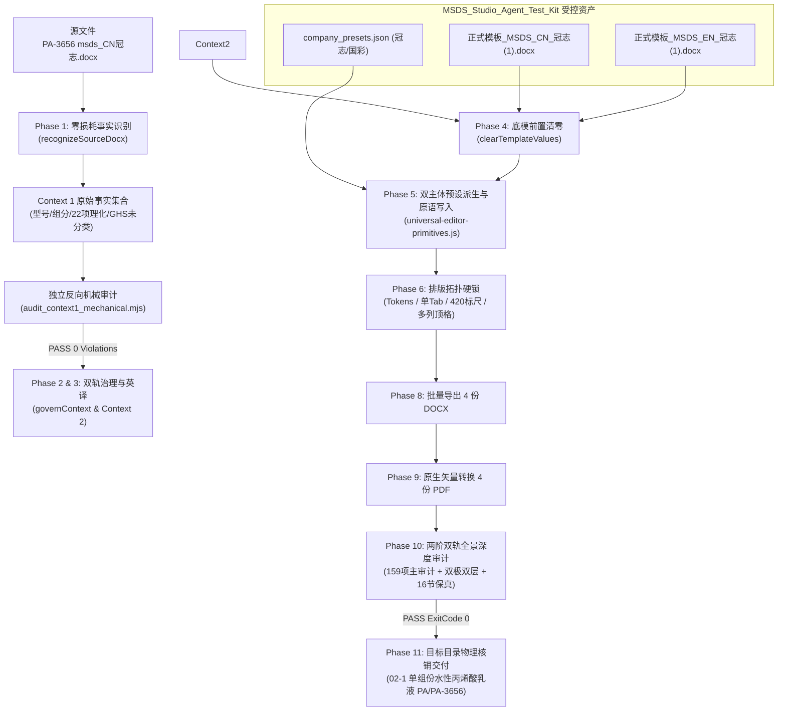

# 技术架构方案与因果拓扑设计 (Design: PA-3656 8-Format Production)

## 一、 系统架构与执行数据流 (Architecture & Pipeline)

---

## 二、 核心技术权衡与状态机因果映射

1. **GHS 危害状态机二分判定 (Origin Producer Isolation)**：
   - 源文件 Section 2 明示：“根据GHS不属于危险物”，无象形图，无信号词；
   - 状态机转移：`isHazardous: false`, `categories: []`, `signalWord: null`, `pictogramCount: 0`；
   - 彻底阻断向交付物中注入“GHS象形图：无”与“信号词：无”，严格遵守 `INV-ZERO-EXOGENOUS`。

2. **Section 3 组分数据网格克隆机制**：
   - 提取到 2 项组分：
     - `丙烯酸共聚物` (CAS: 商业机密, > 30%)
     - `去离子水` (CAS: 7732-18-5, > 50%)
   - 底模标准组分表格通过克隆增行 (`insertRow`) 严格对齐 2 行，消除旧模板残留的第 3 组分。

3. **Section 9 理化特性微观富文本渲染**：
   - 22 项理化指标逐项按标签对齐；
   - 温度单位规范化：`约100℃` $\rightarrow$ `约 100 °C`；
   - MFFT 与 Tg：`-10`、`0` 规范填入值格；
   - 冒号垂直对齐于 80.28pt 坐标线，严格遵循 `formatLaserTabs`。

4. **双主体信息隔离保障**：
   - 冠志版：统一社会信用代码/企业全称/地址/电话/传真 严格绑定广州冠志；
   - 国彩版：统一社会信用代码/企业全称/地址/电话/传真 严格绑定英德国彩；
   - 页眉页脚型号与企业信息 100% 物理隔离，杜绝交叉串号。
