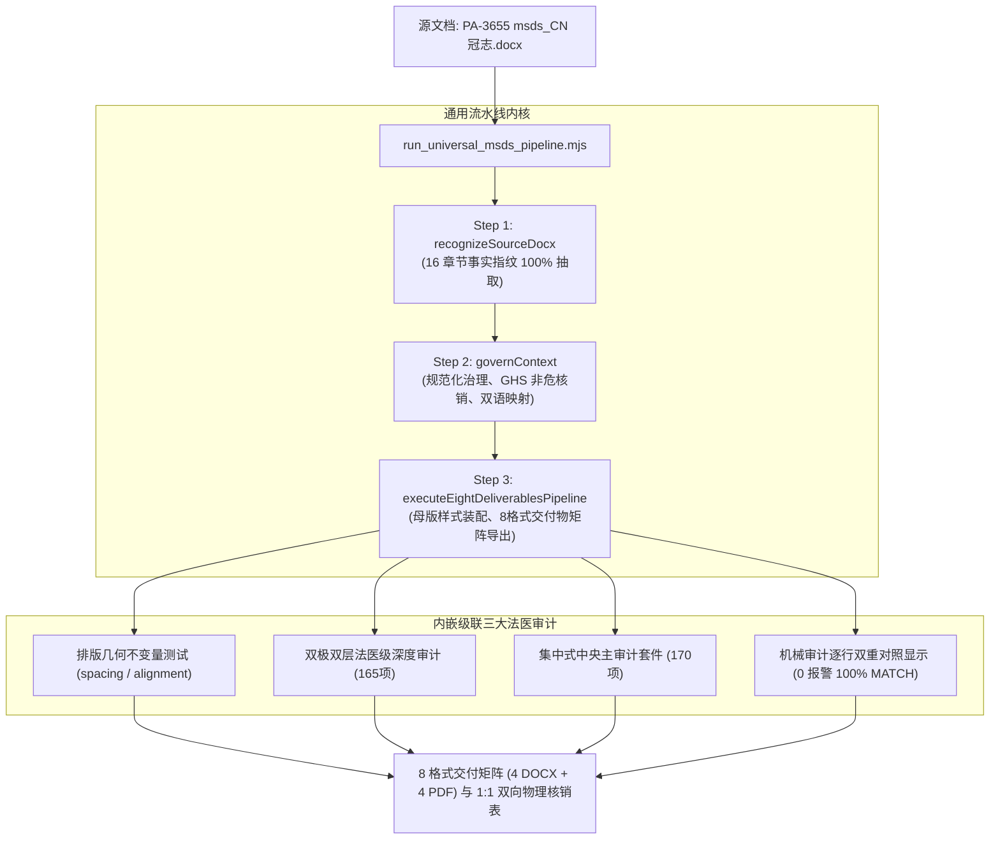

# Design: 拓扑编辑器 Agent 原生 MCP/ACI 工具封装与 PA-3655 覆写产出架构

## 1. 架构目标与演进背景
在前期架构演进中，系统已在 `template-editor.js` 底层实现了四大拓扑原语（内省、变形、排版、事务）。然而，在 MCP / ACI 工具层，Agent 尚无法直接通过独立强类型工具调用这些原语，仍需依赖组合复杂的 `msds_execute_editor_ops` 或由后端流水线自动处理。

本设计确立：
1. **拓扑编辑器 Agent 原生 MCP 工具层**：在 `mcp-server.js` 中新增 4 大专用工具接口，向 Agent 直接暴露强类型原子操作；
2. **扩充万能操作批处理通道**：在现存 `msds_execute_editor_ops` 中补齐 `reshapeRows`、`morphToFullWidth`、`applyAdaptiveRuler` 等操作类型；
3. **基于改进流水线的一键生产**：执行 Agent 调用 `run_universal_msds_pipeline.mjs` 对物理源文件 `PA-3655 msds_CN 冠志.docx` 进行端到端覆写产出与全量审计。

## 2. 拓扑四层原语 Agent MCP 工具映射矩阵

```text
┌────────────────────────────────────────────────────────────────────────┐
│ Layer 4: 事务安全与合规审计层                                           │
│ MCP Tool: msds_validate_topology_invariants                            │
│ 原语映射: validateTopologicalInvariants(session, secNum)               │
│ 职能: 边框外实内虚校验、零 <w:numPr> 校验、零 8730 页脚畸变校验          │
├────────────────────────────────────────────────────────────────────────┤
│ Layer 3: 几何排版与激光标尺层                                           │
│ MCP Tool: msds_apply_typography_ruler                                  │
│ 原语映射: applyAdaptiveRuler / formatSection9LaserTabs / enforceFlush   │
│ 职能: 80.28pt 黄金基准对齐、Tier A/B 自适应标尺、值单元格顶格左对齐    │
├────────────────────────────────────────────────────────────────────────┤
│ Layer 2: 结构变形与网格重构层                                           │
│ MCP Tool: msds_morph_section_topology                                  │
│ 原语映射: reshapeTableRows / morphToFullWidth / morphToMultiColumn ... │
│ 职能: 行数扩缩容、大通栏单行重构、多列拆分、单元格合并与新行插入        │
├────────────────────────────────────────────────────────────────────────┤
│ Layer 1: 拓扑感知与内省层                                               │
│ MCP Tool: msds_get_section_topology                                    │
│ 原语映射: getSectionTopology(session, secNum)                          │
│ 职能: 表格骨架探测、行/列数提取、布局角色判定、DOM 文本快照            │
└────────────────────────────────────────────────────────────────────────┘
```

### 2.1 新增 MCP 工具规范定义

1. `msds_get_section_topology`:
   - `inputSchema`:
     - `templateKey` (string, 可选): 母版标识
     - `docxPath` (string, 可选): DOCX 文件完整物理路径
     - `sectionNumber` (number, 必填): 章节编号 (1~16)
   - `returns`: `{ sectionNumber, tableFound, rowCount, columnCount, layout, rows: [...] }`

2. `msds_morph_section_topology`:
   - `inputSchema`:
     - `templateKey` (string, 可选)
     - `docxPath` (string, 可选)
     - `outputPath` (string, 必填): 产出或保存文件路径
     - `sectionNumber` (number, 必填)
     - `action` (string, enum: `reshapeRows`, `morphToFullWidth`, `morphToMultiColumn`, `insertRowAfter`, `deleteRow`, `mergeCells`)
     - `params` (object, 可选): `{ targetRowCount, rowIdx, content, colWidths, fromCol, toCol, cloneFromRowIdx }`
   - `returns`: `{ success: true, action, sectionNumber, topologyAfter }`

3. `msds_apply_typography_ruler`:
   - `inputSchema`:
     - `templateKey` / `docxPath`
     - `outputPath` (string, 必填)
     - `sectionNumber` (number, 必填或 'all')
     - `rule` (string, enum: `adaptiveRuler`, `laserTabsSection9`, `flushLeftValues`, `allRules`)
   - `returns`: `{ success: true, appliedRule, sectionNumber }`

4. `msds_validate_topology_invariants`:
   - `inputSchema`:
     - `docxPath` (string, 必填)
     - `sectionNumber` (number, 可选)
   - `returns`: `{ passed: boolean, errors: [...], warnings: [...] }`

## 3. PA-3655 覆写生产流水线与全景法医审计链路



## 4. 依赖权衡与承重墙约束
- **零破坏已有工具**：现有 `msds_execute_editor_ops`、`msds_batch_export_eight`、`msds_audit_deliverables` 保持 100% 向上兼容，仅做操作集增量扩充；
- **设计令牌与模板边框硬锁**：任何拓扑变形工具严禁破坏外部实线单线 (single) 与内部虚线 (dotted) 的外实内虚公理；
- **单一入口不变量 (INV-ZERO-TEMPORARY-SCRIPTS)**：严禁再为 PA-3655 新建临时生产脚本，必须通过标准统一流水线一键交付。
