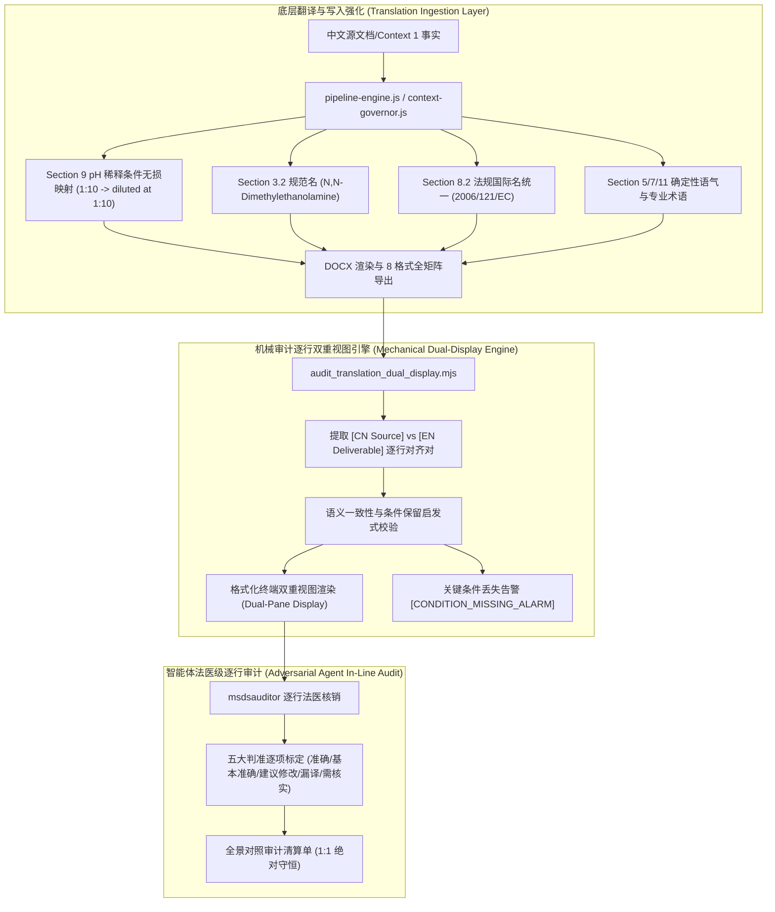

# Design: 翻译底层执行写入与机械审计逐行双重对照显示技术设计

## 1. 架构总览与因果链路 (Architecture & Causal Flow)



---

## 2. 核心模块重构与技术方案

### 2.1 Section 9 pH 条件无损翻译重构 (`pipeline-engine.js`)
- **历史缺陷代码**:
  ```javascript
  else if (/按.*稀释|稀释|水溶液/.test(cnVal)) {
    const m = cnVal.match(/[\d.-]+/);
    enVal = m ? m[0] : cnVal; // 粗暴截断丢弃条件
  }
  ```
- **重构方案**:
  - 精准识别稀释比例与测试条件：
    - `1:10.*(?:比例)?.*稀释`: 转译为 `${range} (diluted with water at a ratio of 1:10)`；
    - `(?:按)?\s*(\d+:\d+).*(?:比例)?.*稀释`: 动态捕获比例，转译为 `${range} (diluted with water at a ratio of $1)`；
    - `(\d+%).*(?:水溶液)`: 转译为 `${range} ($1 aqueous solution)`；
    - 其他未知名词采用规范英译追加，严禁截断。

### 2.2 化学品规范名词表升级 (`context-governor.js` & `pipeline-engine.js`)
- 将 `N,N-二甲基乙醇胺` 与 `二甲基乙醇胺` 标准译名收敛为 `N,N-Dimethylethanolamine`；
- 法规指令统一为 `2006/121/EC`；
- Section 5 消防气体翻译增加确定性保护：`Combustion releases carbon monoxide, carbon dioxide, nitrogen oxides and small amounts of hydrogen cyanide.`。

### 2.3 机械审计逐行双重显示引擎 (`audit_translation_dual_display.mjs`)
- 构建独立的审计呈现子模块，导出 `auditTranslationDualDisplay(sourceOrCnPath, enPath, options)`；
- 遍历 Section 2 至 16 的全部行，逐行提取中英文文本对；
- 对照判定：
  - 判定是否存在关键数字漂移；
  - 判定是否存在未翻译的中文字符；
  - 判定是否存在源文含有稀释/测试条件而英文缺失对应词的病态；
- 格式化终端输出：
  ```text
  ┌─ [Section 09.03] pH value ───────────────────────────────────────────
  │ [CN Source]     : pH 值：7-9（按 1:10 的比例用水稀释）
  │ [EN Deliverable]: pH value: 7-9 (diluted with water at a ratio of 1:10).
  │ [Evaluation]    : ✅ MATCH (All conditions preserved)
  └───────────────────────────────────────────────────────────────────────
  ```
- 集成至 `run_master_msds_audit.mjs` 与 `run_universal_msds_pipeline.mjs`，作为审计阶段的标准双显呈现。

---

## 3. 法定双清单自证 (Dual-List Self-Certification)

### 一、 拟变范围清单 (Proposed Mutation Scope)
| 变动文件 | 因果角色 | 改动目的与封闭边界 |
| :--- | :---: | :--- |
| `web/src/pipeline-engine.js` | `[Root Source]` | 修复 Section 9.3 pH 稀释条件无损翻译，升级 Section 5/8/9 术语映射 |
| `web/src/context-governor.js` | `[Root Source]` | 统一 `N,N-二甲基乙醇胺` 为 `N,N-Dimethylethanolamine` 标准名 |
| `web/scripts/audit_translation_dual_display.mjs` | `[New Feature]` | 新增机械审计逐行双重显示呈现与条件丢失报警引擎 |
| `web/scripts/run_master_msds_audit.mjs` | `[Integration]` | 集成双重显示审计引擎，使中央主审计输出包含逐行双语对照视图 |
| `web/tests/test_translation_and_dual_display_invariants.mjs` | `[Audit Verification]` | 新增防回退单元测试套件（含稀释条件测试与反例变异熔断） |

### 二、 保持现状承诺清单 (Preservation Commitments)
1. **排版几何与模板托底绝对不变**：Section 9 80.28pt 激光垂线、420 dxa 标尺、零 `<w:tabs>`、零非法悬挂缩进保持原样，绝不引入版面退化；
2. **8 格式交付物全矩阵生成管线不变**：母版绑定、DOCX 导出与 PDF 转换底层流程保持不变；
3. **既有 172 项机械主审计与 165 项双层双极审计既有断言不变**：原通过的测试断言继续作为硬准入底线，不弱化任何一项既有标准；
4. **既有已交付型号交付物保持现状**：除测试与验证命令调用外，不随意篡改既有归档目录下的历史产出物。
