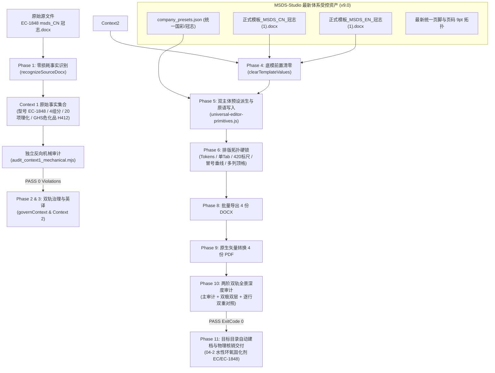

# 技术架构方案与因果拓扑设计 (Design: EC-1848 8-Format Production)

## 一、 系统架构与执行数据流 (Architecture & Pipeline)

---

## 二、 核心技术权衡与状态机因果映射

1. **GHS 危害状态机精准保真 (H412 危险化学品)**：
   - 源文件 Section 2 明示：“对水环境有慢性危害 类别 3 (H412)”，信号词“警告”，无象形图；
   - 状态机转移：`isHazardous: true`, `categories: ['对水环境有慢性危害 类别 3 (H412)']`, `signalWord: '警告'`, `pictograms: []`；
   - 彻底阻断底模默认残留串入或被错误降级为非危险化学品。

2. **Section 3 组分数据网格克隆机制 (4 组分)**：
   - 提取到 4 项组分：
     - `胺类混合物` (CAS: 商业机密, 45-51%) $\rightarrow$ `Amine mixture`
     - `水` (CAS: 7732-18-5, 41-49%) $\rightarrow$ `Water`
     - `丙二醇甲醚` (CAS: 5131-66-8, 3-7%) $\rightarrow$ `Propylene glycol monomethyl ether`
     - `丙酸` (CAS: 79-09-4, 1-3%) $\rightarrow$ `Propionic acid`
   - 底模标准组分表格通过克隆增行 (`insertRow`) 严格对齐 4 行，确保浓度范围精确回填。

3. **Section 9 理化特性微观富文本渲染**：
   - 20 项理化指标逐项按标签对齐；
   - 外观：`半透明粘稠液体` $\rightarrow$ `Translucent viscous liquid`；
   - 初沸点：`约100℃` $\rightarrow$ `Approx. 100 °C`；
   - 相对密度：`约1.00-1.10g/cm3` $\rightarrow$ `Approx. 1.00 - 1.10 g/cm³`；
   - 动力粘度：`2000-12000mPa.s` $\rightarrow$ `2000 - 12000 mPa·s`；
   - 固体含量：`50±2%` $\rightarrow$ `50 ± 2 %`；
   - 冒号垂直对齐于 80.28pt 坐标线，严格遵循 `formatLaserTabs`。

4. **目录自动建档机制 (Automated Model Directory Provisioning)**：
   - 检测目标路径 `算法训练材料/TDS MSDS 重写版/04-2 水性环氧固化剂 EC/EC-1848` 是否存在；
   - 若不存在，流水线自动执行递归创建，确保 8 格式文件准确落地并隔离存放。
