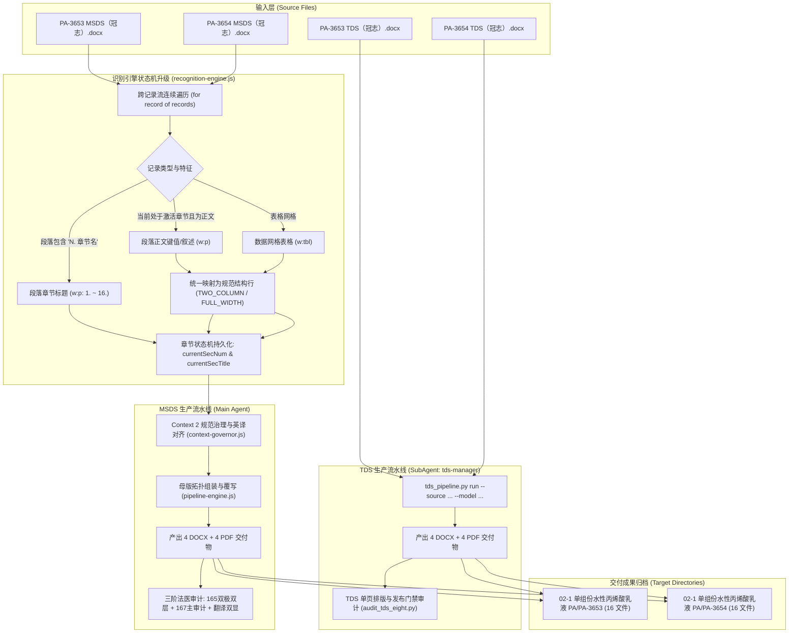

# Design: PA-3653 与 PA-3654 双轨生产与混合排版解析架构设计

## 1. 架构总览 (Architecture Overview)

本系统采用 **Main Agent (MSDS) + SubAgent (TDS)** 协同双轨架构。
底座核心聚焦于 `recognition-engine.js` 的状态机演进，使其具备无感知适配不同 Word 物理拓扑的能力。

---

## 2. 混合排版解析状态机详细设计 (Recognition Engine State Machine)

### 2.1 核心问题根因 (Root Cause Analysis)
在 `docx-engine.js` 中，Word 文档被切分为 `kind: 'text'` (段落) 和 `kind: 'table'` (表格)。
- 当文档采用标准 16 表格时，每个表格的 Row 0 包含章节名，`record.sectionNumber` 能被精准识别。
- 但 `PA-3653` / `PA-3654` 采用公文式混合排版：章节标题作为独立段落置于表格之外，导致：
  1. `kind: 'text'` 的章节段落未被提取为有效章节上下文。
  2. 随后的 `kind: 'table'` 因标题只是 `"产品名称："` 或 `"化学品名称"`，未能继承章节编号，`sectionNumber` 为 null。
  3. 非表格的说明文字段落（急救措施、消防措施等）因 `record.rows` 为空而被循环忽略。

### 2.2 状态机演化机制 (Stateful Record Traverser)
在 `recognizeSourceDocx` 中维护跨记录持久状态：
1. **持久状态变量**：`let currentSecNum = null; let currentSecTitle = '';`
2. **段落记录处理 (`kind === 'text'`)**：
   - 提取段落纯文本 `txt = (record.text || record.title || '').trim()`。
   - 使用增强正则探测是否为大章节标题：`match = txt.match(/^\s*(?:[vV])?\s*(\d{1,2})[\.、\s]+(.*)$/)`。
   - 若匹配且位于 1~16 范围内，校验关键词后，更新状态：
     `currentSecNum = matchedSecNum; currentSecTitle = matchedTitle;`
   - 若非大标题且 `currentSecNum` 处于激活状态（1~16）：
     将该段落文本按换行切分或键值切分，包装为虚拟行对象注入 `facts.sections[currentSecNum]` 与 `secRawRowsMap`，供专属章节解析器提取事实。
3. **表格记录处理 (`kind === 'table'`)**：
   - 检查 Row 0 是否包含章节标题。若有，更新 `currentSecNum`。
   - 若无，但上文段落已确立 `currentSecNum`，则该表格直接继承该 `currentSecNum`。
   - 将表格各行照常进行多维分类与语义注入。

---

## 3. 因果拓扑与爆炸半径控制 (Blast Radius Control)

- **[Root Source] 根因变更点**：
  `F:\App Location\Guanzhi Tong\Skill\MSDS-Engine\web\src\recognition-engine.js`
- **[State Transition] 状态转移产生文件**：
  - `F:\App Location\Guanzhi Tong\Skill\MSDS-Engine\output\PA-3653\` (中间识别资产)
  - `F:\App Location\Guanzhi Tong\Skill\MSDS-Engine\output\PA-3654\` (中间识别资产)
  - `F:\App Location\Guanzhi Tong\Skill\MSDS-Engine\算法训练材料\TDS MSDS 重写版\02-1 单组份水性丙烯酸乳液 PA\PA-3653\` (目标最终交付物)
  - `F:\App Location\Guanzhi Tong\Skill\MSDS-Engine\算法训练材料\TDS MSDS 重写版\02-1 单组份水性丙烯酸乳液 PA\PA-3654\` (目标最终交付物)
- **保持现状承诺 (Leave-as-is)**：
  - 严禁触碰 `web/src/docx-engine.js` 的核心 XML 解析底层。
  - 严禁触碰 `web/src/context-governor.js` 和 `web/src/pipeline-engine.js` 的既有模板逻辑。
  - 保持其他既有型号文件夹和 SelfWork 目录绝对只读。
