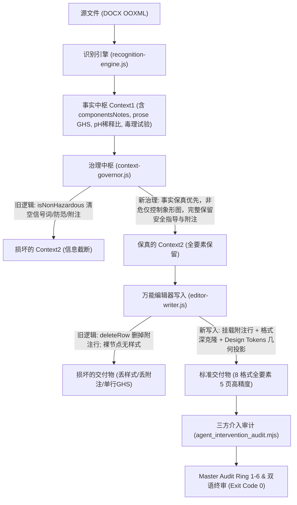

# Technical Design: MSDS Content Fidelity, Universal Dynamic Formatting & Tri-Party Intervention Audit

## 1. 架构拓扑与根因深度剖析



### 1.1 根因一：`context-governor.js` 与 `production-orchestrator.js` 的“过度防御性清空”
- **现象**：当产品被识别为非危险品 (`isHazardous: false`) 时，治理函数直接执行：
  ```javascript
  signalWord: isNonHazardous ? null : raw.ghs?.signalWord,
  hazardStatements: isNonHazardous ? [] : (raw.ghs?.hazardStatements || []),
  precautionaryStatements: isNonHazardous ? { prevention: [], response: [], storage: [], disposal: [] } : ...
  ```
- **后果**：直接将源文件中企业严谨撰写的警告词、危害性说明、15 句散文防范措施全部抹杀为空数组！
- **根治设计**：建立“**事实指纹优先公理**”。非危品仅代表不含高危强危害分类与 GHS 危险象形图，绝对不等于抹杀防范指导与操作说明！只要源文件中提取到非空的信号词、危害性说明、防范说明或环境/物理警示，治理层必须 100% 原样保留并透传至 Context2。

### 1.2 根因二：`editor-writer.js` 的硬编码覆盖与成分附注删除
- **现象**：
  1. Section 2 中，`!isDangerous` 时直接对单元格写入固定的兜底语句（`根据 GHS 标准，该化学品未被分类为危险品。`、`P262...`），压根不读取 `contextData.ghs` 中的真实防范与危害说明；
  2. Section 3 中，`while (s3Rec.rows.length > headerRowsCount + comps.length) { deleteRowFromSession(...); }`，直接将成分表尾部的所有非成分行（包括中和剂成盐附注行）粗暴删除！且从未输出 `componentsNotes`。
- **根治设计**：
  1. Section 2 改造为动态事实渲染：若 `contextData.ghs.precautionaryStatements` 存在内容，按预防、响应、储存、处置结构化排版并写入单元格；若存在 `otherHazards`，写入 2.4 其他危害单元格；
  2. Section 3 改造为附注保留与动态插入：在成分行填充完成后，若存在 `componentsNotes`，保留或动态插入通栏说明行 (`gridSpan=3`)，填入中和剂成盐等法规说明。

### 1.3 根因三：新增内容格式丢失（用户特别提出的痛点）
- **现象**：当向表格中新增行或在单元格中创建新段落时，如果只是调用了简单的 DOM 创建或未施加排版令牌，新增的文字会缺失字体定义（变宋体/Times New Roman 外的系统默认字体）、缺失字号、行距过大或缺失单元格内边距与边框。
- **根治设计**：
  1. 引入**格式深克隆协议 (`deepCloneFormattingFromTemplate`)**：插入新行时，完全复制模板基准行的 `trPr`、`tcPr`、`pPr` 与 `rPr`；
  2. 在全文档写入完成阶段，执行**全局排版拓扑投影 (`applyGlobalTypographyProjection` & `enforceStructuralTypographyInvariants`)**，对新增的所有段落与文本节点进行二次遍历扫描，统一注入：
     - 中文字体：宋体 (`w:ascii="SimSun" w:hAnsi="SimSun" w:eastAsia="SimSun"`)
     - 英文字体：Arial / Times New Roman
     - 字号：9.5pt (`w:sz="19"`) 或 10.5pt
     - 行距：固定行距或 1.15 倍行距，段前段后 0 间距
     - 单元格垂直居中：`w:vAlign w:val="center"`
     - 标准边框：四周边框 `single 0.5pt #000000`

---

## 2. 拟变代码与涉及模块

1. `web/src/recognition-engine.js`：核对优化识别引擎，确保 4840 与 4902 源文件所有章节 100% 提取；
2. `web/src/context-governor.js`：重构非危险品 GHS 事实治理，解除防范说明与附注的清空逻辑，保留 `componentsNotes`、`otherHazards` 与原始信号词；
3. `web/src/production-orchestrator.js`：解除 `normalizeContext` 中的暴力清空，确保 Context2 包含全量事实；
4. `web/src/editor-writer.js`：重构 Section 2 散文防范说明、Section 3 中和剂成盐附注通栏行渲染，并对新增内容注入全局格式硬约束；
5. `web/src/bilingual-mapping-set.js` 或双语模块：补充中和剂成盐附注、散文防范及 pH 稀释比的标准双语映射；
6. `web/scripts/agent_intervention_audit.mjs`：编写全新的法医级三方介入审计工具，对源文件、识别结果、交付物实施 1:1 双向物理对账。
