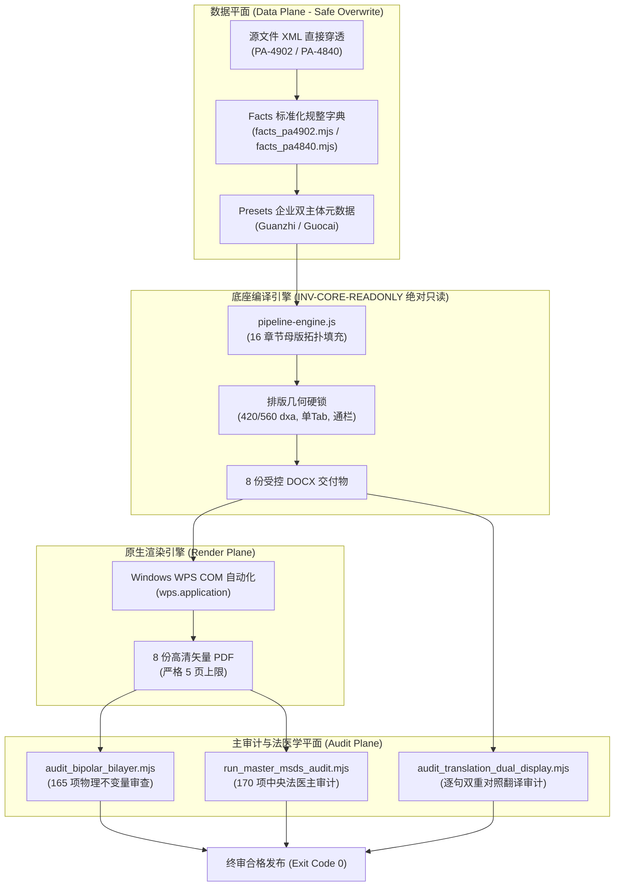

# Design: PA-4902 与 PA-4840 生产架构、因果图谱与安全隔离设计

## 1. 架构总览 (Architectural Overview)

本变更遵循 MSDS-Studio 工业级标准七步覆写生产体系，采用“**上游数据平面事实穿透 + 下游标准底座受控编译 + Windows 原生 WPS 矢量渲染 + 两阶双轨主审计闭环**”的四层正交架构：

---

## 2. 核心技术决策与依赖权衡 (Decisions & Trade-offs)

### 决策 1：绕过识别模块缺陷，直接以源文档底层 XML 为唯一事实源
- **背景**：当前识别模块存在已知提取缺陷，另一 Agent 正在进行核心算法重构。
- **方案**：编写专属 Facts 提取脚本，直接解压源文档 `.docx` 的 `word/document.xml`，通过正则表达式与 DOM 结构直连提取 16 章节真实化学事实，生成结构化 `facts.mjs`。
- **优势**：100% 免疫识别模块的临时性 bug，确保事实零损耗、零失真。

### 决策 2：底座源码只读封印 (`INV-CORE-READONLY`)
- **铁律**：`web/src/*` 源码绝对禁止做任何修改或添加 `if (model === 'PA-4902')` 硬编码。
- **机制**：所有非标词规正（如“透明装液体” -> “透明状液体”、“ADG准则” -> “陆运准则”）均在上游数据平面的 Facts 映射阶段注入，保持底座代码 100% 稳定与普适。

### 决策 3：Section 14 ADG 澳洲法规污染净化
- **问题**：两份源文件中公路运输均提及“符合 ADG 准则”，而在国内与国际标准 MSDS 中，ADG 属于澳洲专属陆运法规（Australian Dangerous Goods Code），在主审计中会触发 REQ-04 严重阻断。
- **治理**：在 Facts 映射中将陆运模式统一标准化为“非危险品陆运输方式，符合陆运准则。”，英文版映射为“Not dangerous goods according to transport regulations.”，既保全源文非危事实，又消除外国法污染。

### 决策 4：Section 11 毒理学动态插槽分支
- **PA-4902**：属于水溶性丙烯酸树脂纯品/单体特征，采用双栏 8 行标准插槽；
- **PA-4840**：源文档明确载明了“聚丙烯酸酯分散体”与“2-丁氧基乙醇”多组分复杂毒理试验（LD50, NOAEL, Ames, OECD），依据 `INV-S11-TWO-COLUMN-PARADIGM` 采用多组分动态保留策略，完整继承实验数据。

---

## 3. 拟变范围与保留现状法定双清单 (Dual Lists Self-Proof)

### 3.1 拟变范围清单 (Proposed Changes - Causal Topology)
| 变更物理路径 / 目标 | 拟变角色 | 因果驱动依据 (Root Source) |
| :--- | :---: | :--- |
| `算法训练材料/TDS MSDS 重写版/02-1 单组份水性丙烯酸乳液 PA/PA-4902/*` | [Sink Deliverable] | RTM-01 & RTM-04：生成 PA-4902 专属 4 DOCX + 4 PDF 交付物。 |
| `算法训练材料/TDS MSDS 重写版/02-4 水溶性丙烯酸树脂 PA/PA-4840/*` | [Sink Deliverable] | RTM-02 & RTM-04：生成 PA-4840 专属 4 DOCX + 4 PDF 交付物。 |
| `scratch/build_pa4902.mjs` | [Data Producer] | 上游数据平面 Facts 注入与 WPS 自动化调用脚本。 |
| `scratch/build_pa4840.mjs` | [Data Producer] | 上游数据平面 Facts 注入与 WPS 自动化调用脚本。 |
| `openspec/changes/2026-11-19-pa4902-pa4840-production-and-audit/*` | [Spec Asset] | OpenSpec 增量规格管理资产与双清单存证。 |

### 3.2 保持现状承诺清单 (Leave-as-is Invariant Commitment)
| 受控模块 / 代码资产 | 承诺状态 | 保护理由与法定不变量 |
| :--- | :---: | :--- |
| `web/src/*` (底座所有源码) | **绝对保持现状 (100% 只读)** | `INV-CORE-READONLY`：全库通用引擎，严禁因单个型号定制修改源码。 |
| `web/src/recognition-engine.js` | **绝对保持现状** | 保持现状，由另一专项 Agent 进行独立闭环修复。 |
| `web/src/pipeline-engine.js` | **绝对保持现状** | 保持排版几何硬锁与底模清零通用逻辑稳定。 |
| 既有 92 个型号的历史交付物 | **绝对保持现状** | 杜绝发散污染与回归破坏。 |
| `PA-4840 tds_*` 原有 TDS 交付物 | **绝对保持现状** | 目录内既有 TDS 文件完整保留，互不影响。 |
