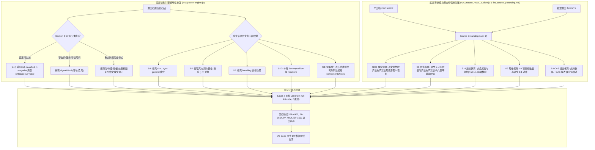

# Design: 识别模块与审计模块底层通用性优化与源文件强制对账审计设计方案
## Change ID: `2026-11-19-recognition-and-audit-source-grounding-refactor`

> **体系遵循**：OrbitStack (Ps-openspec) 轨道工程最高治理总纲  
> **核心目标**：从底层彻底消除识别器在非危二分、同义词、散文防范与顶层对象上的 5 大识别瓶颈；将“源文档事实指纹强制对账”深度嵌入主审计引擎。

---

## 1. 架构目标与因果拓扑 (Goals & Cause-Effect Topology)

---

## 2. 核心技术方案与状态机重构

### 2.1 Section 2 GHS 否定语义过滤与非危判定
- **问题**：原逻辑 `categories.length > 0` 在遇到 `GHS危险性类别: 无` 时将 `["无"]` 当成有效分类，致使 `isHazardous = true`。
- **方案**：
  - 定义标准否定词集：`/^(?:无|不适用|不属于危险(?:化学)?品|未分类|not\s*classified|none|n\/?a)$/i`；
  - 提取分类后执行过滤：`const validCategories = categories.filter(c => !negationRegex.test(c.trim()))`；
  - 当 `validCategories.length === 0 && !hasPictograms && !isSignalWordDanger(signalWord)` 时，明确输出 `isHazardous = false`，`categories = []`；
  - 若文本包含“没有明显的已知作用或严重危险”，提取为 `hazardStatements` 中的说明项或保留在 `rawText` 中。

### 2.2 警示词同义词全量覆盖
- **方案**：
  - 正则模式升级为：`/(?:信号词|警示词|警告词|Signal\s*word)[：:\s]*(危险|警告|Danger|Warning)/i`，确保“警告词：警告”100% 捕获。

### 2.3 散文防范说明纯文本后备解析器 (Prose Precautionary Fallback)
- **方案**：
  - 当检测到防范说明标签（预防措施、事故响应、安全存储、废弃处置）时：
    - 若包含 `P\d{3}`，优先采用原有精确代码分流机制；
    - 若整个防范说明未出现任何 `P\d{3}` 编码，自动激活“散文后备模式”；
    - 解析器按子标签（预防措施、事故响应、安全存储、废弃处置）切分段落文本，对每段文本按中文句号 `。`、分号 `；` 切分为独立句子，清洗首尾空白与缩进后存入对应数组；
    - 确保 `prevention`、`response`、`storage`、`disposal` 四大组均有真实句子，彻底消除全空数组。

### 2.4 全章节顶层业务字段补充
- **Section 4**：增加对 `/(?:接触皮肤|皮肤接触)[：:\s]*([^\r\n]+)/`、`/(?:接触眼睛|眼睛接触)[：:\s]*([^\r\n]+)/`、`/(?:一般措施|急救前言)[：:\s]*([^\r\n]+)/` 的匹配，存入 `firstAid.skin`、`firstAid.eyes`、`firstAid.general`；
- **Section 5**：增加对 `/(?:合适的灭火剂)[：:\s]*([^\r\n]+)/`、`/(?:不合适的灭火剂)[：:\s]*([^\r\n]+)/`、`/(?:特殊危害)[：:\s]*([^\r\n]+)/`、`/(?:消防预防措施和保护设备|保护设备)[：:\s]*([^\r\n]+)/` 的匹配，挂载至 `fireFighting`；
- **Section 7**：增加对 `/(?:安全操作防范|操作预防措施)[：:\s]*([^\r\n]+)/` 的匹配，存入 `handlingStorage.handling`；
- **Section 10**：增加对 `/(?:危险分解产物)[：:\s]*([^\r\n]+)/`、`/(?:可能的危害反应)[：:\s]*([^\r\n]+)/` 的匹配，存入 `stabilityReactivity.decomposition` 与 `stabilityReactivity.hazardousReactions`；
- **Section 3**：在解析成分表格后，检查表格下方说明行是否包含 `请注意以下物质`、`中和剂`、`已键合为盐`，提取后存入 `facts.componentsNotes`。

### 2.5 审计模块强制源文件 1:1 物理对账集成
- **方案**：
  - 在 `web/scripts/run_master_msds_audit.mjs` 中正式将 `lint_source_grounding.mjs` 模块作为核心审计环之一进行调用；
  - 自动定位源文件（通过 `sourceDocx` 参数或自动寻找目录下的源留存 docx）；
  - 运行 `lintSourceGrounding(effectiveSourcePath, cnDocxPath, enDocxPath)`：
    - 严禁非危源文件在产出物中出现象形图或 H 语句；
    - 严禁无接触限值源文件在产出物中残留 4 列表格或虚假六亚甲基限值；
    - 严禁篡改 Section 9 理化指标数值与项数；
    - 严禁改变 Section 14 非危险货物定性与温控区间；
    - 严禁增删 Section 3 CAS 组分；
  - 若对账失败，主审计坚决报告失败并以非 0 退出码退出。

---

## 3. 防御性设计与架构不变量 (Invariants)
- **INV-L2-01 (Zero Hardcoding)**：严禁编写 `if (model === 'PA-4902')` 等特判；
- **INV-L2-02 (Zero Warning/Zero Error)**：代码修改必须严格通过 `npm run lint`；
- **INV-L2-03 (Source Fidelity Invariant)**：审计模块以客观源文档事实为绝对准绳。
