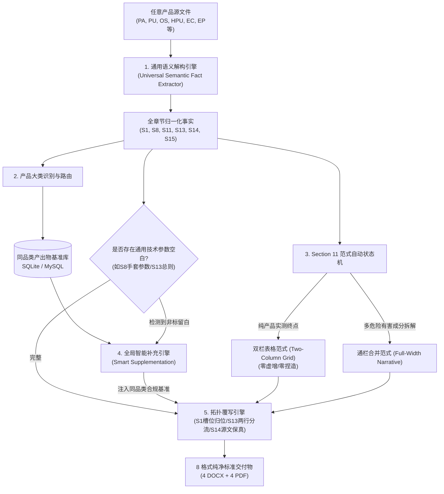

# Technical Design: 全局通用 MSDS 标准化重构与同品类基准数据库补充体系

## 1. 架构总览 (Universal System Architecture)

本设计确立了一套**脱离特定型号依赖、面向全品类化工产品**的通用自动化生产与治理引擎：

## 2. 核心模块与通用机制设计 (Core Universal Modules)

### 2.1 便携式数据库架构（SQLite 快速分发 + MySQL 集中式兼容）
- **便携主库**：`web/data/msds_repo.db` (SQLite 3.x)
  - 零配置、零运行依赖、随 Git 仓库即时分发；
  - 表 `benchmark_category_specs` 包含大类 ID（`category_code`）、标准防护手套规范（`glove_specs_json`）、标准废弃处置通则（`waste_general_json`）、标准法规集（`regulations_json`）；
- **MySQL 兼容架构**：`web/data/mysql_schema.sql`
  - 包含建表 DDL 与预填充基准数据，支持一键导入生产 MySQL 数据库。

### 2.2 六大核心章节通用槽位与状态机设计
1. **Section 1 全局通用槽位法则**：
   - 提取逻辑：无论源文档格式如何，提取 `model`（型号代码）与 `chinese_name`（产品品名）；
   - 注入规则：
     - 中文版 Row 1 `1.1 产品名称：` ──> 仅写入型号（如 `PA-3654`、`PA-4780`、`PU-2346A` 等）；
     - 中文版 Row 2 `中文名称：` ──> 必填 `品名 + 空格 + 型号`（如 `水性丙烯酸乳液 PA-3654`），严格响应底模 Row 2 `此处填写产品中文名称+型号`，彻底消灭全品类 Row 2 留白缺陷；
     - 英文版 Row 1 `1.1 Product name:` ──> 英文品名 + 型号。
2. **Section 8 全局通用手套技术参数智能补充**：
   - 保留源文件对材质的指名要求（如丁腈 NBR、氟橡胶 FKM）；
   - 从 `benchmark_category_specs` 提取大类标准防护技术基准：
     - 材料标准：`EN 374-3`；
     - 氟化橡胶 – FKM：`厚度≧0.4mm；穿透时间≧480min.`；
     - 丁基橡胶 – IIR：`厚度≧0.5mm；穿透时间≧480min.`；
     - 丁腈橡胶 – NBR：`厚度≧0.35mm；穿透时间≧480min.`；
     - 建议：`及时更换受污染手套，脱手套后彻底洗手。`；
   - 英文版 Section 8 100% 对应补齐，工程控制补齐 `Provide adequate ventilation and local exhaust.`。
3. **Section 11 毒理学双范式通用状态机**：
   - 彻底修复 `pipeline-engine.js` 内部无条件强行调用 `buildThreeTierSection11` 的历史重大 Bug；
   - **判定条件**：
     - 若源文件存在对各具体成分（如 NMP、DMAC、游离 TDI/HDI）分别列出毒理数据的，激活 `PARADIGM_1_FULL_WIDTH_MERGED`；
     - 否则，只要源文件列出产品本身的测试终点（经口 LD50、皮肤刺激、眼睛刺激、致敏性、致突变性、致癌性等），强制激活 `PARADIGM_2_TWO_COLUMN_GRID`（双栏表格：指标名称 \| 实测数值/结论）；
   - **零捏造铁律**：在双栏范式下，绝对禁止插入“该产品无可用的毒理学研究...”等硬编码口水话。
4. **Section 13 废弃处置通用两行分流**：
   - Row 1：国家和地方危废环保法规总则；
   - Row 2：`处理方法：` \| 容器倒空、专业回收、严禁排入废水；
   - 消除幽灵空行 Row 2 与空白值 Row 3。
5. **Section 14 运输信息通用保真**：
   - 全面解析公路运输规范、IMDG CODE（海运）、IATA 规则（空运）及温控避光要求，100% 还原源文事实；
   - 英文版逐项专业对齐翻译。
6. **Section 15 法规信息通用规范去重**：
   - 标准化呈现核心法规清单，消除单元格长文本拥挤与重复罗列。
7. **治理 Test Kit 规范**：
   - 更新 `体系交接文档/MSDS_Studio_Agent_Test_Kit/README_FOR_AGENT.md`，固化上述 6 大通用规则。

## 3. 爆炸半径与承重墙保护 (Blast Radius Control)
- **绝对只读承重墙**：
  - 官方底模（`web/public/templates/*.docx`）几何拓扑与单元格定义 100% 只读；
  - 排版几何 Design Tokens（420/560 dxa 自适应标尺、单制表符）绝对锁定；
- **受控施工范围**：
  - `web/data/msds_repo.db` 与 `web/data/mysql_schema.sql`；
  - `web/src/smart-matching.js` 与 `web/src/pipeline-engine.js`；
  - `体系交接文档/MSDS_Studio_Agent_Test_Kit/README_FOR_AGENT.md`；
  - PA-3654 全套交付物及通用回归验证。
