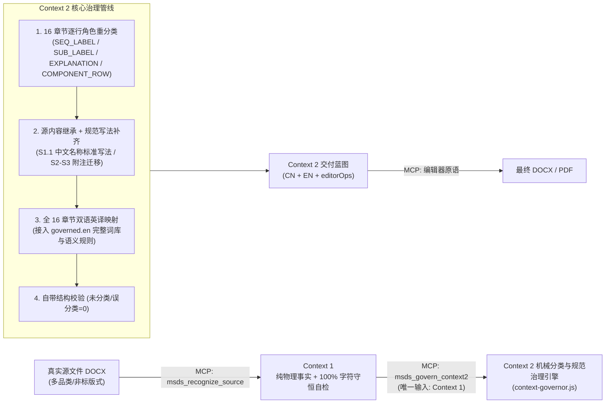

# Design: Context 1 -> Context 2 多样本检验与工作流统一加速架构

## 一、 因果拓扑与职责边界

## 二、 关键技术决策

1. **Section 1.1 CN 版产品中文名称标准写法规范化**：
   - 若源文档 `1.1` 的 `中文名称` 未包含 `modelCode`（如源文仅写了 `水溶性羟基丙烯酸树脂`），`Context 2` 自动规范化为 `<中文品名> <modelCode>`（例如 `水溶性羟基丙烯酸树脂 PA-4902`）；若已包含则保持规范空格格式，确保完全继承源品名且符合 CN 交付规范。
2. **全 16 章节英文映射闭环**：
   - 当前 `buildStructuredContext2` 在 S4~S16 部分字段直接调用 `translateChemicalTerm`，导致标准应急/消防/泄漏/存储/防护/处置陈述未英译。改造后将优先对接 `governed.en`（以及 `pipeline-engine` 共享的双语标准句库 / `translateSection3Notes` / `translateToxicologyValueToEnglish` 等导出函数或字典映射），使 Context 2 表格中的 `英文映射 (EN)` 列具备完整、地道、可审计的英文译文。
3. **机械辅助分类覆盖边缘场景**：
   - 强化 `parseSeqLabel`（支持 `4.1.`、`4.1 `、`11.10`、全半角冒号）与 `isBoldLabel`（覆盖 Section 8 PPE 子项、Section 13 `处理方法`、Section 15 `其它的规定`/`符合下列法规要求`、Section 11 组分题头）；
   - 针对 Section 8 含有多列接触限值表（OEL，如 PU-202A）的情况，精确标定 `TABLE_HEADER` 与 `OEL_ROW`，绝不误判为 `EXPLANATION`。
4. **统一网关提速与零冗余阅读**：
   - 在 `msds_mcp_gateway.mjs` 提供单步直通能力（支持一键传入 `--sourceFilePath` 直接连续产出并校验 `Context 1 + Context 2`），并在 `msds-studio/SKILL.md` 将工作流压缩为“3 条确定性网关命令”，彻底消除 Agent 通读源码和自写脚本。
