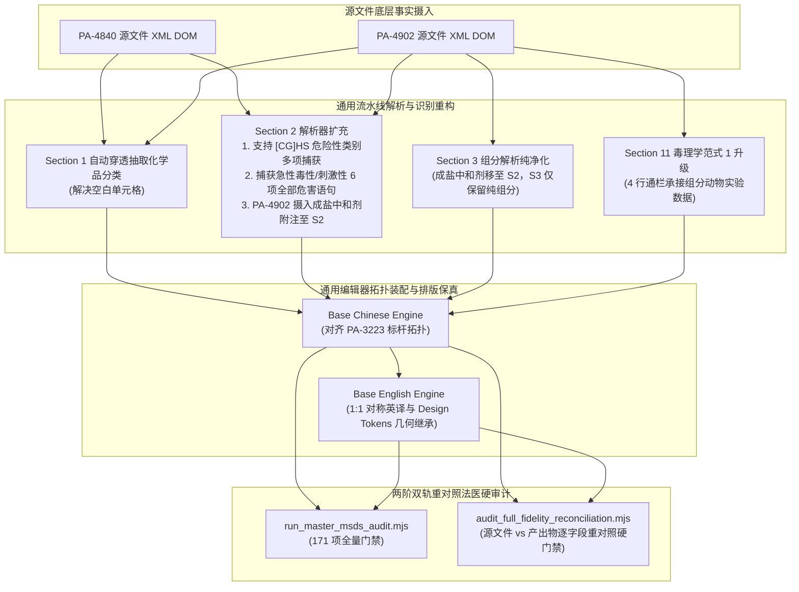

# 技术设计：PA-4840 与 PA-4902 产出物全景重对照与拓扑重构方案

> **设计文档**: `design.md`  
> **治理体系**: OrbitStack (Ps-openspec) 轨道工程体系 - Step 2 规格立法与双清单门禁

---

## 1. 核心技术架构与因果数据流 (Architecture & Causal Data Flow)



---

## 2. 核心模块与拓扑设计

### A. Section 1 中文化学品分类自动穿透与防空设计 (`pipeline-engine.js`)
- 在 `buildBaseChineseEngine` 中，不仅检查 `facts.chemicalClassification`，同时在为空时自动从 `srcEngine` 的 Section 1 记录（匹配 `/化学品分类|产品分类|产品类别/`）中穿透提取值，回填至模板 Section 1 行 3 单元格，确保 100% 填充；
- 在 `buildBaseEnglishEngine` 中，同步利用专业翻译字典将提取的值翻译为标准英文（如 `Acrylic polymer dispersion` / `Waterborne acrylic polymer resin`）。

### B. PA-4840 Section 2 危害性说明与分类全量保全设计 (`pipeline-engine.js`)
- 扩充 `parseSection2FromSource` 中的分类题头匹配正则，兼容 `CHS危险性类别` 与 `GHS危险性类别`；
- 当检测到标签要素或危险性类别下列载的 `急性毒性4经口...`、`眼睛刺激2...`、`皮肤刺激2...`、`对水生生物有害...` 等语句时，将其全部捕获并放入 `parsed.hazardStatements`（以及 `parsed.categories`）；
- 在 `buildFullWidthSection2` 中，`2.3 危险性说明：` 完整遍历并输出全部 6 项危害语句，英文版匹配其英文专业医学翻译，绝对不遗漏任何一项。

### C. PA-4902 成盐中和剂迁移置入 Section 2 拓扑设计 (`context-governor.js`, `pipeline-engine.js`)
- 按照 PA-3223 标杆架构：
  - Section 2 结构装配：
    ```text
    2.1 GHS危险性类别：
    根据GHS不属于危险物 (或 GHS危险性类别: 无)
    羟基丙烯酸酯聚合物GHS危险性分类：不适用；

    2.2 GHS标签要素：
    请注意以下物质：
    N,N-二甲基乙醇胺，中和剂，已键合为盐，质量浓度小于1.0%，特定阈值浓度≥5%
    GHS分类：
    易燃液体3 H226；
    急性毒性4 吸入性 H332；
    急性毒性4 经皮H312；
    皮肤腐蚀1B H314；
    特异性靶器官系统毒性（一次接触）3 H335；
    危险象形标记：无
    警告词：警告

    2.3 危险性说明：
    没有明显的已知作用或严重危险。

    2.4 防范说明：
    ...
    ```
  - Section 3 组分表格纯净化：移除成分表格底部的附注行，严格保持为纯净的 4 行化学组分（表头 + 4 组分），中英文双向同构；
  - 英文版 Section 2 同步在标签要素中挂载标准英译成盐中和剂说明。

### D. PA-4902 Section 11 毒理学范式 1 升级设计 (`pipeline-engine.js`)
- 识别 PA-4902 包含成分级毒理数据（水溶性羟基聚丙烯酸酯与乙二醇丁醚 LD50），自动采纳 PA-3223 标杆的 4 行通栏范式 1 表格：
  - Row 0: `11.毒性资料`
  - Row 1: `该产品无可用的毒理学研究。`
  - Row 2: `下面是这些成分的毒理学数据。`
  - Row 3: 各成分实验数值（乙二醇丁醚经皮、吸入、经口 LD50）；
- 英文版 1:1 对称构建 4 行英文通栏表格。

### E. 全自动法医级“源文件 vs 产出物”重对照硬审计设计 (`scripts/audit_full_fidelity_reconciliation.mjs`)
- 针对产出物建立物理比对硬门禁：
  - 断言 PA-4840 Section 2 包含全部 6 项危害描述；
  - 断言 PA-4902 Section 2 包含 `危险象形标记：无`（或 `象形图：无`）及成盐中和剂全套说明；
  - 断言 PA-4902 Section 3 严格为 4 行纯化学组分表格，无附注行残留；
  - 断言 PA-4902 Section 11 包含乙二醇丁醚实测 LD50 毒理数据；
  - 断言 Section 1 化学品分类单元格非空。

---

## 3. 法定双清单自证 (Dual-List Self-Proof)

### 清单一：拟变范围清单 (Proposed Scope with Causal Annotations)
1. `web/src/pipeline-engine.js` `[Root Source]`：
   - 优化 `parseSection2FromSource`：支持 `CHS危险性类别` 与标签下多项危害说明的全量抽取；
   - 优化 `buildBaseChineseEngine`：Section 1 化学品分类为空时自动穿透 `srcEngine` 回填；
   - 优化 `buildFullWidthSection2`：在 Section 2 中承接成盐中和剂法规附注，规范呈现象形标记，全量渲染危害性说明；
   - 优化 `buildBaseEnglishEngine`：去除 Section 3 英文组分表底部的附注行（因已移至 Section 2）；
   - 优化 `detectSection11Paradigm`：将 PA-4902 正确路由至 4 行通栏范式 1 表格以保全组分毒理数据。
2. `web/src/context-governor.js` `[State Transition]`：
   - 协调 Section 2 与 Section 3 之间的成盐中和剂数据流向，将 `componentsNotes` 映射至 Section 2 标签要素作用域。
3. `web/scripts/audit_full_fidelity_reconciliation.mjs` `[Verifier]`：
   - 新增独立的源文件 vs 产出物全字段物理重对照硬审计套件。
4. `web/scripts/run_master_msds_audit.mjs` `[Verifier]`：
   - 同步更新 Section 2 象形标记与中和剂说明在 Section 2 的断言规则，保持 171 项全量通过。
5. `web/scripts/run_generate_4840_4902.mjs` `[Runner]`：
   - 重新执行流水线生成全部 16 份最终交付物。

### 清单二：保持现状承诺清单 (Leave-As-Is Commitments)
1. **官方母版排版拓扑现状绝对保持**：
   - 严禁篡改 `web/public/templates/正式模板_MSDS_CN_冠志(1).docx` 及英文底模底层 XML；
   - 严禁触碰任何源码级封印标记（`@ANTIGRAVITY_INVARIANT_LOCK`）；
2. **Design Tokens 几何与字阶标准保持**：
   - 表格边框外实线 (single) 内虚线 (dotted)、Section 2 纯净大通栏零内框线规范绝对保持；
   - 恒定字阶（表头 12pt 黑体/Arial Bold，表格内容 9.5pt 宋体/Arial Regular）绝对保持；
   - 行距 1.15 倍、段前段后 0 磅标准绝对保持；
3. **其他章节既有逻辑与非受累型号绝对保持**：
   - PA-4840 的 Section 11 20 行标准插槽结构绝对保持；
   - Section 4、5、6、7、8、9、10、12、13、14、15、16 已审计通过的标准化内容与格式绝对保持；
   - 既有历史测试用例与防假阳性反过拟合过滤规则绝对保持。
