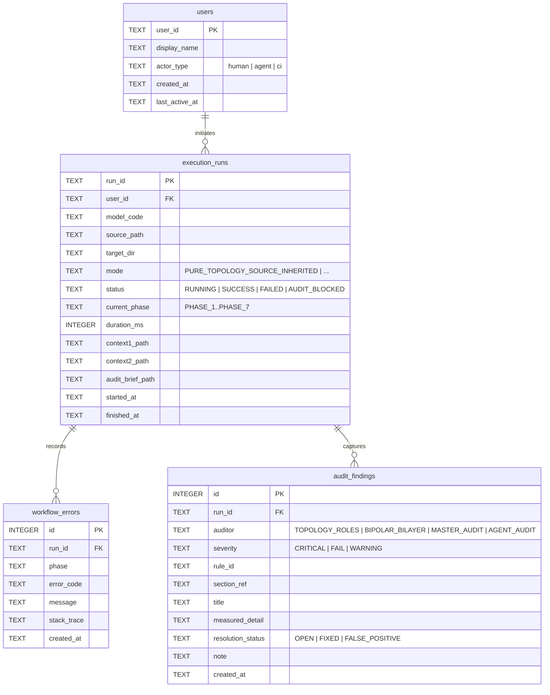

# Design: 用户数据库与覆写审计全过程执行记录数据库

## 1. 底座与用户数据物理隔离设计
- **数据库引擎**：复用 Node.js v24 原生内置 `node:sqlite` (`DatabaseSync`)，零外部编译依赖。
- **物理分离**：
  - 仓库追踪（仅底座）：`web/src/user-exec-db.js`、`web/scripts/query_exec_logs.mjs`、`.gitignore` 保护规则。
  - 本地私有（禁止入库）：`web/data/user_exec_logs.db`（含 `-wal` / `-shm`），首次调用 `getUserExecDb()` 时按需自动创建与建表。

## 2. 数据库 Schema 拓扑 (ER Diagram)



## 3. 流水线集成与流式镜像捕获拓扑

```text
run_standard_production.mjs
  ├── 启动阶段: ensureUser() -> createExecutionRun() [status=RUNNING]
  ├── Phase 1~6: try { updateRunPhase() ... } catch (err) { recordWorkflowError(), finishRun('FAILED') }
  └── Phase 7 (审计阶段):
        ├── spawnSync('node', [auditScript, ...]) 捕获 stdout/stderr 并实时透传控制台
        ├── parseAuditOutput(auditor, output) 提取 FAIL / CRITICAL / WARNING 明细
        └── insertAuditFindings(runId, findings) -> 无论审计是否阻断，均确保数据落库后退出
```
