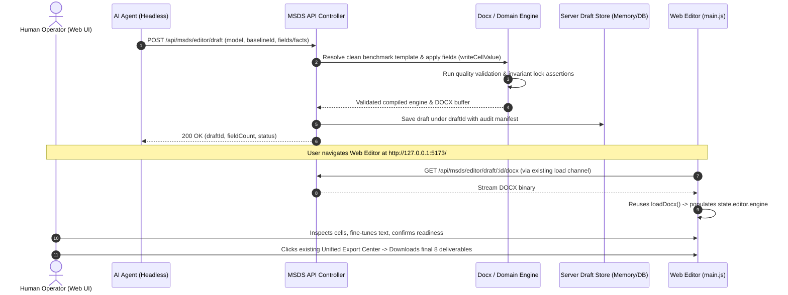

# Design: Agent-Editor Collaborative Draft Architecture

## Architecture Overview

This design establishes a clean bridge between headless Agent automation and the interactive Web Editor while honoring the core constraint of **zero unauthorized UI mutation**.

## Technical Components

### 1. Server Draft Store & API Controller (`web/src/msds-api-controller.js`)
- Maintain an active draft map `editorDrafts = new Map<string, EditorDraft>` in the server runtime.
- For persistence, mirror draft metadata and DOCX bytes to SQLite via `msds-db.js` helper functions.
- In `POST /api/msds/editor/draft`:
  1. Retrieve the base official template (`正式模板_MSDS_CN_冠志(1).docx`, etc.);
  2. Parse template via `loadDocx`;
  3. Map `fields` (e.g. `{ "9.3": "pH: 7.0-8.5", "1.2": "..." }`) to table cells and invoke `writeCellValue` with appropriate role styles;
  4. Run `assertDeliverableQuality` or invariant assertions to block corrupted payloads;
  5. Store the resulting engine and export buffer.

### 2. Frontend UI Minimization Strategy (`web/src/main.js`)
- **Strict UI Reuse Policy**: Avoid adding arbitrary buttons or restructuring toolbars.
- **Hydration Channel Options (for User Guidance)**:
  - *Option A (URL Query Driven)*: User opens or refreshes `http://127.0.0.1:5173/?draftId=xxx`, which automatically loads the draft into the editor via existing `loadDocx` pipeline.
  - *Option B (Existing Template Baseline Selector)*: The baseline selector seamlessly presents available server drafts alongside the static template options.
  - *Option C (Existing Inspect / Repo View)*: Surface the collaborative draft in the existing inspection record table, enabling loading through the existing "导入模板编辑器" button.
- **Human Authority**: The loaded draft seamlessly populates `state.editor.engine`, activates `state.view = 'editor'`, sets `state.editor.dirty = true`, and directly utilizes existing editing and export dialogs.
