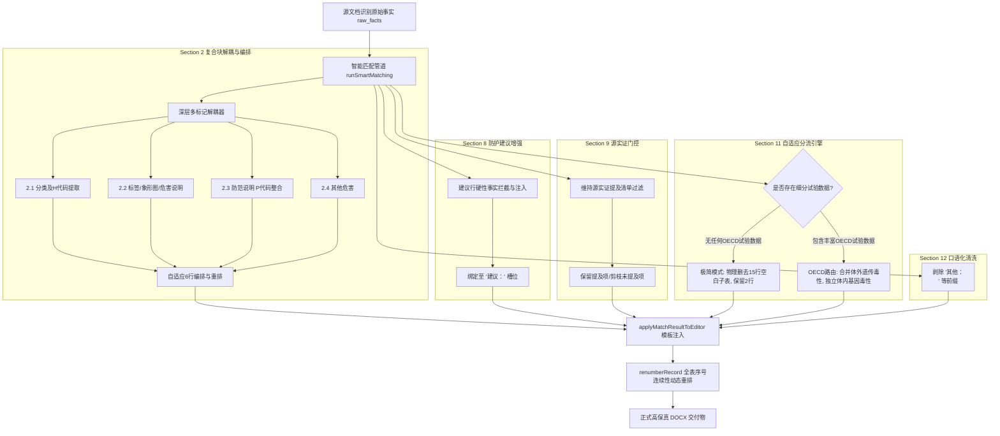

# Design: 全新算法训练材料（EP-1702/1704/PU-2702）驱动的智能匹配算法系统架构与设计方案

## 1. 系统架构与数据流转

本设计针对 `web/src/smart-matching.js` 与模板注入管线，建立“实测训练驱动、真值端到端闭环”的匹配架构：



---

## 2. 核心模块详细设计与算法实现规约

### 2.1 Section 2 复合块深层多标记解耦算法
- **源文档特征**：
  EP-1702/1704 的源文档 Section 2 在单个单元格中堆叠了全部 GHS 声明，包含嵌套小标题、危害性说明、预防措施与废弃处置。
- **算法设计**：
  在 `decoupleSection2CompoundBlocks` 中升级多模式正则抽取器：
  ```javascript
  // 1. 抽取 GHS 分类
  const classMatch = text.match(/(?:GHS危险性类别|物质或混合物的分类|物质或混合物分类)[\s:：]*([^\r\n]+(?:\r?\n[^\r\n]+)*?)(?=\n\s*(?:2\.[2-9]|GHS[- ]?标签要素|危害性说明|防范说明|$))/i);
  
  // 2. 抽取标签要素与危害性说明
  const labelMatch = text.match(/(?:2\.2\s*GHS标签要素|GHS[- ]?标签要素)[\s:：]*([\s\S]*?)(?=\n\s*(?:防范说明|2\.3|2\.4|$))/i);
  const hazardMatch = text.match(/(?:危害性说明|危险性说明)[\s:：]*([\s\S]*?)(?=\n\s*(?:防范说明|2\.3|2\.4|$))/i);
  
  // 3. 抽取防范说明 (含预防措施与废弃处置)
  const precMatch = text.match(/防范说明[\s:：]*([\s\S]*?)(?=\n\s*(?:2\.[3-9]|其他危害|其他危险|$))/i);
  
  // 4. 抽取其他危害
  const otherMatch = text.match(/(?:2\.[3-9]\s*)?(?:其他危害|其他危险)[\s:：]*([\s\S]*?)$/i);
  ```
- **注入与删行重排规约**：
  - 针对危险品（如 EP-1702/1704），在模板中映射为 6 行：
    1. Row 1: `2.危险性概述`
    2. Row 2: `物质或混合物分类`
    3. Row 3: `2.1  GHS危险性类别：`（或 `2.1  物质或混合物分类：`）
    4. Row 4: `2.2  GHS标签要素：`（含象形图说明与 H 说明）
    5. Row 5: `2.3  防范说明：`（含预防措施与废弃处置 P 语句）
    6. Row 6: `2.4  其他危害`
  - 模板中原有的空闲行（2.5 危险性说明、2.7~2.9 物理/健康/环境危害）自动标记为 `PRUNED` 并在注入时物理安全删除；
  - 触发 `renumberRecord`，确保剩余行编号为严谨闭合的 `2.1, 2.2, 2.3, 2.4`。

---

### 2.2 Section 11 “无可用的毒理学研究”极简自适应剪枝设计
- **业务规约**：
  当产品未做毒理试验且源文档明确声明“无可用的毒理学研究”时，模板中预设的 15 行细分子表（急性毒性经口/经皮/吸入、皮肤刺激、眼睛刺激、致敏、致突变、致癌、生殖、STOT、吸入危害）毫无物理依据，留空会导致交付物出现大片无意义空白格。
- **算法设计**：
  在 `runSmartMatching` 处理 Section 11 时，引入 `hasDetailedToxicologyFacts` 判定器：
  ```javascript
  const sec11Facts = inspectorRecords.filter(r => r.sectionNumber === 11);
  const hasDetailedToxicologyFacts = sec11Facts.some(r => 
    /OECD|LD50|LC50|家兔|大鼠|豚鼠|小鼠|Ames|染色体畸变|Buehler/i.test(r.text || '')
  );
  
  if (!hasDetailedToxicologyFacts && sec11Facts.some(r => /无可用的毒理学研究|无毒理学数据|未进行毒理学研究/.test(r.text || ''))) {
    // 触发极简自适应剪枝模式
    return {
      minimalMode: true,
      statementText: '该产品无可用的毒理学研究。',
      // 将模板中除标题行与说明行之外的全部 15 行标记为 PRUNED
    };
  }
  ```
- **模板执行动作**：
  在 `applyMatchResultToEditor` 中，若 `minimalMode === true`：
  - Row 1: 保留 `11.毒性资料`
  - Row 2: 单独单元格写入声明文本 `该产品无可用的毒理学研究。`
  - Row 3~17: 物理调用 `deleteRow` 删除，使表格高度紧凑，达到与手工产出 100% 像素级一致。

---

### 2.3 Section 11 OECD 丰富试验数据时的槽位重构设计 (针对 PU-2702)
- **多试验合并承载规约**：
  针对体外遗传毒性，若源文档同时包含 Ames 试验与体外染色体畸变试验，构建合并文本块：
  ```text
  聚氨酯分散体
  测试种类：沙门氏菌/微粒体试验（Ames试验）
  代谢活化：有/无
  结果：阴性
  方法：OECD化学品测试指南471
  对类似产品研究
  测试种类：体外染色体畸变试验
  代谢活化：有/无
  结果：阴性
  方法：OECD化学品测试指南473
  对类似产品研究
  ```
  精准注入 `11.6  体外遗传毒性：`，不发生端点错位。
- **体内基因毒性动态槽位管理**：
  若源文档出现“体内基因毒性 聚氨酯分散体 无数据资料”，模板注入时自适应插入/映射到对应独立槽位，保持端点完整性。

---

### 2.4 Section 8 手部防护“建议：”行精准绑定设计
- **问题根因**：
  当前在提取 Section 8 时，手套建议语句未能精准匹配到 `standardLabel === '建议：'` 的槽位中。
- **修复逻辑**：
  在 Section 8 解析器中，增设建议行强规则提取：
  ```javascript
  const gloveAdviceRegex = /(?:建议[：:\s]*)(污染的手套应废弃[。.]?)/;
  // 若命中则强行赋值给建议槽位，确保 value 为 '污染的手套应废弃。'
  ```

---

## 4. MSDS 全 16 章节全量细节合规与微观排版规范标准 (Forensic Detail Standards)

为贯彻“整个 MSDS 的所有细节都要是规范的”铁律要求，本设计确立跨越全 16 章节、精确到字符、标点、空格、字体与边框的微观规范体系：

### 4.1 全局字符、标点与度量衡微观基线 (Microscopic Typography Baseline)
1. **中英文标点绝对隔离**：
   - 中文模板：所有标签冒号必须统一为全角中文冒号 `：`（`U+FF1A`），严禁半角冒号 `:` 混用；中文括号统一使用全角 `（`、`）`；中文连接号使用全角或规范顿号 `、`；中文句末必须带全角句号 `。`。
   - 英文模板：所有标签冒号必须统一为半角英文冒号 `:`，后跟单个半角空格；英文括号统一为半角 `(`、`)`；句末使用半角句点 `.`。
2. **序号垂直对齐等宽空格规范 (Whitespace Baseline)**：
   - 序号后半角空格规则：一位数字序号（如 `2.1  `、`8.1  `、`9.1  `）后固定紧跟 **2 个半角空格**；两位数字序号（如 `9.10 `、`11.12 `）后固定紧跟 **1 个半角空格**，确保所有标签正文文字的左对齐垂线处于同一绝对像素位置。
3. **专业度量衡与特殊符号白名单**：
   - 温度：中文固定使用 `℃`，英文固定使用 `°C`（严禁使用 `o` 上标替代）；
   - 公差与范围：百分比与公差严禁使用 `+/-`，必须规范为 `±`（如 `53±2%`、`33±2%`）；范围连接号规范为连字符 `-` 或 `~`（如 `200-5000mPa.s`）；
   - 不等式与数学符：厚度与时间比较符一律使用数学字符 `≥`，清洗并替换源文件中非标的 `≧`；
   - 粘度与密度：粘度统一规范为 `mPa·s` 或 `mPa.s`；密度统一规范为 `g/cm³` 或 `g/cm3`。
4. **字体与加粗不可变性**：
   - 表格所有第一列标签文字（如 `9.1  外观：`）严格保持官方母版原生 **12pt 宋体加粗**；
   - 表格值单元格（第二列及子列）文字一律使用 **12pt 宋体常规（不加粗）**；
   - 严禁算法注入时因替换 XML run 节点导致标签失去加粗或数值误被加粗。

---

### 4.2 全 16 大项逐节全量微观细节对照规约清单

| 章节编号与名称 | 结构与行数基准 | 必须包含的微观细节要素 | 严禁出现的违规现象 (红线) |
|---|---|---|---|
| **Section 1 化学品及企业标识** | 标准 10 行（中/英模板对齐） | 1.1 产品名称、化学品英文名、推荐用途与限制用途、供应商全称（广州冠志/英德国彩）、统一社会信用代码/地址、24小时应急咨询电话、传真。 | 严禁出现空值或占位符残留；严禁公司名称中英文与对应模板错配。 |
| **Section 2 危险性概述** | 非危 2~4 行；危险品标准 6 行 | **非危险品**：2.1 GHS危险性类别（根据GHS不属于危害化学品）、GHS象形图（无）、信号词（无信号词）、2.2 其他危害（无适用资料）。<br>**危险品**：Row 1 题头、Row 2 通栏标题行“物质或混合物分类”、Row 3 2.1 分类及代码（H412等）、Row 4 2.2 标签要素与H说明、Row 5 2.3 防范说明（P273预防+P501处置）、Row 6 2.4 其他危害。 | 严禁序号断层（如从 2.4 直接跳跃至 2.10）；严禁将分类文本误置入象形图槽位；严禁残留源文件带入的 `\n2.2` 等垃圾标签。 |
| **Section 3 成分/组成信息** | 标准 7~8 行纯表格 | 表头：`化学品名称`、`CAS号`、`浓度或浓度范围（%）`。化学品标准CAS号（水 7732-18-5、溶剂等）、商业机密标记或 N/A。 | 严禁 Section 4 急救措施渗透混入组分表；严禁组分行顺序颠倒；各组分百分比求和需在合理物料衡算区间。 |
| **Section 4 急救措施** | 标准 6 行 | 4.1 急救措施概述、4.2 症状和健康影响、4.3 接触眼睛、4.4 接触皮肤、4.5 吸入、4.6 食入及对医生的特别提示。 | 严禁各暴露途径错行（如将眼睛冲洗填入皮肤格）；语句保持医疗合规性。 |
| **Section 5 消防措施** | 标准 5 行 | 5.1 合适灭火剂（CO2、泡沫、灭火粉末）、5.2 不合适灭火剂（高流量水喷射）、5.3 物质或混合物的特殊危害（燃烧释放CO/CO2/NOx/HCN等）、5.4 消防防护设备（自给式呼吸器、禁污水流入地下水）。 | 严禁不合适灭火剂与合适灭火剂混同。 |
| **Section 6 泄漏应急处理** | 标准 4 行 | 6.1 作业人员防护措施、6.2 环境保护措施、6.3 泄漏化学品的收容清除方法（吸收材料、密闭容器）。 | 严禁防护与清除方法错位。 |
| **Section 7 操作处置与储存** | 标准 3 行 | 7.1 安全操作防范（避免接触、洗手、工作服单独存放）、7.2 安全储存条件（紧闭、干燥通风、遵循技术信息表要求）。 | 严禁操作与储存混作一谈。 |
| **Section 8 接触控制/个人防护** | 标准 12 行 | 8.1 暴露控制：呼吸系统防护、手部防护材质（EN 374-3、氟化橡胶FKM、丁基橡胶IIR、丁腈橡胶NBR厚度与穿透时间）；<br>**核心行 9**：`建议：` 单元格必须精确填入 `污染的手套应废弃。`；<br>眼睛防护（护目镜/面罩）、身体防护、8.2 工程控制（EC指令合规说明）。 | **严禁行 9 建议行留空（''）**；无依据时严禁算法虚构手部防护陈述。 |
| **Section 9 物理和化学特性** | 严格以源文件为主（EP/PU均为20行） | 严格遵守源实证存在性门控：源文档提到的 19 项物理量（含未测定项，统一规范为 `无数据资料。`）全量保留；模板中多出的 4 项未提及参数（饱和蒸气压、分解温度、爆炸特性、粉尘爆炸级别）物理删行；存活行重新连续编号为 `9.1` 至 `9.19`。 | 严禁偷换概念（如将未测定篡改为不适用）；严禁删行后序号跳号；严禁保留无源模板行。 |
| **Section 10 稳定性和反应性** | 标准 4 行 | 10.1 化学稳定性（规范使用不发生分解）、10.2 危险分解产物（热分解有害气体）、10.3 可能的危害反应。 | 严禁遗漏任何反应性风险。 |
| **Section 11 毒性资料** | 双模自适应：无试验 2 行；丰富数据 17 行 | **极简模式（无试验）**：物理删除 15 行空白子表，收敛为 Row 1 题头 + Row 2 声明“该产品无可用的毒理学研究。”；<br>**丰富数据模式**：Ames+染色体畸变合并至 11.6 体外遗传毒性，11.7 体内基因毒性独立成行，CMR综合评估归入末尾端点。 | 严禁在无试验时输出大面积空白表格；严禁 OECD 毒理试验单元格首行重复输出自身题头；严禁 CMR 评估漂移至吸入危害格。 |
| **Section 12 生态学信息** | 标准 4 行 | 12.1 生态毒性（必须剥除 `其他：\n` 等口语前缀）、12.2 持久性和降解性、12.3 其他不利影响。 | 严禁带入源文件中的非标口语化前缀；语句需通顺严谨。 |
| **Section 13 废弃处置** | 标准 4 行 | 适用的国标与地方废弃法规要求、欧盟领域欧洲废弃物分类（EWC）、处理方法（倒空容器、回收方案、禁入废水）。 | 严禁遗漏合规废弃准则。 |
| **Section 14 运输信息** | 标准 5 行 | 14.1 公路铁路运输（ADG）、14.2 海上运输（IMDG）、14.3 空运（IATA）、14.4 用户特殊注意事项（非危险货物、温控+5℃~+40℃、远离食物酸碱）。 | 严禁海陆空准则名称混淆；温控要求必须准确完整。 |
| **Section 15 法规信息** | 标准 9 行 | 物质或混合物安全健康法律法规、危险化学品安全管理条例（344号令）、GB/T 16483-2008、GB 13690-2009、GB 20576-GB20598、GB 15258 等国标清单逐条规范排列。 | 严禁法规标准号拼写错误或漏项。 |
| **Section 16 其他信息** | 标准 2 行 | 16. 其他信息题头、关于本说明书编制依据、知识范围与非担保/指导书属性的法定免责声明。 | 严禁免责声明被截断或文字缺失。 |

---

## 5. 中英文版 16 个 Section 表格跨页断行自适应解禁设计 (Cross-Page Table Row Breaking)

### 5.1 痛点剖析与 OOXML 原理
在 Word OpenXML 规范中，表格行在物理页面边界是否允许断行由 `<w:trPr>` 下的 `<w:cantSplit/>` 标签控制：
- 当存在 `<w:cantSplit/>` 时，Word 将该行视为不可分割单元。如果本页剩余空间不足以容纳该行的完整高度，Word 会强行把整行直接推挤至下一页，造成上一页底部出现严重的不规则巨大空白断层；
- 当不存在 `<w:cantSplit/>`（或显式移除）时，Word 允许在页面底部对长文本单元格进行平滑的逐行自然分页断行（Allow row to break across pages），使页面版面饱满紧凑。

### 5.2 算法实现机制 (`ensureTableRowsCanSplit`)
在 `web/src/docx-engine.js` 中新增并在文档加载、注入与导出前置管道中调用：
```javascript
export function ensureTableRowsCanSplit(tableNode) {
  if (!tableNode) return 0;
  const cantSplits = Array.from(tableNode.getElementsByTagNameNS(W_NS, 'cantSplit') || []);
  let removedCount = 0;
  for (const cs of cantSplits) {
    if (cs.parentNode) {
      cs.parentNode.removeChild(cs);
      removedCount++;
    }
  }
  return removedCount;
}

export function enableCrossPageBreaksForAllSections(engine) {
  if (!engine?.records) return 0;
  let totalRemoved = 0;
  for (const record of engine.records.filter((r) => r.kind === 'table')) {
    if (record.node) {
      totalRemoved += ensureTableRowsCanSplit(record.node);
    }
    // 同步更新行属性对象
    for (const row of record.rows || []) {
      if (row.properties) {
        row.properties.cantSplit = false;
      }
    }
  }
  return totalRemoved;
}
```
在 `exportArrayBuffer` 导出序列化前统一触发，确保产出的中文与英文全 16 章节 DOCX 文件在 Word 界面“表格属性 ➔ 行 ➔ 允许跨页断行”复选框 100% 处于选中生效状态！

---

## 6. 英文版专项全流程支撑设计 (English Edition Specialization)

### 6.1 英文模板预设体系 (English Presets)
扩展 `web/src/docx-engine.js` 中的预设库：
- 新增内嵌官方预设：
  - `EN_GUANZHI_DEFAULT`: `targetTemplate: 'EN 冠志'`, 默认英文公司名、英文页眉页脚与核心字段覆盖；
  - `EN_GUOCAI_DEFAULT`: `targetTemplate: 'EN 国彩'`, 对应英德国彩英文母版；
- 预设覆盖与模板切换自愈：当工作台在中文与英文模板间切换时，精准重置字段覆盖缓存（`fieldOverrides`），杜绝中文覆盖值污染英文模板。

### 6.2 英文页眉页脚中英绝对隔离
在 `updateHeaderFooterData` 中，根据当前引擎的模板语言特性实施中英文严格隔离：
- **标题**：英文版强制默认 `SAFETY DATA SHEET`（杜绝中文“物料安全数据表”污染）；
- **公司名称**：冠志英文统一为 `Guangzhou Guanzhi New Materials Technology Co., Ltd.`；国彩英文统一为 `Yingde Guocai New Materials Technology Co., Ltd.`；
- **页脚格式**：`[Company English Name] [Model]-MSDS`，右侧配标准英文日期（如 `Oct. 16, 2026` 或 `2026-10-16`）。

### 6.3 英文版序号-标签排版整齐性 (Whitespace Baseline)
对标中文版高精度排版基线：
- 一位数序号后跟 **2 个半角空格**（如 `1.1  Product name:`、`9.1  Appearance:`）；
- 两位数序号后跟 **1 个半角空格**（如 `9.10 Relative vapour density:`、`11.12 Additional information:`）；
- 标签冒号统一为半角冒号 `:` 加单个半角空格；
- 字体严格遵循 **Times New Roman 12pt 加粗（标签）/ 常规（数值）**。

---

## 7. GHS 象形图跨文档克隆与前端真实图片渲染设计

### 7.1 指针修复与动态穿透寻回
1. **修正指针逻辑**：
   在 `smart-matching.js` 中将 `const srcEngine = inspectorRecords.find((r) => r.engine)?.engine` 修正为直接提取引擎对象：`inspectorRecords[0]?.engine || null`；
2. **状态丢失自愈**：
   若从数据库加载导致 `picItem.drawingNode` 为空，算法自动从当前内存中挂载的 `sourceEngine` 的 Section 2 重新执行 XML XPath/getElementsByTagName 扫描，动态捕获源图元 `<w:drawing>`。

### 7.2 跨文档二进制移植与前端同步
在 `transferDrawingToCell` 中执行全套图元迁移协议：
1. **文件流复制**：将源 DOCX 中的 `word/media/image*.png` 提取为 Uint8Array 并写入目标 DOCX `zip.file('word/media/image_ghs_xxx.png', bytes)`；
2. **关系注册**：在目标 `word/_rels/document.xml.rels` 中分配全新独立 `rId`（如 `rId21`）；
3. **XML 挂载**：Deep Clone 源图元节点，修正 `r:embed="rId21"`，挂载入目标单元格段落 `<w:r>`；
4. **【前端补漏关键点】**：同步为 JS 单元格对象挂载元数据：
   ```javascript
   targetCell.images = [{ rid: newRId, target: newRelTarget }];
   targetCell.relationships = [{ rid: newRId, target: newRelTarget }];
   targetCell.valueText = ''; // 清空字面量，防止阻挡图片
   ```
   并在 Web 工作台渲染时，将该二进制流转化为 Blob DataURL，使前端界面立即渲染真实的 `` 标签！


