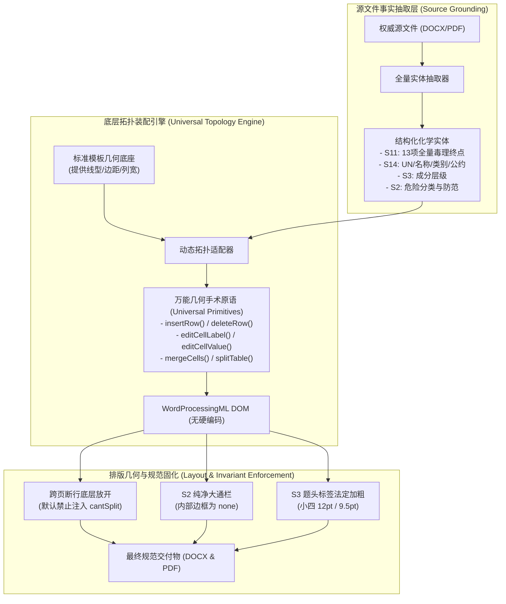

# Technical Design: MSDS-Studio 通用拓扑结构重构与源文件事实绝对驱动设计方案 (Design)

## 1. 系统架构与拓扑驱动设计哲学 (Architectural Paradigm)

用户深刻指出：
> “一定要把MSDS-Studio开发成通用拓扑结构而不是万能答案，所有内容必须来源于源文件，模板提供拓扑结构，因此所有关于MSDS Studio底层的修改都是关于拓扑结构的修改，禁止任何硬编码。”

本方案确立**通用拓扑驱动 (Topology-Driven Engine Architecture)**：
1. **职责分离**：
   - **源文件 (Source File)**：唯一权威的数据事实源泉（提供毒理终点、运输要素、化学指标、法定公约与防范说明）；
   - **模板 (Template)**：提供基础页面几何约束（纸张大小、边距、表格样式、边框粗细与基准列宽）；
   - **通用编辑原语 (Universal Editor Primitives)**：作为拓扑结构调整的唯一法定手术刀（增行、删行、拆分、合并、修改标签、写入数值），禁止私写局部脚本篡改结构。
2. **拓扑自适应管道 (Schema-Adaptive Pipeline)**：
   系统解析源文件事实后，通过通用原语对模板表格进行动态扩缩装配，生成与源文件事实 1:1 精准对称的排版拓扑。



---

## 2. 五大底层缺陷详细技术方案

### 2.1 REQ-01: Section 3 “3.2 成分”标签识别与加粗格式底层固化
- **根因分析**：排版引擎在处理 Section 3 时，仅将第 3 行合并为通栏单元格，但在 `enforceStructuralTypographyInvariants` 中漏掉了 Section 3 题头行的加粗处理。
- **底层改造方案**：
  1. 在 `enforceStructuralTypographyInvariants` 中新增 Section 3 结构性题头加粗拦截：
     ```javascript
     const s3Rec = eng.records.find(r => r.sectionNumber === 3);
     if (s3Rec) {
       for (const row of s3Rec.rows) {
         const c0 = row.cells[0]?.node;
         const txt = (row.cells[0]?.text || '').trim();
         if (/^(?:3\.[12]\s*)?(?:成分|混合物|物质|Ingredients|Mixture|Substance)/i.test(txt)) {
           // 确保包含 3.2 编号与规范标签名
           const formattedTxt = isEn ? '3.2  Ingredients:' : '3.2  成分：';
           applyRunsTypography(c0, formattedTxt, {
             font: isEn ? 'Arial' : '宋体',
             sz: isEn ? '19' : '24',
             bold: true
           }, W_NS);
         }
       }
     }
     ```
  2. 隔离保护：严格限定仅处理题头单元格，具体成分行（Row 3 及以后）保持常规体，严禁整表全量误加粗。

### 2.2 REQ-02: 全局表格跨页断行底层默认放开 (彻底消灭表格间大空白)
- **根因分析**：`pipeline-engine.js` line 4185 错误地对除 Section 2 以外的所有表格行全量追加了 `<w:cantSplit/>`，导致页面剩余纵向空间不足以容纳整行时被强推至下一页，引发 10~15 cm 巨大空白。
- **底层改造方案**：
  1. 彻底删除 `pipeline-engine.js` 中盲目追加 `<w:cantSplit/>` 的全局循环；
  2. 在 `docx-engine.js` 中建立跨页断行规则：
     - **默认行为 (Default)**：所有表格数据行严禁注入 `<w:cantSplit/>`，已存在者执行移除；
     - **白名单例外 (Whitelist Only)**：仅当行为表格 Row 0（章节大标题，如 `1. 化学品及企业标识`）或单一数据列头行（如 `化学品名称 | CAS号 | 质量分数%`）时，保留或注入 `<w:cantSplit/>`，防止标题行孤立在页面底部；
  3. 所有多行叙述性章节（Section 2、Section 8、Section 11、Section 12、Section 13、Section 14、Section 15、Section 16）100% 允许跨页断行，消除空白。

### 2.3 REQ-03: Section 11 源文件事实绝对至上与动态表格拓扑构建
- **根因分析**：旧系统采用固定 7 行或 11 行模板匹配，导致源文件中的 6 大关键毒理评估终点（STOT 一次性接触结论、CMR 评估、亚急性毒性、体内基因毒性等）被直接截断丢弃。
- **底层改造方案**：
  1. **实体解析器增强 (`parseSection11FromSource`)**：
     - 完整提取源文件中所有出现的毒理学终点，不再丢弃任何带有化学评价的段落；
     - 针对双组分（聚氨酯分散体 vs 乙醇），完整建立各组分对应的测试数据对象；
  2. **动态表格拓扑构建器 (`buildDynamicSection11Table`)**：
     - 利用 `universal-editor-primitives` 动态伸缩 Table 11 行数：
       `Row 0`: 章节大标题
       `Row 1`: 前言说明行（“该产品无可用的毒理学研究...”）
       `Row 2..N`: 依据源文件实际提取的 $K$ 个毒理学终点，动态调用 `insertRow()` 插入对应行；
     - 每行左侧写入标准化二级标签（如 `11.1  急性毒性：`、`11.2  皮肤腐蚀/刺激：`、`11.8  特异性靶器官系统毒性——一次接触：`、`11.11 亚急性/亚慢性毒性：`、`11.13 CMR评估：`）；
     - 每行右侧写入源文件的完整测试结论（聚氨酯分散体数据 + 乙醇测试数据 + 法定豁免声明“基于现有数据，未满足分类标准”）；
  3. **双语拓扑镜像保证**：英文版严格依据中文提取项数 1:1 进行动态英译装配，确保行数与插槽绝对同构。

### 2.4 REQ-04: Section 14 运输信息动态结构自适应与彻底清除硬编码
- **根因分析**：代码中写死了 `in accordance with ADG regulations.`（澳大利亚法规）等外生硬编码常量，机械复制 UN 1866 三遍以填满 4 行模板，丢弃了源文件载明的国际公约（MARPOL/IBC规则）与安全防范说明。
- **底层改造方案**：
  1. **连根拔除外生硬编码**：全库搜索并清除所有 `ADG regulations` 字符串与特判型号逻辑；
  2. **源文件公约与防范说明保全**：
     - 完整提取并输出 `按《MARPOL73/78》公约附则II和IBC规则：不适用` / `Maritime transport in bulk according to IMO instruments: Not applicable`；
     - 完整提取并输出 `特殊防范措施：参见6-8节` / `Special precautions: See sections 6-8`；
     - 完整保留温控与防混存储运要求（温度不高于 +35℃，不低于 -10℃，远离食物、酸和碱）；
  3. **通用原语驱动的动态结构装配**：
     - 依据通用危化品分类结果（闭杯闪点、初沸点、UN 编号），通过通用原语动态构建危化品 4 行或非危 2 行结构，彻底杜绝型号特判。

### 2.5 REQ-05: Section 2 纯净大通栏，彻底清除内框虚线
- **根因分析**：`docx-engine.js` 的 `renderFullWidthRow` 在被 Section 2 调用时，由于 `borders: true` 导致默认注入了 `dotted` 上下边框。
- **底层改造方案**：
  1. 重构 `renderFullWidthRow` 中的边框注入逻辑：
     ```javascript
     if (options.isSection2) {
       // Section 2 纯净大通栏规范:
       // 内部行之间严禁任何边框 (top: none, bottom: none, insideH: none)
       // 仅保留整个大通栏的最外层单实线边框
       const isFirstRow = (rowIndex === 1);
       const isLastRow = (rowIndex === record.rows.length - 1);
       
       const tcBorders = doc.createElementNS(W_NS, 'w:tcBorders');
       tcPr.appendChild(tcBorders);
       
       // 顶部边框: 仅第一行有外框实线，内部行为 none
       setTcBorder(tcBorders, 'top', isFirstRow ? 'single' : 'none', 'auto', '4', W_NS);
       // 底部边框: 仅最后一行有外框实线，内部行为 none
       setTcBorder(tcBorders, 'bottom', isLastRow ? 'single' : 'none', 'auto', '4', W_NS);
       // 左右边框: 保持外框单实线
       setTcBorder(tcBorders, 'left', 'single', 'auto', '4', W_NS);
       setTcBorder(tcBorders, 'right', 'single', 'auto', '4', W_NS);
     }
     ```
  2. 效果验证：OpenXML 中不存在任何 `dotted` 属性；PDF 视觉呈现为完全连续一体的大通栏卡片。

---

## 3. 双清单机制 (Dual Lists Invariant)

### 3.1 拟变范围清单 (Proposed Changes Scope)
| 变动文件 | 修改角色 | 变更要点与因果机制 |
| :--- | :---: | :--- |
| `web/src/docx-engine.js` | [Root Source] | 1. `renderFullWidthRow`: Section 2 内部边框设为 `none`，清除内框虚线；<br>2. 表格跨页断行反转：默认移除 `<w:cantSplit/>`，仅白名单保留表头行。 |
| `web/src/pipeline-engine.js` | [Root Source] | 1. Section 3 Row 2 题头标签法定加粗（小四 12pt / 9.5pt）；<br>2. 移除全局盲目追加 `<w:cantSplit/>` 循环；<br>3. Section 11 基于通用原语动态构建拓扑，保全 13 项毒理终点；<br>4. Section 14 拔除澳大利亚 ADG 硬编码，全量保全 MARPOL/IBC 公约，通用原语装配。 |
| `web/scripts/run_master_msds_audit.mjs` | [State Transition] | 1. 增加 Section 2 内框无虚线断言；<br>2. 增加 Section 3 题头加粗断言；<br>3. 增加 Section 11 13项全量毒理终点保真断言；<br>4. 增加 Section 14 国际公约保全与反 ADG 虚假法规断言。 |

### 3.2 保持现状承诺清单 (Preserved Invariants Commitment)
1. **Section 9 激光垂线对齐不变量**：中英文 4 份 PDF 中 Section 9 全部 19 项标签首字严格保持在 $80.28\text{pt}$ 垂直对齐，代码已加锁绝对不触碰；
2. **Section 15 现行法规时效性正向演进不变量**：现行有效的国务院 591 号令、GB 30000 系列国标保持现状；
3. **TDS 树脂中和剂与 pH 事实不变量**：三乙胺 (TEA, CAS 121-44-8) 与 pH 7-10 保持现状；
4. **官方 DOCX 模板母版物理文件**：保持绝对只读，严禁私改母版文件。
