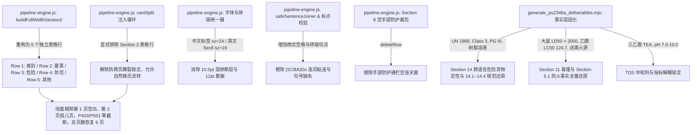

# Design: PU-2346A Section 2 多行重构与全维度事实忠实度技术方案 (Design)

## 1. 架构分析与根因诊断

### 1.1 Section 2 单行巨石结构与 `<w:cantSplit/>` 导致的排版雪崩 (DEF-01 ~ DEF-04 / REQ-01)
- **根因分析**：
  在当前 `pipeline-engine.js:buildFullWidthSection2` 实现中，Section 2 被强制清理为仅剩 Row 0（标题）与 Row 1（单单元格通栏）：
  ```javascript
  while (s2.rows.length > 2) { s2 = deleteRow(engine, s2, s2.rows.length - 1); }
  // 所有 2.1 到 2.5 段落（对于 PU-2346A 多达 29 个段落）全部打包进单一 paragraphs 数组
  renderFullWidthRow(s2, 1, paragraphs, { isSection2: true, ... });
  ```
  而在后处理阶段（`pipeline-engine.js:8089`），系统执行了“防跨页撕裂加固”，为文档中所有表格的所有 `w:tr` 盲目注入了 `<w:cantSplit/>`：
  ```javascript
  if (trPr.getElementsByTagNameNS(W_NS, 'cantSplit').length === 0) {
    trPr.appendChild(tr.ownerDocument.createElementNS(W_NS, 'w:cantSplit'));
  }
  ```
- **崩溃连锁反应**：
  1. PU-2346A 属于含 21.5% 乙醇的易燃危化品，拥有完整的分类、象形图、信号词、危险说明以及长达数十行的 P2xx/P3xx/P4xx/P5xx 防范说明，Row 1 物理高度高达 25cm 以上（超过 A4 纸可打印高度 24cm）；
  2. Word/LibreOffice 排版引擎检测到 Row 1 带有 `<w:cantSplit/>`（禁止跨页断行），但在第 1 页无法容纳 25cm，只能整行推至第 2 页，导致第 1 页留下半页巨大空白（12cm 空白）；
  3. 第 2 页仅能放下 Table 2 Row 0（“2. 危险性概述”标题），而 Row 1 依然放不下，再次推至第 3 页，使第 2 页成为只有单行标题的“孤儿页”；
  4. 推至第 3 页后，Row 1 依然超出单页最大高度，排版引擎触发**溢出物理截断（Overflow Clipping）**：底部的 `P403+P235`（存放在通风良好处、保持低温）与 `P501`（废弃处置）直接被截断丢弃，造成法律事实永久性灭失；
  5. 导致整篇 MSDS 页码由标准的 5 页失控暴增至 10 页！

- **技术解法**：
  1. **解耦重构 Section 2 为 5 个独立自然行**：
     - Row 0: 标题行（`2. 危险性概述` / `2. Hazards Identification`）；
     - Row 1: `2.1 GHS危险性类别` / `2.1 Classification of the substance or mixture`；
     - Row 2: `2.2 GHS标签要素`（含象形图、危害组分、信号词）；
     - Row 3: `2.3 危险性说明`（Hazard statements）；
     - Row 4: `2.4 防范说明`（Precautionary statements，含预防、响应、储存、处置）；
     - Row 5: `2.5 其他危害`（Other hazards）。
  2. **豁免长行 `<w:cantSplit/>` 注入**：
     - 在全局 `<w:cantSplit/>` 注入循环中，显式排除 Section 2 表格的所有数据行（尤其是 Row 4 和 Row 3），或者仅对单行高、高度不超过单页的表格行应用 `cantSplit`，允许长防范说明跨页平滑流转，彻底根除截断与孤儿页。

---

### 1.2 排版与文本规范缺陷 (DEF-11 ~ DEF-15B / REQ-02, REQ-03)
1. **中文标签单元格字号断层 (DEF-11)**：
   - 在 `pipeline-engine.js:formatSection7ChineseLabel` 等格式化逻辑中，数字序号（如 `1.1  `）被硬编码为 `sz="21"`（10.5pt），而汉字标签为 `sz="24"`（12pt）。
   - **解法**：统一中文第一列标签单元格中所有 Run（包括数字序号、标点与汉字）字号为法定小四 12pt（`sz="24"`）。
2. **英文 Section 8 标签题头被误设为 12pt (DEF-12)**：
   - `pipeline-engine.js:8206` 存在历史硬编码：`// Section 8 英文标签题头统一字号规范: 统一为 w:sz="24"`，导致英文版 Section 8 标签异常膨胀。
   - **解法**：将英文版 Section 8 标签单元格字号统一下调并锁定为标准五号 9.5pt（`sz="19"`）。
3. **英文连词粘连与标点缺陷 (DEF-13, DEF-14)**：
   - 英文句子拼接使用 `+` 直连，导致 `(SCBA)Do`、`equipmentEnsure` 连词粘连；英文描述性段落末尾偶发缺失句号。
   - **解法**：引入安全句子拼接器 `safeSentenceJoiner`（在标点与单词间强制检查并补齐西文空格）；在英文段落生成末端自动校验并补齐句号 `.`。
4. **Section 9 标签序号与标题间距规范**：
   - 确保 `9.1  Appearance:` 等标签保持统一的双空格标准。
5. **Section 8 手部防护通栏空挂天窗 (DEF-15A)**：
   - 在手部防护行无总体概述描述时，调用 `deleteRow(engine, s8, handRowIdx)` 自动清除该空行，仅保留具体手套材质指标行。

---

### 1.3 Agent 执行端事实偏差 (DEF-05 ~ DEF-10 / REQ-04 ~ REQ-06)
1. **Section 14 运输信息与危险品定性 (DEF-05, DEF-06)**：
   - PU-2346A 含 21.5% 乙醇，闪点 42°C，依法属于第 3 类易燃液体。
   - **解法**：在 `generate_pu2346a_deliverables.mjs` 中显式固化事实：`isDangerousGoods: true`, `unNumber: '1866'`, `properShippingName: '树脂溶液'` / `'RESIN SOLUTION'`, `hazardClass: '3'`, `packingGroup: 'III'`。根除英文版 fallback 为非危的假数据，并在中文版中输出标准 14.1~14.4 四行结构。
2. **Section 11 毒理学与 Section 6.1 防火事实 (DEF-07, DEF-08, DEF-09)**：
   - **解法**：分项还原经口、吸入、经皮毒理数据，保留大鼠经口 $LD_{50} > 2000\text{ mg/kg}$、乙醇 $LD_{50} = 10470\text{ mg/kg}$、乙醇吸入 $LC_{50} = 124.7\text{ mg/L}$，杜绝“Inhalation: No data available”伪通；Section 6.1 显式包含“远离火源/火种”防火事实。
3. **TDS 中和剂三乙胺回锁 (DEF-10)**：
   - **解法**：将 TDS 事实字典中的中和剂锁定为“三乙胺 (Triethylamine, TEA, CAS: 121-44-8)”，清除 DMEA，pH 解耦保持 7.0-10.0。

---

## 2. 因果拓扑图 (Causal Topology)



---

## 3. 法定双清单自证 (Mandatory Dual Lists)

### 3.1 拟变范围清单 (Proposed Changes Scope)

| 序号 | 目标文件路径 | 因果角色 | 拟变内容要点 |
| :---: | :--- | :---: | :--- |
| 1 | `web/src/pipeline-engine.js` | **[Root Source]** | 重构 `buildFullWidthSection2` 为 5 行结构；在 `<w:cantSplit/>` 循环中排除 Section 2；统一中文标签 `sz="24"`；恢复英文 Section 8 标签 `sz="19"`；增加安全西文句子拼接与终端句点；Section 8 手部防护空行调用 `deleteRow`。 |
| 2 | `web/scripts/generate_pu2346a_deliverables.mjs` (或对应生成管道脚本) | **[Root Source]** | 固化 PU-2346A Section 14 事实（UN 1866, Class 3, PG III, RESIN SOLUTION）；固化 Section 11 毒理与 6.1 施救事实；回锁 TDS 中和剂为三乙胺（TEA）。 |
| 3 | `web/scripts/run_master_msds_audit.mjs` | **[State Transition]** | 增加针对 Section 2 P403/P501 不截断断言、Section 14 UN 1866 判定断言、中文标签字号均一性断言。 |

### 3.2 保持现状承诺清单 (Preservation Commitments)

| 序号 | 受保护文件/逻辑区域 | 承诺保持现状的理由与范围 |
| :---: | :--- | :--- |
| 1 | `web/src/pipeline-engine.js` 中所有标记 `@ANTIGRAVITY_INVARIANT_LOCK` 的区域 | 此前加固的制表位逻辑、Section 8.1 题头保护、双空格逻辑等，保持绝对只读，严禁篡改破坏。 |
| 2 | `web/src/docx-engine.js` 基础 XML 解析与表格底座 | 底层 DOM 解析与通用单元格合并机制稳定可靠，绝不顺手重构。 |
| 3 | 其他产品型号（EP-1404, BL-8129A 等）已归档交付物与事实脚本 | 严格限定于 PU-2346A 及其生成链路，严禁越界修改其他产品的既有代码与数据。 |
| 4 | 既有通过的 153 项自动化主审计基准测试集 | 严格保持测试严密性，严禁弱化既有测试断言。 |
