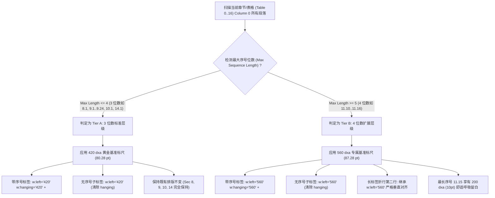

# 技术架构方案：基于章节最大序号位数自适应分层对齐引擎与 4 位数长序号舒适间距规范

## 1. 架构拓扑与状态机转移图



---

## 2. 数学与几何物理模型计算

### 2.1 3 位数标准层级 (Tier A: Section 8, 9, 10, 14)
- **基准序号样本**：`9.1`、`8.1`、`14.1`
- **序号字符宽度**：约 240 dxa (12.0 pt)
- **悬挂缩进量**：`420 dxa` (21.0 pt)
- **呼吸间隔**：`420 - 240 = 180 dxa` (9.0 pt，约 3.2 mm，黄金呼吸间距)
- **PDF 物理对齐坐标**：`单元格基线 59.28 pt + 21.0 pt = 80.28 pt`

### 2.2 4 位数扩展层级 (Tier B: Section 11 及未来 4 位数章节)
- **最长序号样本**：`11.15`、`11.10`、`11.16`（5 字符）
- **序号字符宽度**：在 10.5pt (sz="21") 宋体/Times New Roman 下，宽度约 340~360 dxa (17~18 pt)
- **旧版缺陷痛点**：若强行采用 420 dxa，呼吸间隔仅剩 `420 - 360 = 60 dxa` (3 pt / 1 mm)，极度紧密拥挤！
- **新版专属悬挂缩进量**：确立为 **`560 dxa`** (28.0 pt)
- **舒适呼吸留白**：`560 - 360 = 200 dxa` (10.0 pt，约 3.5 mm，与 3 位数黄金间距完美等比例呼应！)
- **PDF 物理对齐坐标**：`单元格基线 59.28 pt + 28.0 pt = 87.28 pt`
- **章节内部闭环**：
  - `11.1` ~ `11.9`（短序号）通过 `<w:tab/>` 跳至 560 dxa；
  - `11.10` ~ `11.16`（长序号）通过 `<w:tab/>` 跳至 560 dxa；
  - `11.7` 长标签折行第二行（“性：”）继承段落左缩进 560 dxa；
  - 章节全量标签在 87.28 pt 上实现 100% 激光铅垂线共线对齐！

---

## 3. 技术改动要点

1. **`web/src/universal-editor-primitives.js` (`applyGlobalTypographyProjection`)**：
   - 在处理每个表格之前，首先进行整表探查：
     ```javascript
     let maxSeqLength = 0;
     for (const r of rows) {
       const c0Text = (r.cells[0]?.textContent || '').trim();
       const m = c0Text.match(/^(\d+\.\d+(?:\.\d+)?)\b/);
       if (m && m[1].length > maxSeqLength) {
         maxSeqLength = m[1].length;
       }
     }
     const isTierB = (maxSeqLength >= 5); // 包含 11.10 ~ 11.16 等 5 字符/4 位数字长序号
     const targetIndent = isTierB ? '560' : '420';
     ```
   - 父级带序号标签：统一注入 `w:left=targetIndent`、`w:hanging=targetIndent`、`w:leftChars="0"`；
   - 子级无序号标签：统一注入 `w:left=targetIndent`（无 hanging），首字绝对对齐于该章节基准线；
2. **`web/src/docx-engine.js` (`formatSection11LabelCell`)**：
   - 将 Section 11 标签格式化默认悬挂缩进调整为 `560` dxa，与全局 Tier B 规范保持 100% 严密咬合；
   - 序号与标签之间通过制表位跳至 560 dxa，彻底舒展 `11.15` 与标签的呼吸留白；
3. **`web/scripts/run_master_msds_audit.mjs`**：
   - 更新 Item 154 对齐断言：
     - Tier A（Sec 8, 9, 10, 14）：实测坐标 80.28 pt [PASS]；
     - Tier B（Sec 11）：实测坐标 87.28 pt [PASS]，且 `11.7` 换行第二行坐标 87.28 pt [PASS]；
   - 保持 170 项全绿满分通过（退出码 0）。
