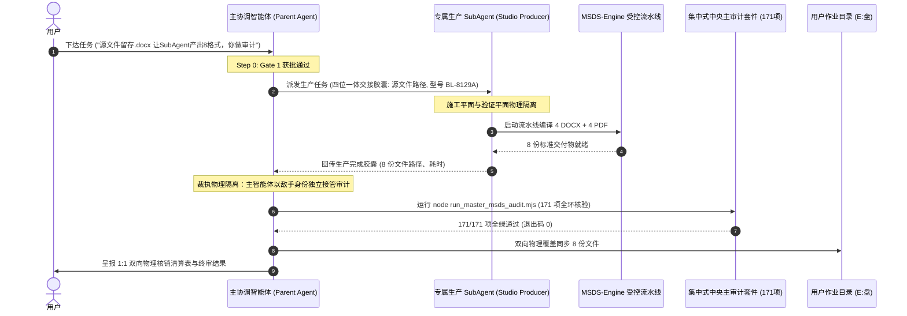

# 技术架构方案：BL-8129A 生产与独立审计 (Design Document)

## 一、 系统架构与状态机

## 二、 关键技术选型与物理隔离实现

1. **生产 SubAgent 配置**：
   - 使用现有预定义的 `msds-overwrite-producer`（或基于 `self` 派发）；
   - 生产任务严格封闭在生成与格式转换范围内；
   - 严禁生产 SubAgent 自主判定审计通过。
2. **主智能体独立执裁**：
   - 机械确定性审计：运行集中式中央主审计套件 `run_master_msds_audit.mjs`；
   - 涵盖刚刚下沉的 `INV-TRANS-ZERO-OMISSION` 机械门禁，严格核销全篇 16 章节双语参数；
   - 真实进程退出码 0 作为解锁交付的充要条件。
