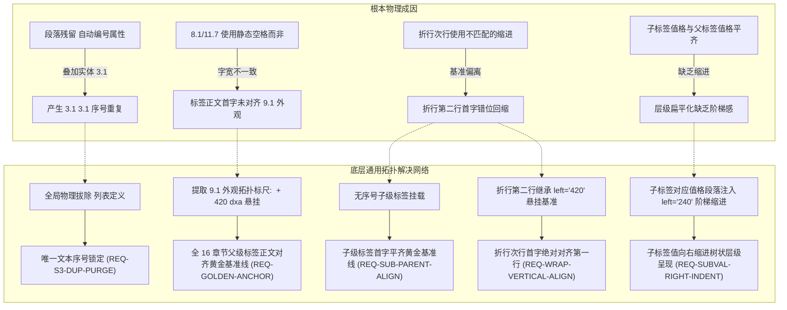

# 架构设计方案：全局 16 章节黄金基准对齐 (9.1 外观标尺) 与层级树拓扑工程

## 一、 系统架构因果拓扑 (Causality DAG)

---

## 二、 黄金基准几何模型 (The Golden Anchor Geometry Model)

以 **`9.1 外观`** 的法定排版为全系统唯一的黄金几何标尺：

1. **父级带序号标签几何拓扑 (Parent Label with Sequence)**：
   - 段落属性：`<w:ind w:left="420" w:hanging="420"/>`；
   - Run 1 (序号)：输出实体序号文本（如 `9.1`、`8.1`、`11.7`、`3.1`），紧随 `<w:tab/>`；
   - `<w:tab/>` 使得光标在 Word 中跳跃至第一个制表停靠位，由于悬挂缩进为 420 dxa，制表位**严格停靠在 420 dxa**；
   - Run 2 (标签正文)：首字（“外”、“暴”、“亚”、“产”等）精确从 **420 dxa** 处起始；
   - 换行次行（Line 2）：由于段落整体 `left="420"`，折行后的第二行第一个字符（如 `性：`）自然从 **420 dxa** 处起始，与 Line 1 正文首字铅垂对齐。
2. **子级无序号标签几何拓扑 (Sub-Label without Sequence)**：
   - 段落属性：`<w:ind w:left="420"/>`（清除 `hanging` 与 `firstLine`）；
   - 正文首字直接位于 **420 dxa** 处，与父级标签正文首字形成 100% 绝对铅垂共线。
3. **子级对应值几何拓扑 (Sub-Value Rightward Indentation)**：
   - 段落属性：`<w:ind w:left="240"/>`（比值格左边框向右缩进 240 dxa / 约 1.2 字符宽度）；
   - 形成清晰的父子树状阶梯视觉层次。

---

## 三、 法定双清单自证 (Statutory Dual Manifests)

### 1. 拟变范围清单 (Proposed Changes Manifest)

| 文件路径 | 变更角色分类 | 变更因果要点 |
| :--- | :--- | :--- |
| `web/src/docx-engine.js` | [Root Source] | 在段落创建与清洗逻辑中清除所有 `<w:numPr>`；封装以 `9.1 外观` 为蓝本的 `applyGoldenAnchorLabelLayout` 与 `applySubLabelAnchorLayout` |
| `web/src/universal-editor-primitives.js` | [State Transition] | 在 `applyGlobalTypographyProjection` 中对 16 个章节应用统一黄金标尺投影，对子级标签对应值单元格注入向右阶梯缩进 |
| `web/src/pipeline-engine.js` | [State Transition] | 更新 `rebuildUnifiedLabelRun` 与 `normalizeSection3Typography`，清除空格间距，接入标准 `<w:tab/>` 黄金锚点并根除序号复读 |
| `web/src/template-editor.js` | [State Transition] | 保证交互式编辑器与会话导出时同步执行黄金锚点与阶梯缩进投影 |
| `web/scripts/run_master_msds_audit.mjs` | [Gate Invariant] | 升级主审计套件至 170 项全景物理断言，新增黄金基准垂线对齐核验、子标签值向右缩进核验与 `<w:numPr>` 零容忍断言 |

### 2. 承诺保持现状清单 (Leave-as-is Commitment Manifest)

| 既有功能与承重墙模块 | 现状承诺与封印保护 |
| :--- | :--- |
| **Section 2 纯净大通栏架构** | 严格保持外框实线、内框完全为 `none` 的通栏几何形态，严禁因对齐修改引入任何内框虚线 |
| **Section 3/8/11/14 事实保真与动态构建** | 严格保持化学事实（UN 1866、MARPOL 公约、16 项毒理终点、三乙胺与 pH 保真），严禁破坏源数据 |
| **全篇字阶规范** | 严格保持中文标签 12pt 宋体加粗、英文标签 9.5pt Arial 加粗、值格常规细体的统一标准，杜绝任何字号跳字 |
| **其他既有测试与 Oracle 映射** | 保持所有既有 166 项主审计项基准线不变，仅正向增补 4 项黄金几何与层级断言 |
