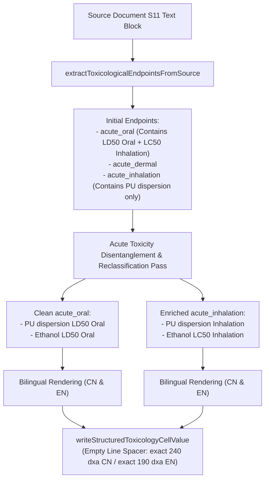

# Design: Section 11 Empty Line Height Calibration & Acute Toxicity Inhalation Reclassification

## 1. Architectural Analysis

### Root Cause Analysis (5-Whys)
1. **Why is the empty line spacer too tall?**
   In `writeStructuredToxicologyCellValue`, empty paragraphs were created using the same default paragraph spacing (`w:line="300" w:lineRule="auto"`) as normal content lines. Because Word computes auto-line spacing based on font metrics plus line spacing rules, an empty paragraph renders at ~15pt-18pt height. Setting `w:lineRule="exact"` with `w:line="240"` (CN) / `w:line="190"` (EN) constrains the empty paragraph height to exactly 12pt / 9.5pt, perfectly matching the single-line height of the prescribed font size.
2. **Why was LC50 Inhalation placed under 11.1 Acute Oral Toxicity?**
   In the source document (`PU-2346A msds_CN 冠志.docx`), ethanol's oral toxicity and inhalation toxicity data were pasted together immediately under the header `急性毒性，经口`. The source extraction logic in `extractToxicologicalEndpointsFromSource` partitioned endpoints by slicing contiguous text between section headers (`急性毒性，经口` until `急性毒性，经皮`). Consequently, the entire ethanol block—including `LC50 吸入 - 大鼠 - 雄性和雌性 - 4 h - 124.7 mg/l`—was assigned to `11.1 急性毒性，经口`.
3. **What is the generic architectural fix?**
   After initial endpoint extraction, apply an acute toxicity reclassification pass in `extractToxicologicalEndpointsFromSource`:
   - Inspect `acute_oral`: if an inhalation measurement pattern (`LC50\s*吸入|半数致死浓度.*吸入|Inhalation`) is detected, extract the inhalation component and its data;
   - Remove the inhalation block from `acute_oral`;
   - Locate `acute_inhalation` and append the extracted inhalation test data (maintaining component attribution and empty line separation);
   - This ensures chemical classification fidelity across all models without altering raw source files.

## 2. Technical Architecture & Dataflow

## 3. Statutory Dual Lists (法定双清单)

### 3.1 拟变范围清单 (Proposed Changes)
| 文件路径 | 拟变函数 / 逻辑块 | 因果角色 | 变更要点说明 |
| :--- | :--- | :--- | :--- |
| `web/src/docx-engine.js` | `writeStructuredToxicologyCellValue` | [State Transition & Typography] | 空白段落高度精准校准：`w:lineRule="exact"`，中文设定为 `240`（12pt），英文设定为 `190`（9.5pt），消除多余空白跨度 |
| `web/src/docx-engine.js` | `extractToxicologicalEndpointsFromSource` | [Root Source & Ingestion] | 增加急性毒性跨终点数据科学解耦分流逻辑：自动将混排在经口毒性中的 `LC50 吸入` 实测数据剥离并归口合并至 `11.3 急性毒性，吸入` |
| `web/src/pipeline-engine.js` | `translateToxicologyValueToEnglish` | [Translation Protection] | 确保 11.3 中追加的乙醇吸入毒性实测数据在英文版中精准翻译并生成多段落结构 |

### 3.2 保持现状承诺清单 (Leave-as-is Invariants)
| 保护资产 / 不变量 | 法定基准要求 | 承诺边界 |
| :--- | :--- | :--- |
| Section 14 动态拓扑 | 9 行拓扑、420 dxa 悬挂缩进、国际海运公约 (MARPOL) 与安全防范说明 (参见6-8节) | 绝不触碰或退化 Section 14 任何逻辑 |
| Section 11 表格微观对齐 | 2800 / 6981 列宽、560 dxa / 87.28pt 对齐线、无加粗常规体数值 | 保持所有列宽与对齐基准不变 |
| Section 2 通栏卡片 | 纯通栏容器无内边框、结构性标签加粗规范 | 绝对保留现有通栏卡片无边框状态 |
| 170 项 MSDS 主审计 | `web/scripts/run_master_msds_audit.mjs` 170 项全绿 | 保持 170/170 全部通过，退出码 0 |
| 编译器与机检门禁 | `npm run lint` 零错误、零警告 | 执行机检严格 `--max-warnings=0` 退出码 0 |
