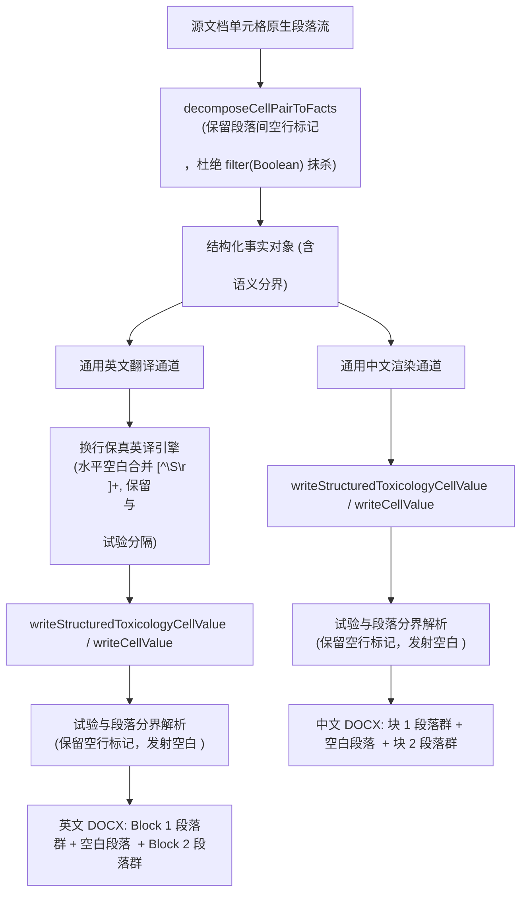

# Design: Universal Multi-Study & Multi-Paragraph Line-Break and Empty-Line Preservation

## 1. Architectural Analysis

### Root Cause Analysis (5-Whys)
1. **Why do empty lines get lost in Section 11 and elsewhere?**
   Across the engine, multiple functions aggressively purge empty string tokens:
   - `writeStructuredToxicologyCellValue` in `web/src/docx-engine.js` runs `.split('\n').map(l => l.trim()).filter(Boolean)` and `.map(...).filter(Boolean)`, stripping all empty string items resulting from `\n\n`.
   - `writeCellValue` in `web/src/docx-engine.js` line 2307 executes `valStr.replace(/\r\n?/g, '\n').replace(/\n\s*\n+/g, '\n').trim()`, collapsing all double newlines `\n\n` to a single `\n`.
   - `decomposeCellPairToFacts` in `web/src/smart-matching.js` line 1823 executes `ps1.map(p => p.text.trim()).filter(Boolean).join('\n')`, purging empty paragraphs from source files.
2. **Why does each non-empty line get directly appended?**
   The loop `for (const itemText of cleanItems)` strictly constructs `<w:p>` only for surviving strings. No empty paragraph `<w:p>` is ever emitted.
3. **Why does English output become an unformatted single paragraph without any line breaks?**
   In `translateToxicologyValueToEnglish` (`web/src/pipeline-engine.js`), line 2952 executes `t = t.replace(/\s+/g, ' ')`. This global regex replaces all consecutive whitespace characters—including `\r\n` and `\n`—with a single space `' '`. Thus, all line break structure is permanently destroyed before reaching `writeStructuredToxicologyCellValue`.
4. **Why is this a system-wide generic issue rather than an isolated Section 11 bug?**
   Because `writeCellValue`, `decomposeCellPairToFacts`, and translation routines are shared generic primitives, excessive whitespace compression collapses intentional paragraph/study separations globally.

## 2. Technical Architecture & Dataflow



## 3. Detailed Component Design

### 3.1 `web/src/docx-engine.js`
- **`writeCellValue`**:
  - Replace `.replace(/\n\s*\n+/g, '\n')` with `.replace(/\n{3,}/g, '\n\n')`.
  - Guarantees that intentional double newlines (`\n\n`) separating blocks or studies are preserved globally across all sections.
- **`writeStructuredToxicologyCellValue`**:
  - Normalize line breaks: replace `\r\n` with `\n`.
  - Also detect distinct study transitions if the text does not have explicit `\n\n` (e.g., after `对类似产品(?:的)?(?:毒理学)?研究` / `Studies on a similar product` when followed by `皮肤致敏性` / `测试种类` / `Local lymph node assay` / `Buehler`). Ensure an empty line marker is inserted between distinct studies.
  - Split text by `\n`. Strip leading and trailing empty lines from the block, but preserve intermediate empty lines as `""`.
  - When iterating over items:
    - If item is empty (`""`): append an empty paragraph `<w:p><w:pPr><w:spacing w:line="300" w:lineRule="auto"/><w:ind w:right="480"/><w:jc w:val="left"/><w:rPr><w:sz w:val="24"/></w:rPr></w:pPr></w:p>`.
    - If item is non-empty: append regular run with `itemText`.
  - Prevent duplicate consecutive empty paragraphs (max 1 empty paragraph between blocks).

### 3.2 `web/src/smart-matching.js`
- **`decomposeCellPairToFacts`**:
  - In line 1823, do not use `ps1.map(p => p.text.trim()).filter(Boolean).join('\n')`.
  - Instead, preserve intermediate empty paragraphs:
    ```javascript
    const cell1Txt = ps1.map(p => p.text.trim()).filter((line, idx, arr) => {
      if (!line && idx > 0 && !arr[idx - 1].text.trim()) return false;
      return true;
    }).map(p => p.text.trim()).join('\n').trim();
    ```
- **`decoupleSection11ToxicologyBlocks`**:
  - Ensure multi-study endpoints (sensitization, in vitro mutagenicity, acute toxicity) retain `\n\n` empty line separation.

### 3.3 `web/src/pipeline-engine.js`
- **`translateToxicologyValueToEnglish`**:
  - Replace line 2952:
    `t = t.replace(/\s+/g, ' ')` $\rightarrow$ `t = t.replace(/[^\S\r\n]+/g, ' ')`.
  - Normalize multiple consecutive newlines to at most two: `t = t.replace(/\n{3,}/g, '\n\n')`.
  - Ensure study headers and key labels (`Local lymph node assay (LLNA):`, `Buehler Test (dermal):`, `Test type:`, `Species:`, `Result:`, `Method:`, `Classification:`, `Studies on a similar product`) preserve proper leading/trailing newlines so that each item becomes its own paragraph in English.
- **`translateEcotoxicityValueToEnglish`**:
  - Replace `.replace(/\n\s*\n+/g, '\n')` $\rightarrow$ `.replace(/\n{3,}/g, '\n\n')`.

## 4. Statutory Dual Lists (法定双清单)

### 4.1 拟变范围清单 (Proposed Changes)
| 文件路径 | 拟变函数 / 逻辑块 | 因果角色 | 变更要点说明 |
| :--- | :--- | :--- | :--- |
| `web/src/docx-engine.js` | `writeCellValue` & `writeStructuredToxicologyCellValue` | [Root Source & Generic Primitive] | 通用修复 `writeCellValue` 压缩 `\n\n` 缺陷；在 `writeStructuredToxicologyCellValue` 中保留空行并渲染标准空白段落 `<w:p>` |
| `web/src/smart-matching.js` | `decomposeCellPairToFacts` & `decoupleSection11ToxicologyBlocks` | [Root Source & Ingestion] | 通用保留单元格解构过程中的段落间空行；增强多研究分界标记 |
| `web/src/pipeline-engine.js` | `translateToxicologyValueToEnglish` & `translateEcotoxicityValueToEnglish` | [Root Source & Translation] | 废除破坏性 `\s+` 坍缩，采用非换行空白合并正则 `[^\S\r\n]+`，确保换行符结构与多试验空行完整保留 |

### 4.2 保持现状承诺清单 (Leave-as-is Invariants)
| 保护资产 / 不变量 | 法定基准要求 | 承诺边界 |
| :--- | :--- | :--- |
| Section 14 动态拓扑 | 9 行拓扑、420 dxa 悬挂缩进、国际海运公约 (MARPOL) 与安全防范说明 (参见6-8节) | 绝不触碰或退化 Section 14 任何逻辑 |
| Section 11 表格微观对齐 | 2800 / 6981 列宽、560 dxa / 87.28pt 对齐线、无加粗常规体数值 | 保持所有列宽与对齐基准不变 |
| Section 2 通栏卡片 | 纯通栏容器无内边框、结构性标签加粗规范 | 绝对保留现有通栏卡片无边框状态 |
| 170 项 MSDS 主审计 | `web/scripts/run_master_msds_audit.mjs` 170 项全绿 | 保持 170/170 全部通过，退出码 0 |
| 编译器与机检门禁 | `npm run lint` 零错误、零警告 | 执行机检严格 `--max-warnings=0` 退出码 0 |
