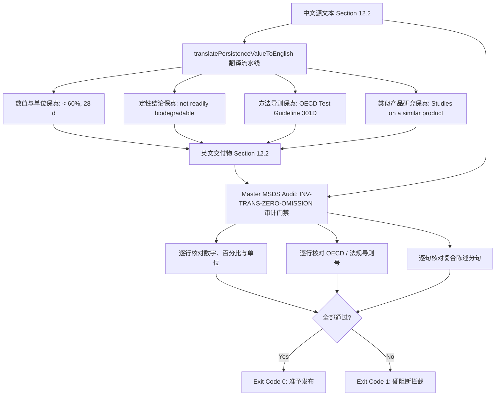

# 技术架构与因果设计方案：双语翻译逐行逐句细节零遗漏与 Section 12.2 细节补齐

## 架构演进目标
落实用户最高指令：“补充细节，加个执行层的审计规则，以后涉及到翻译的，必须逐行对照审计，并逐句检查，要求不准漏任何细节”。

## 因果拓扑与状态机转移

## 技术实现方案

1. **`pipeline-engine.js:translatePersistenceValueToEnglish` 升级**：
   - 移除早熟的纯定性截断 `if (/不易生物降解/) return '...'`；
   - 引入逐项正则替换规则：
     - `生物降解性：` -> `Biodegradability: `
     - `＜` / `＞` -> `< ` / `> `
     - `\b(\d+)\s*d\b` -> `$1 d`
     - `该产品不易生物降解` -> `the product is not readily biodegradable`
     - `OECD化学品测试指南301D` -> `OECD Test Guideline 301D`
     - `对类似产品的研究` -> `Studies on a similar product`
   - 保持末尾句号闭合。

2. **`run_master_msds_audit.mjs` 执行层门禁升级 (Ring 4)**：
   - 增加审计项：`INV-TRANS-ZERO-OMISSION: 双语翻译逐行逐句细节零遗漏机械硬门禁`；
   - 自动遍历全文档所有章节（特别是 Section 11, 12, 14）：
     - 提取中文所有数值 `\b\d+(?:\.\d+)?%?` 及单位；
     - 提取中文所有导则号 `OECD\s*\d+`；
     - 验证英文对应单元格 100% 具备相应数值与导则号；
     - 特别锁定 Section 12.2：若中文有 `<60%` / `301D`，英文必须有 `< 60 %` 与 `301D`。

3. **静态分析与回归防护**：
   - `npm run lint` 必须 0 errors, 0 warnings；
   - 171 项全量主审计必须 100% 通过（退出码 0）。
