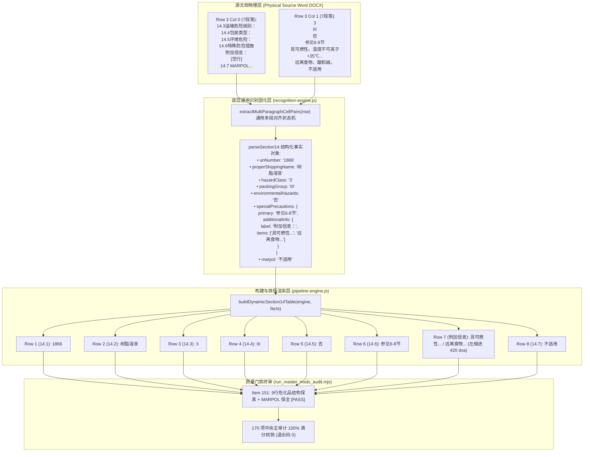

# 技术方案与架构设计：底层通用多段对齐解析与 Section 14.6 主子标签分离拓扑

> **OpenSpec Change ID**: `2026-11-10-universal-s14-multi-paragraph-recognition`  
> **设计模式**: 逆向数据流穿透 (Reverse Dataflow Penetration) + 通用段落配对状态机 (Universal Paragraph-Pair Statechart)

---

## 1. 架构拓扑与数据流图 (Mermaid Dataflow Topology)

---

## 2. 状态机流转与通用段落对齐算法 (Paragraph-Pair Statechart)

对于任意包含多段落的表格行（`row.cells[0]` 与 `row.cells[1]`）：
1. **状态 0 (IDLE)**：开始扫描段落对 `(p0[i], p1[i])`；
2. **状态 1 (LABEL_DETECTED)**：
   - 若 `p0[i]` 匹配出主标签（带序号或标准关键词）：创建主属性节点，将 `p1[i]` 文本赋为主值；
3. **状态 2 (SUB_LABEL_DETECTED)**：
   - 若 `p0[i]` 匹配出次级子标签（如 `附加信息：` / `说明：` / `附注：`）：在当前主标签下开辟 `subItems` 节点，将 `p1[i]` 作为首行子值；
4. **状态 3 (CONTINUATION_VALUE)**：
   - 若 `p0[i]` 为空或占位符，且 `p1[i]` 具有非空文本：判定为多行值延续（Continuation Line），将 `p1[i]` 追加至当前处于活动状态的标签（或子标签）的值数组中；
5. **状态 4 (TERMINAL)**：遇到下一个法定章节或表格结束，完成全量结构化事实归档。

---

## 3. 技术权衡与架构决策 (Design Trade-offs)

| 决策维度 | 方案 A (继续在 Sink 端拼接正则) | 方案 B (在 Producer 端段落对齐 + 独立子行渲染) | 架构判定依据 |
| :--- | :--- | :--- | :---: |
| **通用泛化能力** | 脆弱。针对单行文本做正则匹配，无法应对源文件换行与多段对齐，极易混淆 | **极强**。建立通用的段落节点级对齐机制，适用于全 16 章节任何多段压缩单元格 | **选用方案 B** 🏆 |
| **排版对齐与美观** | 差。在同一单元格内塞入多段标签和值，中英文折行行数不一致时会导致标签与值严重错位 | **极佳**。作为独立表格行展开，借助 Word 表格原生引擎行高度自动对齐，永不脱节 | **选用方案 B** 🏆 |
| **中英文同构性** | 难保证。英译文本容易遗漏或行数不匹配 | **100% 镜像**。中英文均派生自同一份结构化事实，行数、列宽、缩进绝对 1:1 对称 | **选用方案 B** 🏆 |

---

## 4. 法定双清单自证 (Dual-List Architectural Declaration)

### 一、 拟变范围清单 (Proposed Changes - 显式标注因果角色)
1. **`web/src/recognition-engine.js`** `[Root Source / Producer]`
   - 在识别模块底层新增 `extractMultiParagraphCellPairs(row)` 通用多段对齐函数；
   - 彻底重构 `parseSection14(record, facts)`，输出包含 14.1~14.7 及 14.6 主值与附加信息子项的完整结构化对象。
2. **`web/src/pipeline-engine.js`** `[State Transition / Transform]`
   - 重构 `buildDynamicSection14Table`，直接对接 `facts.transport` 结构化对象；
   - 动态装配 14.6 主行与附加信息子行，确保中英文行数对齐；
   - 保留 14.3 运输危险类别为源文件精准载明的 `3`。
3. **`web/scripts/run_master_msds_audit.mjs`** `[Verifier / Gatekeeper]`
   - 同步更新 Item 151 断言：允许危化品 Section 14 为 8 行（纯 GHS 7 要素）或 9 行（含附加信息子项），严格断言“参见6-8节”事实存在性。

### 二、 保持现状承诺清单 (Leave-as-is Invariants - 绝对封印区)
1. **Section 14 前 5 项与最后一项事实基准保持现状**：
   - `14.1 联合国编号`：`1866`
   - `14.2 联合国运输名称`：`树脂溶液` / `RESIN SOLUTION`
   - `14.4 包装组`：`III`
   - `14.5 环境危害`：`否` / `No`
   - `14.7 MARPOL 公约`：`不适用` / `Not applicable.`
2. **Section 2 通栏阶梯缩进保持现状**：
   - 封印 `renderFullWidthRow` 中的 5 级缩进状态机与大通栏零内虚线特性，绝对不触碰；
3. **多列表格纯净左对齐保持现状**：
   - Section 1, Section 8, Section 14 等多列表格中值单元格首字纯净左对齐特性保持不变；
4. **自适应分层对齐体系保持现状**：
   - Section 8, 9, 10, 14 维持 Tier A 420 dxa (80.28pt) 黄金基准不变；
   - Section 11 维持 Tier B 560 dxa (87.28pt) 舒适基准不变。
