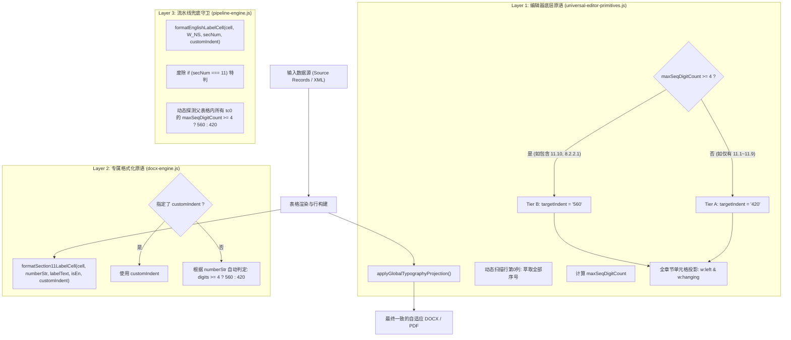

# Design: 自适应动态序号对齐几何拓扑设计方案

## 一、 系统架构与数据流拓扑

对齐治理遵循“底层原语自适应投影 + 专属格式化函数参数解耦 + 流水线动态感知”三层拓扑架构：

---

## 二、 核心变更点技术细节

### 1. `universal-editor-primitives.js`
- 移除 `const isTierB = (maxSeqDigitCount >= 4) || (sectionNumber === 11);` 中的硬编码部分；
- 改为纯粹的动态判定：`const isTierB = (maxSeqDigitCount >= 4);`；
- 正则优化：将 `c0Text.match(/^(\d+\.\d+(?:\.\d+)?)/)` 升级为 `c0Text.match(/^(\d+(?:\.\d+)+)/)`，全量通配多级序号（如 `8.2.2.1`、`11.10` 等）；
- 保持已统一的字号设计令牌 `tokens.LABEL_SEQ`（英文 19 即 9.5pt，中文 21 即 10.5pt）。

### 2. `docx-engine.js`
- `formatSection11LabelCell(cell, numberStr, labelText, isEnglish = false, customIndent = null)`：
  - 动态计算：`const digitsOnly = (numberStr || '').replace(/\D/g, '');`
  - `const indent = customIndent || (digitsOnly.length >= 4 ? '560' : '420');`
  - 调用 `applyStandardHangingIndent(cell, indent, indent);`，彻底摆脱 560 固化。
- `formatSection11ToxicologyRow` 中生成 11.7 生殖毒性合并单元格时，若为 8 行毒理拓扑（最大序号为 11.8），默认使用 420 dxa 标尺。

### 3. `pipeline-engine.js`
- `formatEnglishLabelCell`:
  - 移除第 5118 行 `if (sectionNumber === 11) indent = '560';`；
  - 统一由表格内部序号数字位数动态计算 `isTierB`。

---

## 三、 风险与防御策略

1. **Section 9 激光垂线对齐冲突风险**：
   - Section 9 序号为 `9.1` ~ `9.15`，其中 `9.10` ~ `9.15` 为 3 位纯数字（`910` $\to$ 3 位数字）。
   - 最大位数仍为 3 位，因此 Section 9 天然维持 420 dxa（即 80.28pt 激光垂线），与 `check_pdf_s9_alignment.py` 100% 契合。
2. **多级复杂编号防越界风险**：
   - 若某章节包含 `14.1.1` 或 `8.2.2.1`，其纯数字分别为 4 位，将精准命中 `maxSeqDigitCount >= 4`，自动启用 560 dxa 标尺，防止窄标尺文字被推至下一行。
