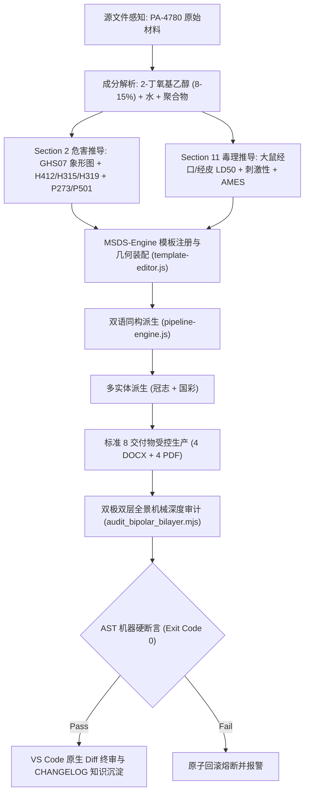

# Design: 典型水性丙烯酸乳液 (PA) 官方基准模板与受控流水线拓扑

## 一、 系统架构与数据流图

## 二、 关键技术细节与权衡

1. **Section 2 GHS 象形图高保真渲染**：
   - 提取 `PA-4780 msds_CN 冠志.docx` 中的真实 GHS 象形图图片；
   - 在 DOCX 生成时通过 `writeRichTextToCell` 或直接通过媒体引用无损注入单元格，确保在 PDF 导出中无偏移。
2. **Section 11 毒理学槽位双向映射**：
   - 中文版采用标准 16 行槽位或成分毒理列表；
   - 英文版同步英译：`Acute toxicity: Oral LD50 (rat) > 2,000 mg/kg`, `Skin irritation: Causes skin irritation`, `Eye irritation: Causes serious eye irritation`, `Mutagenicity: Ames test negative`。
3. **双极双层审计 AST 扩展 (`audit_bipolar_bilayer.mjs`)**：
   - 增加对 PA 型号包含 2-丁氧基乙醇时的特异性断言：
     - 断言包含 H412；
     - 断言包含 P273 与 P501；
     - 断言 Section 11 包含经口急性毒性数值。
