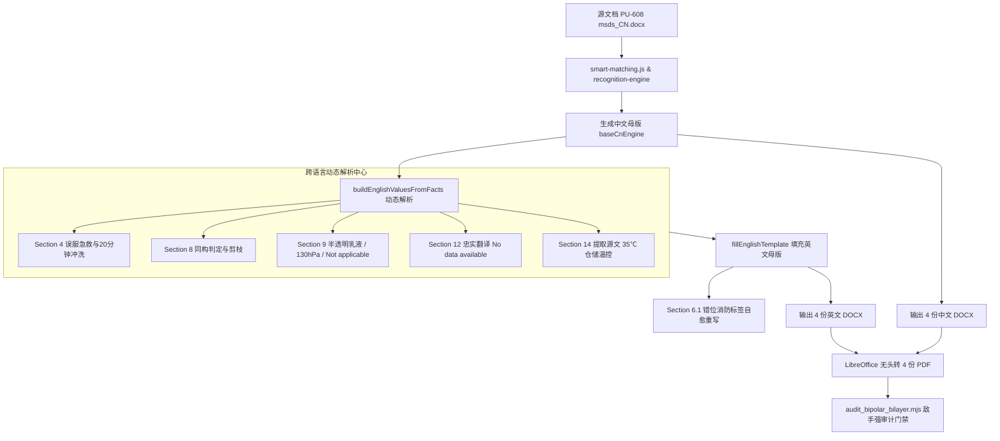

# Design: 跨语言事实保全与动态驱动技术架构

## 一、 架构原则与权衡 (Decisions & Trade-offs)
1. **中文母版单一事实源 (Single Source of Truth)**：
   英文交付物不再持有脱离中文母版的静态常数字典，所有理化、急救、仓储温度、生态结论必须从 `baseCnEngine` 的对应章节中提取并经专业英译规则转换为英文，实现中英文事实 100% 物理咬合。
2. **底模缺陷自愈机制 (Template Healing Invariant)**：
   针对底层英文模板（`正式模板_MSDS_EN_冠志(1).docx`）历史遗留的标签笔误（如 Section 6.1 残留 `Firefighting precautions`），引擎在执行 `fillEnglishTemplate` 时主动执行自愈重写，确保最终交付物标签合规。
3. **结构对称性剪枝 (Symmetric Pruning)**：
   当判断中文版 Section 8 无 OEL 控制参数执行了删除多余行时，英文版执行完全对称的删除操作，实现中英文 16 章节表格行数的严格同构。

## 二、 数据流与调用拓扑 (Mermaid)

