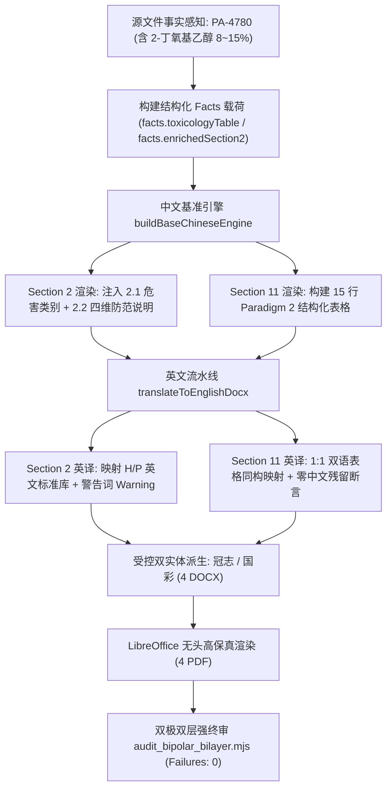

# Design: PA-4780 Section 2 与 Section 11 深度扩充架构设计

## 1. 架构流转拓扑 (Architecture Topology)

## 2. 核心技术设计
1. **Section 11 模态升级**：
   - 当检测到 PA-4780 启用了结构化毒理表格（`facts.toxicologyRows` 或 `isStructuredTableMode`）时，系统切换为标准多行表格模式（Paradigm 2），保留原始模板或动态创建 15 行标准插槽结构。
2. **Section 2 规范化渲染**：
   - 采用 PU-608 规范的通栏渲染函数，四维分流防范说明（预防/响应/储存/处置），注入 8 空格微偏移前缀。
3. **双极双层审计适配**：
   - 在 `audit_bipolar_bilayer.mjs` 中，当行数 $>4$ 时自动进入 Paradigm 2 分支，验证 11.1 经口 LD50、主要皮肤刺激、主要粘膜刺激及经皮吸收危险断言。
