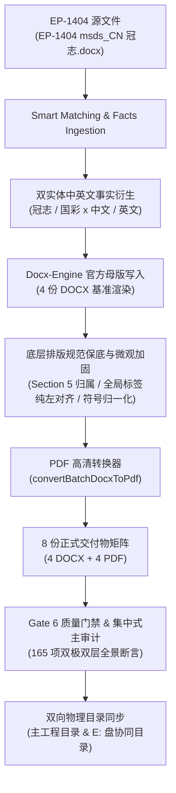

# OpenSpec Architecture Design: EP-1404 8 格式受控生产设计

## 1. 系统架构与流水线拓扑

## 2. 状态机与因果角色映射

| 模块 / 环节 | 因果角色 | 输入契约 | 输出保障 / 状态转换 |
| :--- | :---: | :--- | :--- |
| `executeEightDeliverablesPipeline` | [Origin Producer] | EP-1404 源文件 Buffer + 危险性事实重载 | 生产初版 4 份双实体双语 DOCX |
| `generate_ep1404_deliverables.mjs` | [State Transition] | 初版 DOCX | 执行微观字体加固（S2 加粗、S3 符号、S8 表格尺寸）、S5 烟尘归属核验、全篇标签左对齐核验 |
| `convertBatchDocxToPdf` | [State Transition] | 4 份最终定型 DOCX | 批处理生成 4 份高清 PDF，保证时间戳绝对同步（<5秒） |
| `audit_bipolar_bilayer.mjs` | [Env-Authored Witness] | 交付目录下 8 份文件 | 165 项质量断言全量覆盖，输出退出码 0 |
| `fs.copyFile` | [State Transition] | 目标交付物 | 镜像同步至外部协同目录 `E:\冠志\TDS MSDS (2)\待处理文件\EP-1404\` |

## 3. 防线控制与最小爆炸半径
- **隔离范围**：改动严格限制在 `web/scripts/generate_ep1404_deliverables.mjs` 的调用与流水线参数适配中；
- **只读保证**：底层已固化的承重墙逻辑（`web/src/docx-engine.js`、`web/src/pipeline-engine.js`、`web/src/smart-matching.js`）完全保持只读，不新增任何针对 EP-1404 的特定 hardcoding 特判；
- **全篇标签左对齐硬门禁**：通过已升级的 Gate 6 与主审计 G-09 / L-S13 联合把关，杜绝非左对齐流入生产环境。
