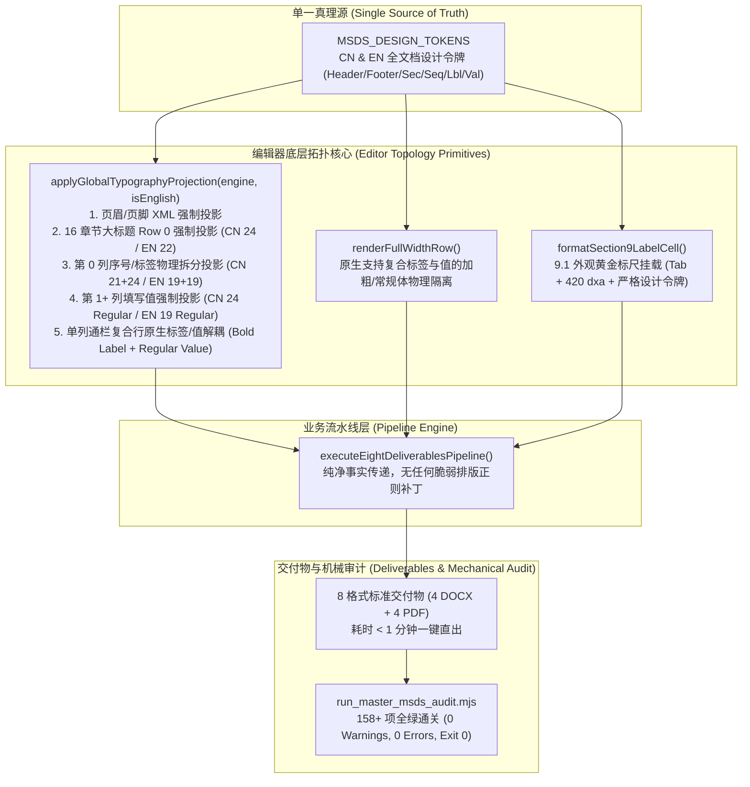

# Technical Design: 全局编辑器底层拓扑排版与字阶治理架构

## 一、 架构理念与全景拓扑 (Architectural Vision)



---

## 二、 关键技术方案 (Key Technical Solutions)

### 1. 彻底根除“序号缩水”历史糟粕逻辑
- **现存病态**：
  ```javascript
  // 历史遗留错误逻辑 (universal-editor-primitives.js)
  const seqSz = isTierB ? (!isEnglish ? '21' : '18') : (!isEnglish ? (seqStr.length >= 5 ? '19' : '21') : (seqStr.length >= 5 ? '15' : '18'));
  ```
- **重构方案**：
  直接引用 `MSDS_DESIGN_TOKENS.EN.LABEL_SEQ.sz`（恒为 `'19'`，即 9.5pt），彻底删除任何基于字符长度 `seqStr.length >= 5 ? '15' : '18'` 的特判。英文全篇 16 章节所有序号必须恒定为 9.5pt (`sz="19"`)。

### 2. 覆盖页眉与页脚底层 XML 治理
- `applyGlobalTypographyProjection` 在遍历正文表格前，读取并解析 `engine.zip.files['word/header1.xml']` 等页眉页脚部件：
  - 提取页眉段落中的 Run，按主标题 (`sz="18"` 常规体) 与产品型号 (`sz="18"` 加粗) 强制同化；
  - 提取页脚段落，将公司名称强制设置为 9pt (`sz="18"`) 靠左对齐 (`w:jc w:val="left"`)，页码与日期保持 9pt 常规体。

### 3. 表格第 0 行章节大标题全量覆盖
- 消除 `if (rIdx === 0) continue;` 的盲区。
- 对每个表格的 Row 0：
  - 中文版：强制应用 `tokens.SECTION_HEADER`，即宋体 12pt (`sz="24"`, `szCs="24"`), 加粗；
  - 英文版：强制应用 `tokens.SECTION_HEADER`，即 Arial 11pt (`sz="22"`, `szCs="22"`), 加粗；
  - 清除幽灵空 Run 与冗余样式。

### 4. 复合通栏行（Section 2 / 11 / 15）的原生解耦
- 在 `renderFullWidthRow` 与 `applyGlobalTypographyProjection` 中内置标签-值解耦状态机：
  - 匹配已知结构性标签前缀（`2.1 GHS危险性类别:`, `象形图:`, `信号词:`, `危险性说明:`, `防范说明:`, `预防措施:`, `事故响应:`, `安全储存:`, `废弃处置:`, `2.5 其他危害:`, `其它的规定:`, `符合下列法规要求:` 等）；
  - 自动将一个包含“标签：值”的段落拆分为两个独立的 Run：
    - Run 1 (Label): 加粗, `sz="19"` (EN) / `sz="24"` (CN)；
    - Run 2 (Value): 常规体, `sz="19"` (EN) / `sz="24"` (CN)；
  - 从根本上免除上层外挂脚本去手工正则切分 DOM。

### 5. 生成脚本从 1.5 小时降至秒级
- 清空 `generate_os8970_deliverables.mjs` 中行 65~350 的 300 行手工 XML 操作。
- 脚本纯粹调用 `executeEightDeliverablesPipeline`，流水线调用完底层编辑器后直接导出。
- 整个生成流程一键直通，耗时从 1.5 小时骤降至 30~45 秒。
