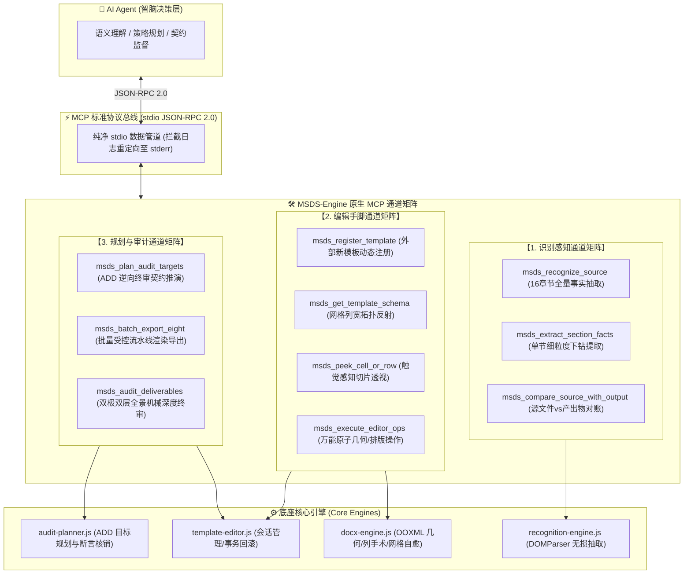
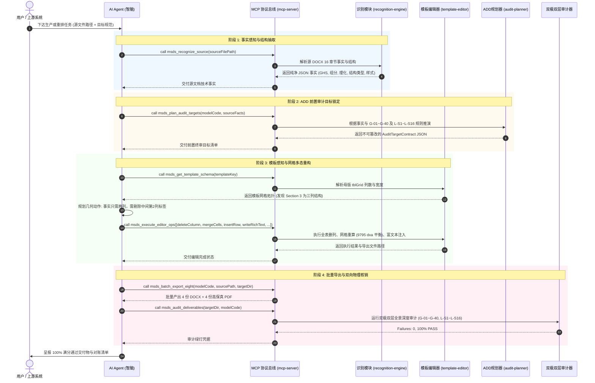
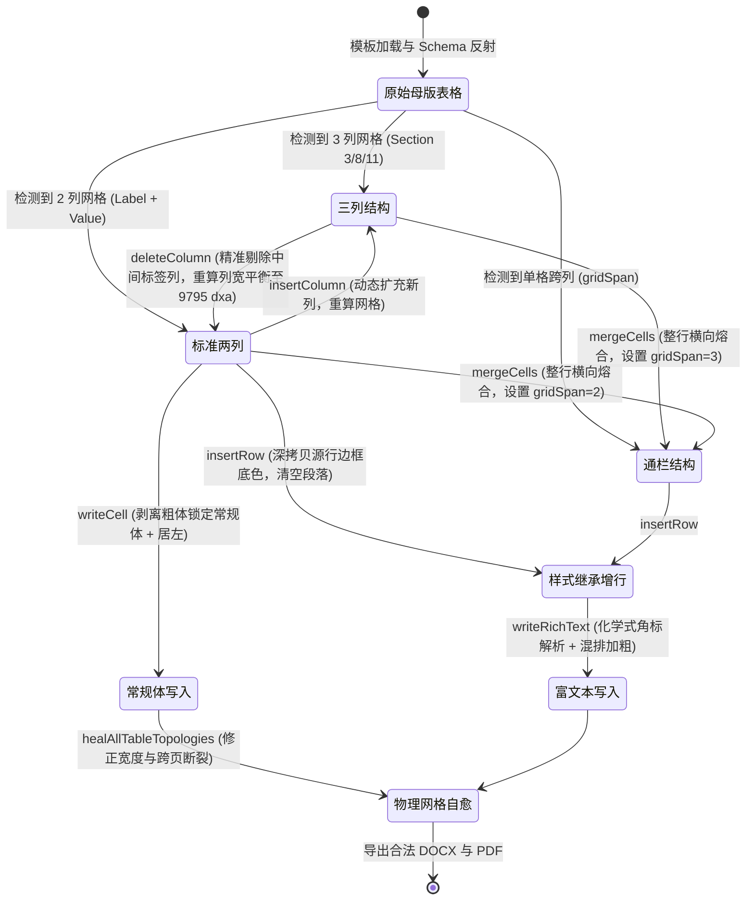

# Design: 识别与编辑模块 MCP 通道全景图谱与 Skill 优化工作流设计

## 一、 系统架构全景图谱 (System Architecture Graph)

---

## 二、 交互调用全流程时序图 (Agent End-to-End Workflow Sequence)

---

## 三、 表格网格多态几何演化状态机 (Grid Geometry State Machine)

