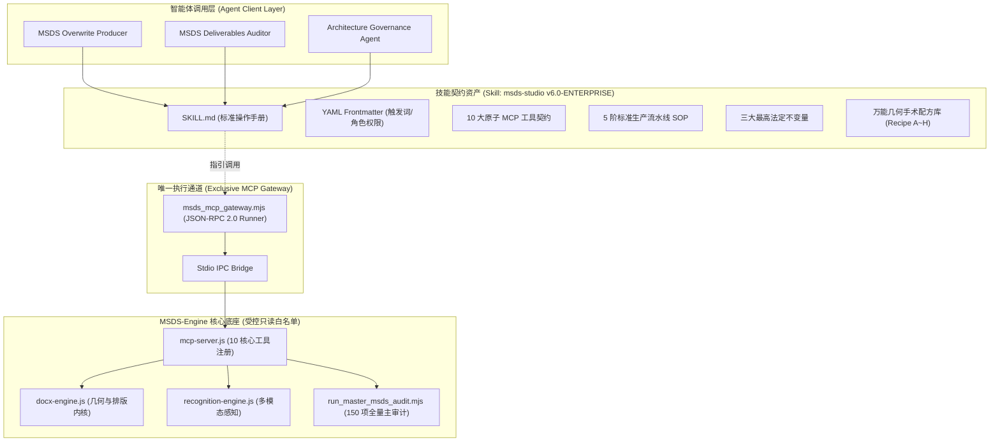

# Design: MSDS MCP 工作流体系技能架构与法定双清单
(`design.md`)

## 一、 系统架构与技能拓扑设计

---

## 二、 架构权衡与设计要点

1. **技能定位归口**：
   - 将散落在 `MSDS_STUDIO_MCP_SKILL_WORKFLOW_SOP.proposed.md`、`UNIVERSAL_MCP_WORKFLOW_FIVE_PUZZLES.md` 与 `MSDS_OVERWRITE_PRODUCER_SOP_MANUAL.md` 中的高价值内容系统性重组并提炼；
   - 升级现有的 `msds-studio` 技能至 `v6.0-ENTERPRISE`，保持技能标识稳定性，同时彻底完成从传统黑盒模式向新一代 MCP 工作流体系的升级。

2. **生产与执行解耦**：
   - 技能中明确强调 `msds_mcp_gateway.mjs` 作为 CLI/脚本驱动的核心执行通道；
   - 强化参数传递模式（支持直接 JSON 与 `--argsFile` 载荷文件模式），彻底免除 Windows 环境下的引号转义摩擦。

3. **全流程门禁与不变量注入**：
   - 将系统核心目录只读约束、底座通用缺陷停机申报单模板直接嵌入技能文档，作为所有 Agent 的法定准入规范。

---

## 三、 法定双清单自证 (Dual Lists Proof)

### 1. 拟变范围清单 (Proposed Changes Scope)

| 文件路径 | 变更类型 | 拟变角色 | 变更动机与受控内容 |
| :--- | :---: | :---: | :--- |
| `openspec/changes/msds-mcp-workflow-system-skill/` | 新增 | `[Root Source]` | 创建规范立法四大法定资产（`proposal.md`, `specs/`, `design.md`, `tasks.md`） |
| `C:\Users\Administrator\.gemini\config\skills\msds-studio\SKILL.md` | 修改/覆盖 | `[State Transition]` | 全面更新全局官方 `msds-studio` 技能至 v6.0-ENTERPRISE，注入 10 大 MCP 工具、5 阶 SOP 与三大不变量 |
| `F:\App Location\Guanzhi Tong\Skill\MSDS-Engine\.agents\skills\msds-studio\SKILL.md` | 修改/覆盖 | `[State Transition]` | 同步更新项目本地 `msds-studio` 技能，保持两处物理哈希 100% 对齐 |

### 2. 保持现状承诺清单 (Leave-as-is Invariants Commitment)

| 核心模块 / 资产路径 | 保护原因与现行不变量 |
| :--- | :--- |
| `F:\App Location\Guanzhi Tong\Skill\MSDS-Engine\web/src/` | **系统目录绝对只读公理 (`INV-SYSTEM-READONLY`)**：底座核心代码（`docx-engine.js`, `pipeline-engine.js`, `mcp-server.js` 等）严禁触碰 |
| `F:\App Location\Guanzhi Tong\Skill\MSDS-Engine\web/templates/` | **官方母版几何不变量**：母版文件严格只读，杜绝任何外部修改 |
| `F:\App Location\Guanzhi Tong\Skill\MSDS-Engine\web/scripts/msds_mcp_gateway.mjs` | **标准网关驱动器**：保持现有 stdio JSON-RPC 2.0 逻辑稳定，不随意改动 |
| `F:\App Location\Guanzhi Tong\Skill\MSDS-Engine\web/scripts/run_master_msds_audit.mjs` | **集中式主审计套件**：150 项断言标准保持绝对锁定 |
