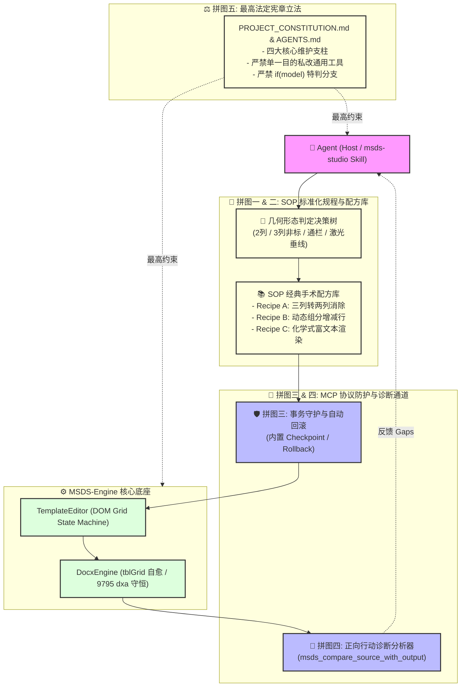

# Design: 通用性 MCP 工作流五大关键拼图架构设计

## 1. 架构总览与五大拼图流转拓扑



---

## 2. 核心模块增强细节

### 2.1 `msds_execute_editor_ops` 事务自愈实现
```javascript
// 在 mcp-server.js 中
const session = await createWorkSession(args.templateKey);
const initialCheckpoint = createCheckpoint(session);

try {
  for (const op of args.operations || []) {
    // 依次执行原子操作...
  }
  const saveRes = await saveSession(session, args.outputPath);
  return { success: true, outputPath: saveRes.outputPath, ... };
} catch (err) {
  // 发生异常立即自动回滚，恢复原始状态
  await rollbackSession(session, initialCheckpoint);
  // 清理临时可能的破损文件
  if (fs.existsSync(args.outputPath)) {
    try { fs.unlinkSync(args.outputPath); } catch (_) {}
  }
  throw new Error(`[Transaction Aborted & Rolled Back] 操作执行失败已安全自愈回退: ${err.message}`);
}
```

### 2.2 `msds_compare_source_with_output` 行动诊断器增强
除逐节比对字符保全比外，增加如下语义与关键行侦测：
- **Section 2 漏识/漏填漏项检查**：检查源文件是否有 GHS 象形图、警告词、防范说明，而产出文件是否为空；
- **Section 3 组分对账**：检查源文件组分数与产出文件行数是否匹配；
- **输出 `actionableGaps`**：结构化透传给调用方 Agent，指导其按图索骥补填。
