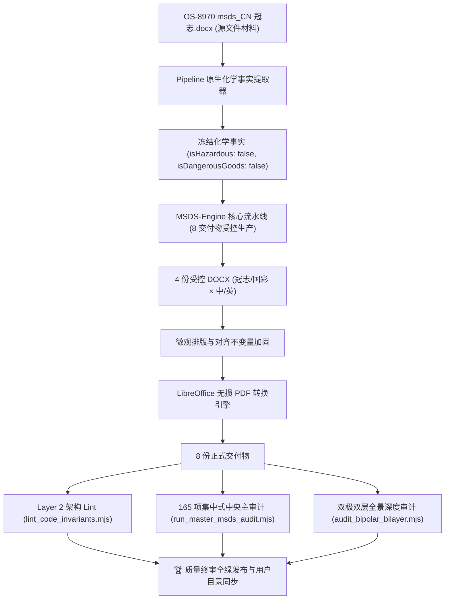
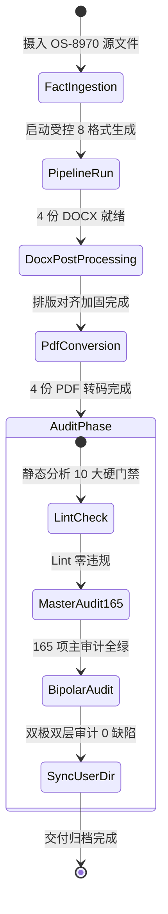

# Design: OS-8970 标准 8 格式受控生产流水线与全景深度审计架构

## 1. 架构总览 (Architectural Overview)

OS-8970 生产流水线基于 MSDS-Engine 原生流水线（`executeEightDeliverablesPipeline`），通过数据驱动方式穿透读取源 Word 文件，将化学事实无损传递至母版套打引擎与 PDF 转换器。

---

## 2. 关键设计决策与权衡 (Tradeoffs & Design Decisions)

### 2.1 Section 2 非危单单元格极简通栏 (Tradeoff: Non-Hazardous Topology)
- **挑战**：危化品产品通常为 5~6 行多行通栏（含分类、要素、危险性说明、防范四大块、其他危害），而 `OS-8970` 是水性非危交联剂。
- **决策**：严格遵循 `G-40` 与 `INV-ZERO-EXOGENOUS` 公理，收敛为 2 行单单元格大通栏（Row 0 题头，Row 1 极简通栏说明）。
- **收益**：避免虚增信号词、象形图或危害说明，且与模板拓扑学完全吻合。

### 2.2 Section 9 黄金对齐与多值拆分 (Tradeoff: Physical & Chemical Properties)
- **挑战**：源文件第 5 行同时包含水溶性与粘度，第 6 行包含自燃温度与闪点。
- **决策**：流水线通过标准映射表将水溶性（`可混溶的` / `Miscible`）、粘度（`＜500 mPa·s`）、自燃温度（`无数据`）与闪点（`初沸点以下无闪点`）精准拆解至 19 行标准模板插槽中。
- **收益**：确保 PDF 渲染时全量标签坐标严格对齐至 `x0 = 80.28pt`，杜绝锯齿状凹凸。

### 2.3 Section 14 非危险货物级联联动 (Tradeoff: Transport Information)
- **挑战**：源文件提及“符合ADG准则”，但 ADG 为澳洲地方标准，非中国/国际通用 MSDS 规范，且容易引起危化品混淆。
- **决策**：遵循 `REQ-04` 消除 ADG 污染，按照国际海运 IMDG、空运 IATA 及国内陆运规范，规范化声明为“非危险货物”，彻底切断 UN 编号虚增。

---

## 3. 状态机转移图 (State Transition Diagram)

