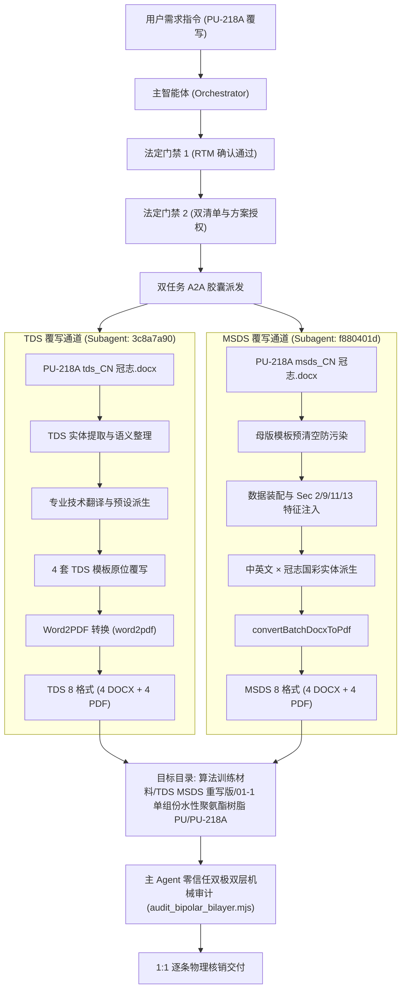

# Technical Design: PU-218A TDS 与 MSDS 双智能体协同标准化生产

## 1. 总体架构拓扑

## 2. 核心技术契约与约束
1. **TDS 标准化契约**：严格遵循 `tds-four-variant-eight-deliverable-standardizer` 规范，输入中文源底稿，派生中英文与冠志国彩双主体，输出 4 DOCX + 4 PDF。
2. **MSDS 工业级规范契约**：严格遵循 `MSDS中英文覆写排版与数据装配全景统一工业级规范 (v5.0.0)`，保证 Section 2 象形图居左与空行分离、Section 9 垂线对齐、Section 11 垂直合并三列拓扑、Section 13 双居中加粗、页脚型号居左与 Revision Date 居右。
3. **输出物绝对纯度**：目标目录内仅存放这 16 份最终交付物，所有临时 dump、缓存或调试中间件不得进入交付目录。
