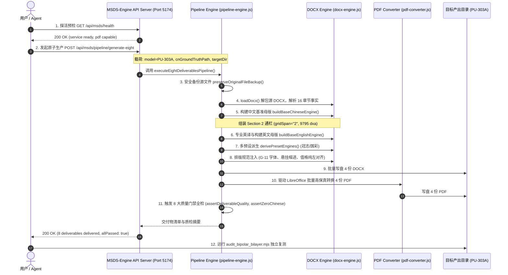

# Design: PU-303A MSDS 系统受控 API 生产架构设计

## 1. 架构拓扑与受控执行流

## 2. 核心技术细节与数据映射

### 2.1 Section 2 危化品事实与通栏装配
- **源文件事实提取**：
  - 类别：吸入急毒 4 类 (H332)、皮肤腐蚀/刺激 3 类 (H316)、眼睛刺激 2B (H320)、生殖毒性 1B (H360)、STOT SE 1 (H370)、STOT RE 2 (H373)；
  - 信号词：危险 (Danger)；
  - 组分关联危害：N,N-二甲基乙酰胺 (DMAC) 透皮吸收风险；
- **排版几何**：
  - Row 0：`2. 危险性概述`；
  - Row 1：单单元格，`w:gridSpan w:val="2"`, `w:tcW w:w="9795" w:type="dxa"`；
  - 内部段落：5 级缩进状态机，英文垂向首字严格对齐。

### 2.2 交付物与目录纯度
- 产出路径：`F:\App Location\Guanzhi Tong\Skill\MSDS-Engine\算法训练材料\TDS MSDS 重写版\01-1 单组份水性聚氨酯树脂 PU\PU-303A`；
- 交付物清单（严格 8 份）：
  - `PU-303A msds_CN 冠志.docx` / `PU-303A msds_CN 冠志.pdf`
  - `PU-303A msds_CN 国彩.docx` / `PU-303A msds_CN 国彩.pdf`
  - `PU-303A msds_EN Guanzhi.docx` / `PU-303A msds_EN Guanzhi.pdf`
  - `PU-303A msds_EN Guocai.docx` / `PU-303A msds_EN Guocai.pdf`
- 严禁向目标目录或 Git 暂存区遗留任何临时脚本或 dump 数据。
